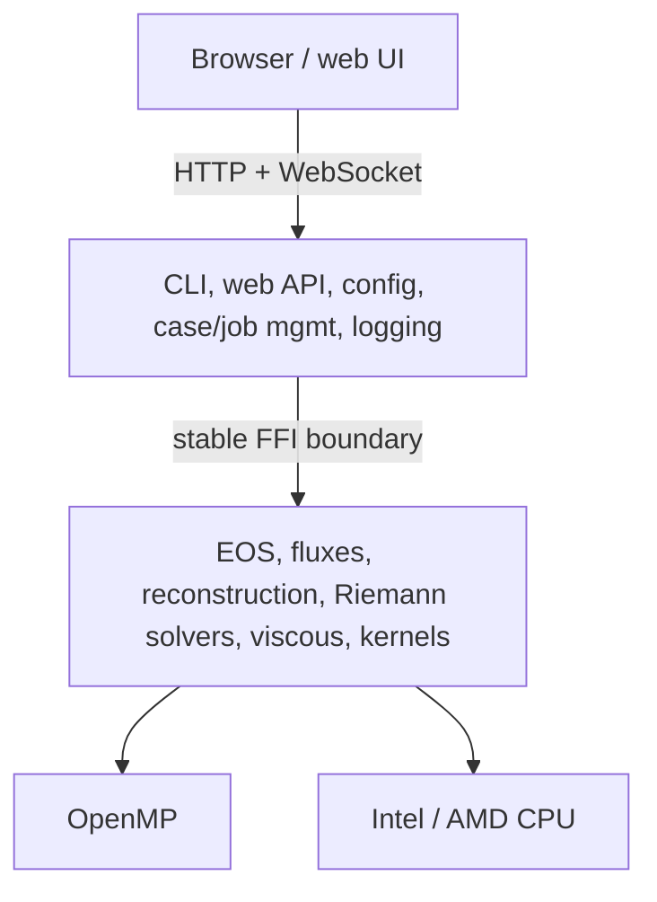

nuFor separates a Rust application layer from a Fortran numerical layer across
a narrow C ABI, with Python reserved for analysis and reference calculations
(never production hot loops).

## Language split

- **Rust**: application framework, CLI, web/API, orchestration, integration.
- **Fortran**: numerical and physics kernels and dense array operations.
- **Python**: analysis, reference solutions, plotting, verification,
  automation.

## Interop

Rust and Fortran cross a deliberate C-compatible ABI: contiguous arrays with
explicit lengths, structured error codes, no Fortran derived-type leakage.
See [[numerics/foundations/memory-layout|the memory layout]] for the full design and its rules.

## Kernel ownership

A numerical kernel has exactly one implementation in the build, and it lives
in the Fortran layer. Rust reaches it across the C ABI rather than computing
the same quantity itself. Where a Rust implementation of a kernel lingers, it
is a reference copy that the parity gate compares against, not a second
shipping path.

The five-species Park-5 lane follows this rule. The mixture closure, the
reaction rates, the operator-split chemistry substep and the upwind species
transport all live in `fortran/api/nuforpark5.f90`. The Rust marching lane
calls them as batch operations over the whole field, one call per kernel per
step. Calling the kernel per cell instead would pay the ABI crossing roughly
three times over for every cell.

## Build

Cargo owns the Rust workspace; a `build.rs` drives CMake to compile the
Fortran kernels into a static archive and link them in. The tree is
`crates/` (Rust), `fortran/` (Fortran), `python/` (analysis), `cases/`
(runnable cases), `docs/` (this site).

## Areas

- [[numerics/1d/euler|Numerics - 1D Euler]]
- [[formats/case-toml|Formats - case.toml]]

## See also

- [[numerics/tools/web-ui|Case console]]
- [[formats/case-toml|case.toml format]]
- [[numerics/3d/state-grid|3D foundations]]
- [[performance/optimization-ledger|Optimization ledger]]
