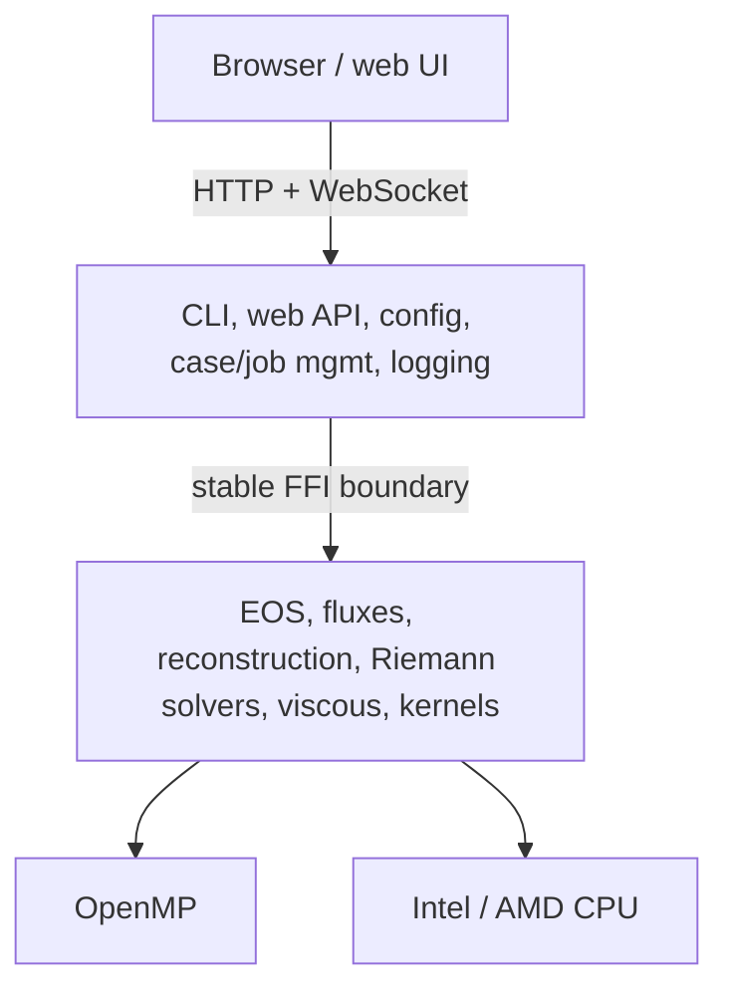

nuFor separates a Rust application layer from a Fortran numerical layer across
a narrow C ABI, with Python reserved for analysis and reference calculations
(never production hot loops).

## Language split

- **Rust**: application framework, CLI, web/API, orchestration, integration.
- **Fortran**: numerical and physics kernels and dense array operations.
- **Python**: analysis, reference solutions, plotting, verification,
  automation.

## Interop

Rust and Fortran cross a deliberate C-compatible ABI: contiguous arrays with
explicit lengths, structured error codes, no Fortran derived-type leakage.
See [[numerics/foundations/memory-layout|the memory layout]] for the full design and its rules.

## Kernel ownership

A numerical kernel has exactly one implementation in the build, and it lives
in the Fortran layer. Rust reaches it across the C ABI rather than computing
the same quantity itself. Where a Rust implementation of a kernel lingers, it
is a reference copy that the parity gate compares against, not a second
shipping path.

The five-species Park-5 lane follows this rule. The mixture closure, the
reaction rates, the operator-split chemistry substep and the upwind species
transport all live in `fortran/api/nuforpark5.f90`. The Rust marching lane
calls them as batch operations over the whole field, one call per kernel per
step. Calling the kernel per cell instead would pay the ABI crossing roughly
three times over for every cell.

## Fortran module map

The Fortran layer is split by concern, and no module grows past roughly 700
lines. The MPI case splits into three pieces:

- `nuforhalos.f90` owns the x-slab decomposition the ranks agree on at case
  init and the halo exchangers for the conserved slab, the turbulence plane,
  the two-temperature plane and the solid mask.
- `nuforcollect.f90` owns the rank probe, the chunk broadcast and the
  gathers that reassemble the global row-major fields from the per-rank
  slabs.
- `nuforbridge.f90` owns the C-ABI march drivers: the Euler,
  two-temperature, viscous and SA steps, plus the one-time case setup that
  ships the thermodynamic tables.

The Euler step is split along the same lines inside `nuforsolver2d.f90`:

- `nufoeqair.f90` holds the equilibrium-air closure and the CEA and TGas1
  tables.
- `nuforfaces.f90` holds the reusable per-strip face work bank.
- `nuforriemann.f90` holds the HLLC face solver and the star state.
- `nuforfluxes.f90` holds the row-wise MUSCL reconstruction and the flux
  sweep.
- `nuforboundary.f90` holds the boundary ghost construction.
- `nufoorturb.f90` holds the SA turbulence closure and transport.
- `nuforvisc.f90` holds the molecular viscosity add-on.

## Build

Cargo owns the Rust workspace; a `build.rs` drives CMake to compile the
Fortran kernels into a static archive and link them in. The tree is
`crates/` (Rust), `fortran/` (Fortran), `python/` (analysis), `cases/`
(runnable cases), `docs/` (this site).

## Areas

- [[numerics/1d/euler|Numerics - 1D Euler]]
- [[formats/case-toml|Formats - case.toml]]

## See also

- [[numerics/tools/web-ui|Case console]]
- [[formats/case-toml|case.toml format]]
- [[numerics/3d/state-grid|3D foundations]]
- [[performance/optimization-ledger|Optimization ledger]]
