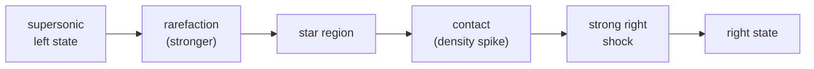

A second, much stronger Riemann problem used to stress the solver: larger
density and pressure jumps and a supersonic left state, producing a left
rarefaction, a central density discontinuity, and a strong right shock.

- Left: rho = 0.445, u = 0.698, p = 3.528. Right: rho = 0.5, u = 0.0, p = 0.571.
- gamma = 1.4, domain [-0.5, 0.5], time 0.15, transmissive boundaries.

The same wave family as Sod but with a supersonic left state and a much
stronger right shock, so the limiter and the positivity floor both get
exercised:

## Verification

Density stays positive and momentum finite through the strong wave, and the
numerical density is compared against the exact 1D Riemann solution. The error
norm shrinks as the mesh refines, the same first-order convergence seen on the
Sod case. Together with the Sod case this forms the core of the shock-tube
verification ladder.

## See also

- [[numerics/1d/sod|Sod verification]]
- [[verification/index|Verification ladder]]
- [[numerics/1d/euler|1D Euler]]
