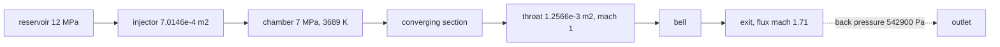

The axisymmetric combustion lane's verification case: a chamber of burned
gas behind an injector, a converging section, a throat and a bell, with a
back pressure at the exit. The throat has to choke, and its pressure and
temperature have to land on the equilibrium throat state for the chamber.



## The case

`cases/chamber-throat/case.toml` runs on a 110 by 40 grid over
0.165 m by 0.1 m. The wall is a chamber of 0.1 m radius that necks to
0.0206 m at x = 0.14925 m and opens into a bell.

| field | value |
| --- | --- |
| equations | `euler_axi`, `eos = "combustion"`, nine species, chemistry on |
| chamber | 7.0 MPa, 3676.53 K, the burned-gas injection map |
| reservoir | 12.0 MPa, 6.191 kg/m3, fed through a 7.0146e-4 m2 injector |
| throat area | 1.2566e-3 m2 on the grid, 1.3338e-3 m2 on the contour |
| back pressure | 542900 Pa |
| march | 0.0005 s in 4223 steps, hllc with muscl, cfl 0.3, four threads |

The injector's area is sized against the grid's throat, not the
contour's. The grid's throat is a staircase plateau nine cells wide, so
its area is 5.8 percent under the continuous contour's. A feed sized
against the contour over-drives that throat by four percent, and the
throat never settles.

## The seed rides the grid

The case starts from a quasi-1d seed. The seed is built on the grid's
own per-column flow area, so the mass flux is uniform across the duct
from the first step and the throat's choked capacity is the grid's. The
old seed came off the continuous contour, which put the sonic point one
column wide on a mesh that holds it nine columns wide. The marched mass
flux then wandered by 23 percent along the duct, and no amount of
settling time fixed it.

## The settled state

The throat's pressure belongs to the sonic point, and on this mesh the
sonic point is not the mesh's narrowest column. The throat's area is a
staircase plateau nine cells wide, the flow reaches the speed of sound
at the plateau's upstream edge, and the pressure keeps falling across
the plateau as the flow expands. Measuring at the narrowest column reads
a pressure 3.3 percent below the one the flow actually chokes at, which
is how this case claimed an eleven percent gap to CEA for a while.

The sonic point is therefore found with the mixed mach, the transonic
similarity parameter that squares the speeds and divides by the
reciprocals, and the crossing is interpolated between the two columns
that straddle mach one. It lands at x = 147.8 mm. The values below are
the mean over the last eight samples of the march, with the spread those
eight samples carry:

| quantity | measured | band | CEA equilibrium | gap |
| --- | --- | --- | --- | --- |
| sonic pressure | 3.7110 MPa | 0.0256 MPa | 4.0535 MPa | -8.4 percent |
| sonic temperature | 3484.0 K | 5.8 K | 3501.98 K | -0.5 percent |
| throat mass flow | 3.7896 kg/s | 0.0254 kg/s | 3.80 kg/s | -0.3 percent |
| chamber pressure | 7.0673 MPa | 0.0061 MPa | 7.0 MPa | +1.0 percent |
| chamber temperature | 3688.6 K | 2.0 K | 3676.53 K | +0.3 percent |
| exit flux mach | 1.710 | | 1 | |

The mass flow is the one number that lands on CEA almost exactly. The
temperature does too. The pressure does not, and the next section says
why.


The axial profile at the settled state carries the sonic marker, the
equilibrium reference lines and the mass flow the duct passes. The mass
flow wanders by about five percent because the measurement integrates
the cell centres over the staircase's annuli, while the solver's own
fluxes run over the cell faces.


## What the gap is made of

An eight percent pressure gap can hide behind a hundred excuses, so the
audit takes it apart with the crate's own thermochemistry. The gas the
injector feeds is frozen by the time it reaches the duct: the
mass-flux-weighted composition holds across the whole converging
section, at 0.77 water, 0.11 hydroxyl and 0.07 oxygen, and the wall is
adiabatic. The gas that chokes is the gas the chamber state says it is,
and its properties come straight from the nasa-7 polynomials the crate
ships:

| property | value |
| --- | --- |
| mean molar mass | 18.559 g/mol |
| gas constant | 448.0 J/(kg K) |
| heat capacity at 3688.6 K | 3262 J/(kg K) |
| gamma | 1.159 |

Walking that gas's own frozen isentrope from the chamber's stagnation
state, with the mixture's own heat capacity integrated along the way,
puts the sonic pressure at 4.0422 MPa. CEA's equilibrium throat sits at
4.0535 MPa, which is 0.28 percent away from it. The gas is not the
explanation, and neither is the chemistry, and neither is the reference.

| reference | throat pressure |
| --- | --- |
| the marched gas's own isentrope | 4.0422 MPa |
| cea's equilibrium throat | 4.0535 MPa |
| the march | 3.7110 MPa |

What is left is the march itself. The converging section is audited on
its own from the last subsonic station, at x = 135.8 mm where the flux
runs at mach 0.61, and that station's own gas says the throat should
choke at 4.0955 MPa. The section is nine percent short of its own
thermodynamics, and the shortage grows on the way in:

| x | marched pressure | off the isentrope |
| --- | --- | --- |
| 137.25 mm | 5.4404 MPa | -2.8 percent |
| 140.25 mm | 4.6651 MPa | -5.9 percent |
| 141.75 mm | 4.1905 MPa | -10.4 percent |
| 147.75 mm | 3.7167 MPa | -11.6 percent |

Nothing physical is taking the pressure out of that flow. The chemistry
has already finished, the wall does not conduct, and the gas's own
isentrope says the pressure should still be there. What is left is
numerical dissipation: the flow accelerates from mach 0.6 to mach 1
across thirteen columns and a sudden step in area, and the scheme bleeds
the transonic acceleration into entropy. Most of it happens where the
area steps into the plateau, at about 141 mm.


Knowing that the loss is ours changes what the fix is. The throat's
pressure is not eight percent low because the chemistry is late or the
closure is wrong. It is low because the mesh's staircased throat
dissipates the acceleration, and the cure is a graded or cut-cell mesh
at the throat, not a change to the gas. Until that mesh lands, twelve
percent is the honest bound on this case, and this page says why.

## The gate

`crates/nufor-cli/tests/chamber_throat_thermo.rs` reads the recorded
state, walks the gas's own isentrope with the crate's heats, and checks
the record against the recomputation:

```
cargo test -p nufor-cli --test chamber_throat_thermo
```

`cases/chamber-throat/gates.py` holds the contracts themselves and
checks that this page publishes the numbers the record carries:

```
cd cases/chamber-throat && python3 gates.py
```

| contract | tolerance | measured |
| --- | --- | --- |
| the throat chokes | the mixed mach crosses 1 | it does, at x = 147.8 mm |
| the sonic temperature | within 5 percent of CEA | -0.5 percent |
| the sonic pressure | within 12 percent of CEA | -8.4 percent |
| the mass flow is conserved | within 8 percent | -0.3 percent |
| the chamber runs subsonic | mach below 0.1 | 0.005 |
| the exit runs supersonic | flux mach above 1 | 1.710 |
| the gas agrees with CEA | within 1 percent | 0.28 percent |
| the march agrees with its gas | within 10 percent | -8.19 percent |

The last two contracts are the ones worth keeping. The seventh ties the
comparison to the gas the march actually runs, so a change in the
closure cannot quietly redefine what the case measures. The eighth
bounds the march's own error, so the case notices when the marching gets
worse even though the throat is still inside the loose contract.

Both gates run in the continuous integration. The heavy gate that
actually marches the case stays on my desktop, because it runs about
thirty minutes in release:

```
cargo test -p nufor-cli --test chamber_throat_gate --release -- --ignored --nocapture
```

## Running it

The march writes its snapshots beside the case file. The distiller walks
them, finds the sonic point in each and writes the record the gates and
the figures read:

```
nufor run cases/chamber-throat/case.toml
python3 cases/chamber-throat/distill.py <run-dir>
python3 cases/chamber-throat/figures.py cases/chamber-throat/settled docs/numerics/2d
```

The distiller writes `settled/history.csv` (the sampled sonic and
chamber states), `settled/profile.csv` (the axial profile),
`settled/stations.csv` and `settled/thermo_inputs.csv` (the gas along
the duct). The rust audit adds `settled/thermo_result.csv` and
`settled/isentrope.csv`, which is the curve the last figure draws. The
walked field itself stays out of the repository, and the gate checks the
record against it whenever a local march leaves it on disk.

## What is not settled

The loss through the converging section is the open problem on this
case. Eight percent is the number the current mesh earns, and the
figure shows it arriving with the staircase. A throat refined in the
axial direction, or cut cells at the shoulder, is the next attempt, and
the eighth contract is what says whether it helped.

The grid's throat area is quantized: 1.2566e-3 m2 on 55 by 20, 110 by
40 and 220 by 80, all within one percent of each other. Only a much
finer grid in y moves it, and the cut-cell machinery is not wired into
the command line. The grid's throat is therefore the throat the gate
measures, and the injector is sized to match it.

The reacting lane's local states carry a few percent of noise: the
finite-rate chemistry relaxes stiffly and the states near the wall
wander, so the sonic pressure moves by 0.7 percent over the settled
window. The gate's bands cover that noise rather than pretending it is
not there.
