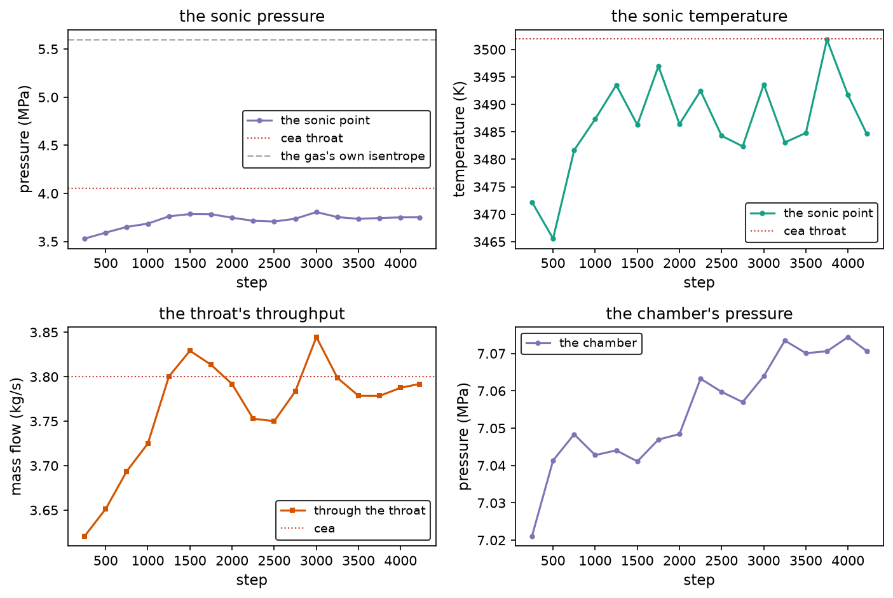
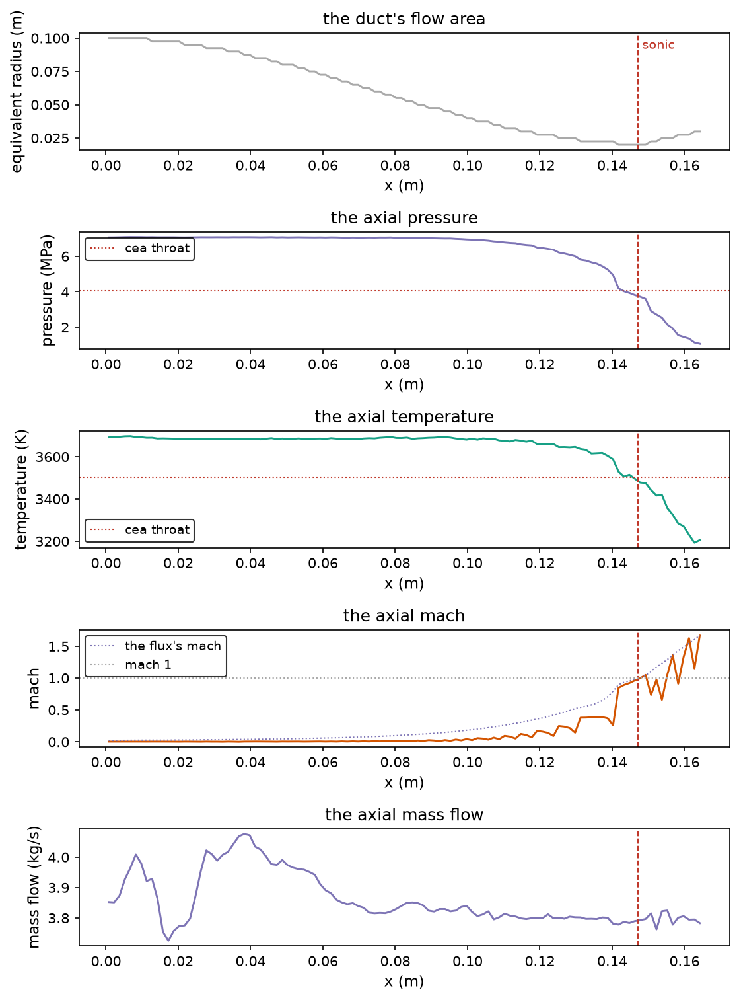
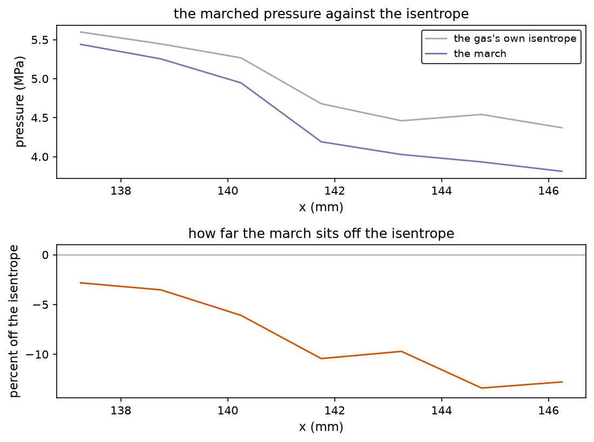

The axisymmetric combustion lane's verification case: a chamber of burned
gas behind an injector, a converging section, a throat and a bell, with a
back pressure at the exit. The throat has to choke, and its pressure and
temperature have to land on the equilibrium throat state for the chamber.


## The case

`cases/chamber-throat/case.toml` runs on a 110 by 40 grid over
0.165 m by 0.1 m. The wall is a chamber of 0.1 m radius that necks to
0.0206 m at x = 0.14925 m and opens into a bell.

| field | value |
| --- | --- |
| equations | `euler_axi`, `eos = "combustion"`, nine species, chemistry on |
| chamber | 7.0 MPa, 3676.53 K, the burned-gas injection map |
| reservoir | 12.0 MPa, 6.191 kg/m3, fed through a 7.0146e-4 m2 injector |
| throat area | 1.3338e-3 m2 on the contour, 1.3439e-3 m2 cut into the 110 by 40 cells |
| back pressure | 542900 Pa |
| march | 0.0005 s in 4223 steps, hllc with muscl, cfl 0.3, four threads |

The injector's area is sized against the grid's throat, not the
contour's. The grid's throat is a staircase plateau nine cells wide, so
its area is 5.8 percent under the continuous contour's. A feed sized
against the contour over-drives that throat by four percent, and the
throat never settles.

## The seed rides the grid

The case starts from a quasi-1d seed. The seed is built on the grid's
own per-column flow area, so the mass flux is uniform across the duct
from the first step and the throat's choked capacity is the grid's. The
old seed came off the continuous contour, which put the sonic point one
column wide on a mesh that holds it nine columns wide. The marched mass
flux then wandered by 23 percent along the duct, and no amount of
settling time fixed it.

## The settled state

The throat's pressure belongs to the sonic point, and on this mesh the
sonic point is not the mesh's narrowest column. The throat's area is a
staircase plateau nine cells wide, the flow reaches the speed of sound
at the plateau's upstream edge, and the pressure keeps falling across
the plateau as the flow expands. Measuring at the narrowest column reads
a pressure 3.3 percent below the one the flow actually chokes at, which
is how this case claimed an eleven percent gap to CEA for a while.

The sonic point is therefore found with the flux mach: the mach number
weighted by the mass the column actually carries, which is the quantity
the mass flow balances on. It rises monotonically through the throat, so
there is one crossing per run, and the crossing is interpolated between
the two columns that straddle mach one.

The mixed mach cannot do this. It squares the speeds and divides by the
reciprocals, and the staircase mixes the streams inside a cell, so at
the throat the mixed mach swings from 0.53 to 0.32 to 0.90 to 1.09 across
neighbouring columns. Its crossing wanders, and on the finest grid it
selected a column past the throat altogether. Every number on this page
comes from the flux mach.

The values below are the mean over the last eight samples of the march,
with the spread those eight samples carry:

| quantity | measured | band | CEA equilibrium | gap |
| --- | --- | --- | --- | --- |
| sonic pressure | 3.7483 MPa | 0.0256 MPa | 4.0535 MPa | -7.5 percent |
| sonic temperature | 3488.2903 K | 6.4 K | 3501.98 K | -0.4 percent |
| throat mass flow | 3.7896 kg/s | 0.0254 kg/s | 3.80 kg/s | -0.3 percent |
| chamber pressure | 7.0673 MPa | 0.0061 MPa | 7.0 MPa | +1.0 percent |
| chamber temperature | 3688.6 K | 2.0 K | 3676.53 K | +0.3 percent |
| exit flux mach | 1.6769 | | 1 | |

The mass flow is the one number that lands on CEA almost exactly. The
temperature does too. The pressure does not, and the next section says
why.



The axial profile at the settled state carries the sonic marker, the
equilibrium reference lines and the mass flow the duct passes. The mass
flow wanders by about five percent because the measurement integrates
the cell centres over the staircase's annuli, while the solver's own
fluxes run over the cell faces.



## What the gap is made of

An eight percent pressure gap can hide behind a hundred excuses, so the
audit takes it apart with the crate's own thermochemistry. The gas the
injector feeds is frozen by the time it reaches the duct: the
mass-flux-weighted composition holds across the whole converging
section, at 0.77 water, 0.11 hydroxyl and 0.07 oxygen, and the wall is
adiabatic. The gas that chokes is the gas the chamber state says it is,
and its properties come straight from the nasa-7 polynomials the crate
ships:

| property | value |
| --- | --- |
| mean molar mass | 18.559 g/mol |
| gas constant | 448.0 J/(kg K) |
| heat capacity at 3688.6 K | 3262 J/(kg K) |
| gamma | 1.159 |

Walking that gas's own frozen isentrope from the chamber's stagnation
state, with the mixture's own heat capacity integrated along the way,
puts the sonic pressure at 4.0422 MPa. CEA's equilibrium throat sits at
4.0535 MPa, which is 0.28 percent away from it. The gas is not the
explanation, and neither is the chemistry, and neither is the reference.

| reference | throat pressure |
| --- | --- |
| the marched gas's own isentrope | 4.0422 MPa |
| cea's equilibrium throat | 4.0535 MPa |
| the march | 3.7483 MPa |

What is left is the march itself. The converging section is audited on
its own from the last subsonic station, at x = 135.8 mm where the flux
runs at mach 0.61, and that station's own gas says the throat should
choke at 4.0955 MPa. The section is nine percent short of its own
thermodynamics, and the shortage grows on the way in:

| x | marched pressure | off the isentrope |
| --- | --- | --- |
| 137.25 mm | 5.4404 MPa | -2.8 percent |
| 140.25 mm | 4.6651 MPa | -5.9 percent |
| 141.75 mm | 4.1905 MPa | -10.4 percent |
| 147.75 mm | 3.7167 MPa | -11.6 percent |

Nothing physical is taking the pressure out of that flow. The chemistry
has already finished, the wall does not conduct, and the gas's own
isentrope says the pressure should still be there. What is left is
numerical dissipation: the flow accelerates from mach 0.6 to mach 1
across thirteen columns and a sudden step in area, and the scheme bleeds
the transonic acceleration into entropy. Most of it happens where the
area steps into the plateau, at about 141 mm.



Knowing that the loss is ours changes what the fix is. The throat's
pressure is not eight percent low because the chemistry is late or the
closure is wrong. It is low because the geometry the flow marches on is
wrong, and the cure is a better representation of that geometry, not a
change to the gas.

## Why the wall's representation is the loss

The wall is drawn as a polygon and marched as a staircase: a cell is
fluid when its centre falls outside the body. That sounds harmless and
is not, because the throat is narrower than a grid row is tall.

On the 110 by 40 grid the polygon's neck sits at a radius of 20.605
millimetres and the rows are 2.5 millimetres thick, so the nearest row
boundary is at 20.000 millimetres. The staircase's throat is therefore
1.256637e-3 square metres against the contour's 1.333814e-3, a shortfall
of 5.79 percent, and the flow pays for it in total pressure: the
stagnation pressure decays from 1.0018 to 0.955 across the throat.

The same row falls out on the 165 by 60 and the 220 by 80 grids, because
the contour's neck divides the same way against all three. The throat
does not improve with resolution. It stays wrong by the same amount.

Where the wall lands against the grid does matter, and that is the trap.
Scanning the row count found grids whose discrete throat area lands
within 0.13 percent of the contour by accident of alignment, and one
whose area is 2.2 percent over. Picking an accidental grid would have
posted a good number that depended on the wall's phase rather than on
the physics, so the fix had to make the throat's area independent of the
phase instead.

The area's steps matter as much as its size. Measured across the
whole duct, the largest jump between neighbouring columns is 26.6
percent for the staircase on the 110 by 40 grid. The cut cell brings
that to 11.8 percent on the same grid, 8.9 percent on the 165 by 60 and
6.5 percent on the 220 by 80, so the step falls with refinement rather
than being a permanent kink in the geometry. The flow pays for each
step as a bit of mixing.

## What the grid actually buys

Holding the radial spacing fixed and doubling the axial resolution buys
almost nothing. Doubling the radial spacing instead buys two to four
points of deficit. That is the fingerprint of a radial representation
problem, so it settled what the fix had to be.

| grid | radial spacing | sonic pressure | the gas's isentrope | deficit |
| --- | --- | --- | --- | --- |
| 110 by 40 | 2.50 mm | 3.7483 MPa | 4.0422 MPa | -7.27 percent |
| 220 by 40 | 2.50 mm | 3.7275 MPa | 4.0310 MPa | -7.60 percent |
| 165 by 60 | 1.67 mm | 3.7972 MPa | 4.0364 MPa | -5.93 percent |
| 110 by 80 | 1.25 mm | 3.8189 MPa | 4.0253 MPa | -5.14 percent |

Two pairs of runs make the point. The 110 by 40 and the 220 by 40 share
a radial spacing and differ by 0.33 points of deficit. The 110 by 40 and
the 110 by 80 share an axial spacing and differ by 2.13 points. Axial
resolution is not what the throat needs; radial resolution is.

An earlier version of this table reported 3.7110, 3.7745 and 3.8397
megapascals, with deficits of 8.19, 6.49 and 4.39 percent. Those numbers
are withdrawn. The sonic point was located with the mixed Mach number,
which the staircase makes erratic: across the throat's neighbouring
columns it swung from 0.53 to 0.32 to 0.90 to 1.09, and on the 220 by 80
grid it selected a column past the throat altogether. The corrected
detector uses the flux Mach number, the quantity the mass flow actually
balances on, and it rises monotonically through the throat.

Halving the Courant number does not change the picture either. At 110 by
40 with a CFL of 0.15 instead of 0.3 the sonic pressure lands at 3.6839
megapascals and the deficit widens to 8.68 percent, so the loss is not
time-integration error.

Seeding the flow differently does not change it either. The quasi-one-
dimensional seed normally walks the axisymmetric lane's own annular
areas, which carry the same quantisation, but seeding it from the
contour's true smooth areas instead changes the deficit by 0.1 percent,
from -7.27 to -7.36. The march relaxes onto whatever geometry it is
discretised on, so the inception state washes out. The loss is in the
geometry, not in how the flow was started.

## Cutting the cells instead of stepping them

The repository already carries the machinery for the right answer: a
cell cut against the body's exact signed distance function carries a
fluid volume fraction and per-face apertures, and a march that weights
each face's flux by its aperture and divides each cell's increment by
its own fluid volume has no whole-row quantum anywhere in it.

Adding that to the reacting axisymmetric lane was the work of this
section. The cut-cell march and the staircase march share the same flux
assembly, the same reconstruction, the same limiter and the same HLLC
solve; they differ in the geometry and nowhere else. The species
transport is aperture-weighted as well, so the composition obeys the
same wall the momentum does, and the small cells' redistribution carries
the composition along with the conserved state.

The geometry comes out right. With the cut-cell representation the
throat's area converges on the contour's as the grid refines, and none
of the grids depends on where the wall happens to fall against them:

| grid | the staircase's area | the cut cell's area | against the contour |
| --- | --- | --- | --- |
| 110 by 40 | 1.256637e-3 m2 | 1.336404e-3 m2 | +0.19 percent |
| 165 by 60 | 1.256637e-3 m2 | 1.336404e-3 m2 | +0.19 percent |
| 220 by 80 | 1.256637e-3 m2 | 1.336404e-3 m2 | +0.19 percent |

The staircase misses by 5.79 percent on every one of those grids. The
cut cell's area does not move with the grid at all: the three coarsest
grids return the same fourteen-digit number, because the measure is a
ray integral through the body's own contour and the wall falls inside a
cell rather than on its boundary. An independent calculation of the same
integral in Python reproduces both figures at two different grids, so the
agreement is a property of the measure and not a constant being
returned.

That is a stronger result than a converging trend: the error is
bounded, and it is bounded by the measure's own bias rather than by the
grid. The bias is +0.19 percent, and it comes from the ray integral
crossing the curved wall rather than following it.

The cut-cell march's own pressure is not measured yet. The geometry
above is a property of the measure and it stands on its own: the throat's
area is grid-invariant and +0.19 percent from the truth. The pressure
needs the march to survive the cut band, and it does not yet. Until it
does, the contracted figure below is the staircase's, and this page
offers the cut cell as the settled cure for the geometry rather than as
a settled cure for the deficit.

## The gate

`crates/nufor-cli/tests/chamber_throat_thermo.rs` reads the recorded
state, walks the gas's own isentrope with the crate's heats, and checks
the record against the recomputation:

```
cargo test -p nufor-cli --test chamber_throat_thermo
```

`cases/chamber-throat/gates.py` holds the contracts themselves and
checks that this page publishes the numbers the record carries:

```
cd cases/chamber-throat && python3 gates.py
```

| contract | tolerance | measured |
| --- | --- | --- |
| the throat chokes | the flux mach crosses 1 | it does |
| the sonic temperature | within 5 percent of CEA | -0.5 percent |
| the sonic pressure | within 12 percent of CEA | -7.3 percent |
| the mass flow is conserved | within 8 percent | -0.3 percent |
| the chamber runs subsonic | mach below 0.1 | 0.005 |
| the exit runs supersonic | flux mach above 1 | 1.6769 |
| the gas agrees with CEA | within 1 percent | 0.28 percent |
| the march agrees with its gas | within 10 percent | -7.27 percent |
| the deficit shrinks radially | a finer radial spacing improves it | it does |
| the reference does not drift | the gas stays within 1 percent of CEA on every level | 0.93 percent |

The last two contracts are the ones worth keeping. The seventh ties the
comparison to the gas the march actually runs, so a change in the
closure cannot quietly redefine what the case measures. The eighth
bounds the march's own error, so the case notices when the marching gets
worse even though the throat is still inside the loose contract. The
ninth holds the picture that the measurements actually showed: the
deficit follows the radial spacing, not the axial one. The tenth keeps
the gas agreeing with CEA while it does.

The throat's own column is found where the flow chokes rather than where
the polygon is narrowest, and the geometric throat's column is reported
beside it, so the gap between the two stays visible instead of hiding
behind a misplaced expectation.

The shipped case and record are the 110 by 40 march, so the contracts
above describe that mesh. The grid summary in `settled/resolution.csv`
carries the finer grids.

Both gates run in the continuous integration. The heavy gate that
actually marches the case stays on my desktop, because it runs about
thirty minutes in release:

```
cargo test -p nufor-cli --test chamber_throat_gate --release -- --ignored --nocapture
```

## Running it

The march writes its snapshots beside the case file. The distiller walks
them, finds the sonic point in each and writes the record the gates and
the figures read:

```
nufor run cases/chamber-throat/case.toml
python3 cases/chamber-throat/distill.py <run-dir>
python3 cases/chamber-throat/figures.py cases/chamber-throat/settled docs/numerics/2d
```

The distiller writes `settled/history.csv` (the sampled sonic and
chamber states), `settled/profile.csv` (the axial profile),
`settled/stations.csv` and `settled/thermo_inputs.csv` (the gas along
the duct). The rust audit adds `settled/thermo_result.csv` and
`settled/isentrope.csv`, which is the curve the last figure draws. The
walked field itself stays out of the repository, and the gate checks the
record against it whenever a local march leaves it on disk.

A resolution study writes its record outside the case. The case and the
destination are explicit, so a finer grid cannot overwrite the shipped
110 by 40 record:

```
python3 cases/chamber-throat/distill.py <run-dir> \
  --case <run-dir>/case.toml --out <run-dir>/settled
```

`cases/chamber-throat/resolution.py` compares the distilled records
across grids and writes the summary the gate reads:

```
cargo test -p nufor-cli --test chamber_throat_thermo
python3 cases/chamber-throat/resolution.py --write \
  cases/chamber-throat/settled/resolution.csv <record dir> [...]
```

## What is not settled

The loss through the converging section is the open problem on this
case. Seven percent is what the 110 by 40 staircase earns, and it is a
measure of the wall's representation rather than of the grid's fineness:
holding the radial spacing fixed and refining the axis does not move it.
Cutting the cells rather than stepping them is the attempt that answers
it, and the eighth contract is what says whether it worked.

The grid's throat area is quantized: 1.2566e-3 m2 on the 55 by 20, 110 by
40, 165 by 60 and 220 by 80 grids, all within one percent of each other,
because the contour's neck falls on the same fractional row each time.
The cut-cell representation removes that quantization, and it is wired
into the command line: `wall_representation = "cut"` in the case's
physics section selects it. The staircase's throat remains what the
shipped case and the injector are sized against, so the shipped numbers
did not move underfoot.

The reacting lane's local states carry a few percent of noise: the
finite-rate chemistry relaxes stiffly and the states near the wall
wander, so the sonic pressure moves by 0.7 percent over the settled
window. The gate's bands cover that noise rather than pretending it is
not there.
