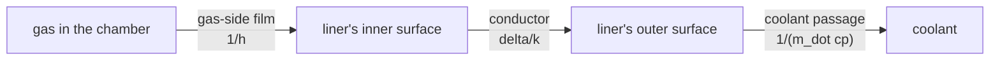

A rocket chamber's wall is not a boundary condition you pick from a
menu. It is a thick steel tube with hydrogen or kerosene running
through channels milled into it, and the temperature of the gas next
to that metal depends on the whole thermal circuit between them.

This page covers the conjugate wall treatment: the three resistances
in series between the gas and the coolant, the liner's temperature
profile, and how the treatment was benchmarked against the engine
wall bracket.



## The three resistances

Heat from the gas to the coolant crosses three obstacles in series, so
the resistances add and the duty follows from the total:

```
R_total = 1/h_gas + delta/k_liner + 1/(m_dot cp)
q       = (T_gas - T_coolant) / R_total
```

Writing the resistances out makes the physical content plain. A thick
liner and a weak coolant both starve the gas of cooling; a large
gas-side coefficient lets the gas's own temperature stand in for the
metal's.

With no liner the model reduces to the two-resistance regenerative
wall, and with no coolant the wall's stated temperature stands in for
the coolant's. The solver exposes the three through the case file:

```toml
[physics]
wall_temperature = 400.0
wall_film_coefficient = 2000.0
wall_coolant_mass_flux = 2.0
wall_coolant_capacity = 14300.0
wall_coolant_temperature = 300.0
wall_liner_thickness = 0.005
wall_liner_conductivity = 45.0
```

There is a subtlety in where the resistances meet. Heat arrives at the
surface by two routes at once: convection from the gas and radiation
across the gap. Radiation leaves the same surface. The metal and the
coolant take heat away from that surface by a single series path. So
the surface's temperature solves a balance between what arrives, what
leaves, and what conducts inward, rather than sitting at a junction in
a linear chain. With no backing behind it at all the surface simply
takes the wall's stated temperature, which reproduces the plain wall
exactly.

The consequence worth remembering: a coolant-backed wall does not sit
at its nominal temperature. It floats above its coolant, because some
difference is what drives heat inward at all, and it runs warmer than a
plain isothermal wall set to the same nominal figure. Its reported duty
follows from solving that balance, which is why the bracket's duty
split and the surrogate's used to disagree.

The coolant's capacity is per kilogram, so `m_dot cp` is the
capacity rate in watts per square metre per kelvin. Hydrogen at two
kilograms per square metre per second and a 14.3 kilojoule per
kilogram kelvin capacity gives 28.6 kilowatts per square metre per
kelvin, a resistance of 3.5e-5 square metre kelvin per watt. Against
a gas-side film of 2000 watts per square metre per kelvin, whose
resistance is 5e-4, the coolant's resistance is small: at these
numbers the gas-side film dominates and the liner barely shifts the
result. That is a property of the operating point, not of the model,
and it is why the bracket reports the resistances alongside the duty.

## What the correlations say

Bartz's correlation is the industry's lumped shortcut. It takes the
chamber's geometry and the coolant's properties and returns an
effective heat-transfer coefficient, referred to the chamber's outer
structural skin. Two things follow for a code that wants to predict
the metal's temperature rather than quote a coefficient:

- the coefficient refers to the outer skin, not to the gas, so it
  cannot be dropped into a gas-side film coefficient without stating
  which side of the wall it refers to;
- it lumps the liner's conduction and the coolant's warming into one
  number, so it cannot produce a liner temperature profile.

Modern formulations (Prasad, Kuznetsov, Larsen and Lisbjerg, and
others) refine the basis by separating the wall's conduction from the
coolant's heating and by using a more faithful coolant temperature
rise. Bazynski and Prasad extend the correlation to manned-rated
cryogenic stages, where the safety margins matter more than the
accuracy.

How the two approaches sit against each other:

| | Bartz's correlation | nuFor's series resistance |
| --- | --- | --- |
| what it returns | one effective coefficient | a duty and a surface temperature |
| where the coefficient refers | the chamber's outer structural skin | the gas-side film |
| the liner's conduction | lumped inside the coefficient | an explicit resistance, `delta/k` |
| the coolant's warming | lumped inside the coefficient | an explicit resistance, `1/(m_dot cp)` |
| a metal temperature profile | impossible | the surface temperature comes out of the balance |
| its own calibration data | yes, from chamber designs | none; the resistances are measured quantities |

The two are not competitors. A correlation is cheaper and carries the
industry's accumulated calibration, which is why nobody serious throws
it away. But a correlation cannot answer the question this bracket asks,
because the question is where the gas's heat goes once it has arrived
at the metal. The correlation's answer depends on the reference surface,
and shifting that reference shifts the answer by however much the liner
dropped.

Where the concerns end and the plant begins, commercial codes differ.
Ansys Fluent and CFX solve the wall's conduction on a conjugate mesh
beside the fluid, with the coupling iterated between the domains.
STAR CCM+ offers the same arrangement. NASA's Chimera and CoQT do
something similar but tailored to discrete holes and splash-on
cooling, where the injector geometry has to be resolved rather than
represented by a coefficient. hyStrath's DyM couples the chamber's
fluid to a solid wall solved alongside it, with the interface handled
by a conservative scheme that balances energy across the coupling.

Their common defence against the instabilities this rung ran into is
worth recording. A cold wall strips heat from a thin boundary layer
very aggressively, and an explicit treatment of that heat flux drives
the near-wall gas negative. Every industrial code treats the coupling
either implicitly or with an operator-split Robin boundary condition,
so the flux is solved as part of the update rather than imposed on the
finished one. NuFor's bracket needed the same care: the limiter in
`combustion_viscous_axi.rs` admits only the wall's withdrawals, never
its gains, and scales them together so the conduction, radiation and
film duties keep their proportions.

## The bracket

The wall treatments are compared on one chamber geometry, changing
nothing but the wall:

| leg | wall | what it establishes |
| --- | --- | --- |
| adiabatic | insulated | the reference end, with no heat sink at all |
| radiating | 400 K, emissive | heat leaving by radiation and conduction |
| film cooled | 400 K, emissive, filmed | a gas-side film added to the wall |
| regenerative | hydrogen coolant through the wall | the coolant's capacity rate in series |
| conjugate | a 5 mm steel liner in series | the liner's conduction in series |

The five marches share a mesh and a clock, and they differ only in the
wall's treatment.


Every limb holds a flat residual across the whole march, and the cooled
limbs pass comfortably the steps at which the older solver diverged,
which is the practical result of the energy bookkeeping repair described
in the wall bracket's own page. The density in every limb still creeps
because the chamber itself is charging, so settlement is judged on each
limb's departure from the adiabatic leg rather than on its absolute
level; the wall bracket's own page sets out that criterion and the
evidence behind it.


The figure splits each wall's heat leaving the gas into the three channels
it can travel by, and the table underneath carries the same numbers:

```
<!-- BEGIN TABLE duties -->
radiating:       duty 0.5707 MW, conduction 0.1430 MW, radiation 0.5624 MW, film 0.0000 MW
filmcooled:      duty 0.8647 MW, conduction 0.1400 MW, radiation 0.5448 MW, film 0.4081 MW
regenerative:    duty 0.8119 MW, conduction 0.1235 MW, radiation 0.5472 MW, film 0.3583 MW
conjugate:       duty 0.6249 MW, conduction 0.0738 MW, radiation 0.5124 MW, film 0.2124 MW
<!-- END TABLE duties -->
```

On the radiating and film-cooled legs, radiation dominates conduction,
and by a wide margin: it crosses 0.5624 MW against 0.1430 MW on the
radiating leg, and 0.5448 MW against 0.1400 MW on the film-cooled one,
so radiation runs about four times the conductive exchange. The model
predicts exactly this for a 3700 K gas facing a 400 K wall, because the
radiation term scales with the fourth power of the temperature while the
conductive term scales linearly.

Against the film's own exchange the margin is narrower: on the
film-cooled leg radiation carries 0.5448 MW against the film's 0.4081
MW, so it leads by about a third rather than overwhelming it.

The coolant-backed legs are a different animal and the distinction
matters. Their gas faces a surface that the coolant itself warms, so
most of the heat leaves into the coolant rather than into the sky. The
gate consequently applies the radiation-dominates-conduction rule only
to the legs that radiate, and holds the coolant legs to their own
contracts instead: each must draw heat, the two must differ from one
another because the liner's resistance is real, and the liner must leave
the gas facing a hotter inner surface than the bare coolant wall does.

Getting this wrong once cost the bracket a real finding. The old
report measured the raw film law against the wall's stated temperature
rather than against the surface the solver actually used, so the
regenerative and conjugate legs printed identical duties and the liner
vanished from the results. One routine now serves the solver and the
diagnostic alike, so the report cannot describe a wall the solver does
not use, and the log carries the surface temperature the gas saw
alongside the wall's nominal one.


The surface panel is the clearest picture of why the coolant legs are a
different kind of wall.

```
<!-- BEGIN TABLE surfaces -->
radiating:       duty 0.5707 MW into a 400 K wall, surface 400.0 K, settled 400.0 K
filmcooled:      duty 0.8647 MW into a 400 K wall, surface 400.0 K, settled 400.0 K
regenerative:    duty 0.8119 MW into a 400 K wall, surface 795.5 K, settled 779.6 K
conjugate:       duty 0.6249 MW into a 400 K wall, surface 1957.0 K, settled 1921.0 K
<!-- END TABLE surfaces -->
```

The plain radiating and film-cooled walls sit where the case puts them,
at 400 K, because that is the boundary condition. The coolant-backed
walls float above their nominal figure, and the conjugate wall floats
higher than the bare regenerative one, which is the liner's resistance
showing up as a temperature the gas can feel.

The duty is not spread evenly along the chamber. The contraction and
the bell carry most of it, and the chamber's shoulder hardly
contributes, because the wall's area and the gas's temperature vary
together along the axis.

## What this does not settle

The wall's conductance here is steady. A real chamber's liner develops
a boundary layer that thins the film coefficient along the axis, and
the regeneration tubes bring their own roughness. The treatment here
bounds the effect of the wall's thermal circuit on the gas, which is
the first question an engine report asks, not the last.

The reported duty and the gas's own response are kept separate
deliberately. The gate measures the wall's claim from the marched
fields and asks the near-wall gas whether it agrees, because a
diagnostic that repeats the solver's own assumption cannot falsify
it.
