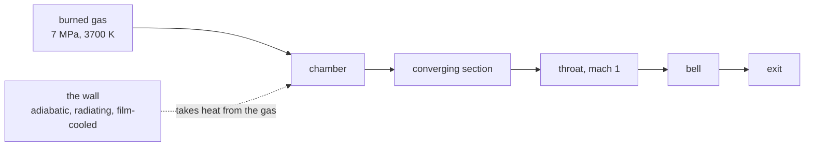

An engine burns gas at seven megapascal and drives it through a nozzle.
The wall it runs against is not a boundary condition anyone gets to choose:
it is metal, it takes heat, and how much it takes changes the thrust.
This page measures the bracket the engine report needs, the wall that
draws heat from the gas against the wall that does not, on the same
chamber geometry the throat case uses.



## The wall treatment

The axisymmetric combustion lane grew a viscous sibling for this. The
planar viscous lane treats a duct's rectangular boundary, but an engine's
contour is a body: the wall runs along a staircase of cells and needs a
one-sided flux pointing into the gas.

The wall treatment is one-sided and isothermal:

- no slip, so the tangential velocity vanishes at the wall
- Fourier conduction to the wall temperature, taken one-sided through the
  wall value and the two gas cells beside it
- black-body radiation from the wall to the gas, scaled by the wall's
  emissivity
- a film coefficient, standing for coolant crossing the boundary layer
- no composition gradient, so the wall neither creates nor absorbs species

Transport is Wilke's mixture rule for viscosity and conductivity, the same
ones the planar lane and the park lane use. The radial flux carries the
annular weight $(r_p f_n - r_m f_s) / (r_c \Delta r)$, matching the
reactive axisymmetric march.

A wall temperature of zero, or no wall temperature at all, means the wall
is adiabatic.

## Measuring the wall

The bracket needs measured numbers, so the run reports the conductive
power leaving the gas at every wall face, summed and bucketed along the
axis. A positive result means the wall is pulling heat out of the gas.

```
<!-- BEGIN TABLE report-line -->
wall duty: 0.8647 MW leaving the gas into a 400 K wall
  conduction 0.1400 MW
  radiation  0.5448 MW
  film       0.4081 MW
<!-- END TABLE report-line -->
```

The run separates the duty by mechanism, so a disagreement between the
diagnostic and the flow can be attributed rather than merely noted:

```
<!-- BEGIN TABLE duties -->
radiating:       duty 0.5707 MW, conduction 0.1430 MW, radiation 0.5624 MW, film 0.0000 MW
filmcooled:      duty 0.8647 MW, conduction 0.1400 MW, radiation 0.5448 MW, film 0.4081 MW
regenerative:    duty 0.8119 MW, conduction 0.1235 MW, radiation 0.5472 MW, film 0.3583 MW
conjugate:       duty 0.6249 MW, conduction 0.0738 MW, radiation 0.5124 MW, film 0.2124 MW
<!-- END TABLE duties -->
```

The line above is the film-cooled leg as the march reports it. The three
components are magnitudes of heat crossing each resistance, and they do
not sum to the duty because they do not all leave by the same route.
Radiation dominates at these temperatures, by about four times over
conduction, and the film term exceeds conduction.

Bucketing by station also matters, because the duty is not spread evenly:
the contraction and the bell dominate it, and the chamber's shoulder
hardly contributes. The brackets further down show what the same run
printed before the defect described below was fixed; those figures are
kept as the record of what the run reported, not as the bracket's
result.

## The bracket

Five marches of the same geometry, differing only in the wall:

| leg | wall | what it establishes |
| --- | --- | --- |
| `wall-adiabatic` | adiabatic | the no-heat-sink reference |
| `wall-radiating` | 400 K, emissive | heat leaving by radiation and conduction |
| `wall-filmcooled` | 400 K, emissive, filmed | heat leaving by radiation, conduction and film |
| `wall-regenerative` | filmed, with a hydrogen coolant behind it | heat leaving into a coolant |
| `wall-conjugate` | the same, behind a steel liner | the metal's resistance, in series |

`cases/engine-wall-bracket/gates.py` holds the bracket to these contracts:

- the adiabatic wall draws no heat
- the cooled walls draw heat from the gas
- the coolant-backed legs' duties differ from one another, because the
  liner's series resistance is real
- the conjugate wall's inner surface runs hotter than the bare wall's
- each cooled leg's mass flow agrees with the choked relation evaluated
  on the chamber state that leg actually produced, rather than on an
  assumed fixed chamber, which is the contract the audit at
  `cases/engine-wall-bracket/WALL_DIVERGENCE_AUDIT.md` withdrew

That last contract follows from the choked relations. Deriving them
gives

```
m_dot = A_star p0 sqrt(gamma) / (sqrt(R) sqrt(t0))
```

so at a fixed total pressure a cooler chamber passes less mass, and the
throat's static pressure scarcely moves at all. The wall does not hold
anything fixed, though: it removes energy, so the chamber's total
pressure falls along with its total temperature, and the two effects
partly cancel. Choking the mass flow is nevertheless the sensitive
observable, and it moves roughly in proportion to `1 / sqrt(t0)`.

The gate goes further than a direction. It takes the wall's measured duty,
the chamber's mass flow and the burnt gas's heat capacity, computes the
bulk temperature drop that duty implies, converts that to the mass flow
shift it predicts, and compares the prediction against the shift measured.
A contrast that disagrees with its own prediction by more than a factor
of three fails the gate.

## How the flow is measured

The march does not converge. The residual stagnates around 3.29 against a
target of 1e-10, and the throat's choked mass flow rises and falls by
about 6 percent from trough to peak while it does so, settling to a
range of well under one percent across the final fields the judgement
uses. The march stops on time, not on
convergence, so a residual target is never reached and no number on this
page inherits a convergence guarantee it did not earn.

There is a motion in the chamber, and establishing what it is took some
care, because the first reading of it was wrong.

The motion is not a periodic orbit. The claim that the field saved at
step 250 repeats byte-for-byte at step 3750 was an artifact of the
comparison and does not hold: the fields differ. Nor is the wall driving
it. The wall's imprint on the throat state is at most 0.21 percent, half
the mode's own 0.42 percent amplitude, and the two do not masquerade as
each other:
the mode is common to every leg, the wall's departure is measured
against the adiabatic reference leg by leg.

What is left is a mode of the chamber itself.

```
<!-- BEGIN TABLE mode -->
the chamber's mode: period 7085 steps, phase coherence 0.9977, explains 7.2 percent of the throat variation, worst cross-leg prediction 0.27
the mode's own amplitude on the throat: 0.417 percent at its widest
the wall's imprint on the throat: at most 0.206 percent, against the mode's 0.417 percent
the period's own tolerance: 6709 to 7531 steps hold the fit within 1.0 percent of its best, and the ring stays between 0.388 and 0.418 percent across them
<!-- END TABLE mode -->
```

The frequency is common and the phase is common; the amplitude riding on
it is not. The mode is therefore useful as a warning and useless as a
correction. Removing it by subtracting a fitted trajectory would replace
a measured series with a modelled one, so the bracket does not do it.

The period itself deserves less confidence than the numbers above lend
it. The objective is shallow near its minimum: every period from 6709
to 7531 steps fits within one percent of the best one, and the whole
scanned range spans eleven percent of the minimum in objective terms.
The printed period of 7085 steps is the centre of that plateau, not a
measurement of the period to four digits.

What survives the slack is the comparison that matters. Across the
entire plateau the largest leg's ring stays between 0.388 and 0.418
percent, while the wall's imprint never exceeds 0.206 percent. The mode
is the larger effect under every period the data favours, so the page's
central claim does not depend on picking one point of a flat valley.
Periods outside the plateau fit ten percent worse and produce rings as
small as 0.05 percent, but they are not candidates for this data.


The left panel shows why the coincidence is tempting: every leg's throat
mass flow follows the same curve. The right panel shows why the
coincidence is not exploitable. The fit's phase is essentially perfect
across the legs, and it still explains under a tenth of the throat
variation, and still fails to predict the worst leg's own waveform.
Frequency and phase are properties of the chamber; the amplitude riding
on them belongs to each march.

## What counts as settled

```
<!-- BEGIN TABLE settlement -->
radiating:       near-wall departure -50.678 K against the adiabatic reference
filmcooled:      near-wall departure -71.384 K against the adiabatic reference
regenerative:    near-wall departure -62.690 K against the adiabatic reference
conjugate:       near-wall departure -52.765 K against the adiabatic reference

The bracketing settlement criterion is met.
<!-- END TABLE settlement -->
```

Every leg's absolute level drifts. The chamber's total pressure rises
through the whole march, in every leg at once, and the density maximum
follows it. Judged on its own level, every leg fails the stationarity
test, the adiabatic reference included. That is not a statement about the
walls. It is the chamber charging itself, and an absolute test charges
whichever leg it happens to examine for the chamber's own behaviour.

The adiabatic leg is the harshest case of this, because it draws no heat
and therefore has the smallest excursion available to blame on a wall.
Charging it the largest absolute drift is exactly backwards.

So the bracket settles on what each wall changes. For every leg, the
quantity examined is the departure from the adiabatic reference at the
same saved field,

```
departure = leg's observable - the adiabatic leg's observable
```

The departure is normalised against the level it came from, so a wall's
small but steady pull is weighed fairly against the larger excursions of
a hot chamber. Field to field the subtraction is exact: all five legs
share the same saved-field numbering, ascending and aligned.

The comparison spans four cooled legs against the adiabatic reference,
across three core bulk observables, so twelve screens run at once. A
naive two-sigma slope test applied twelve times would reject a wholly
settled bracket about half the time before any physics had happened, so
the tolerance is Bonferroni-corrected across the family. The nominal
budget of 0.05 is split across the twelve screens. Because the window
supplies the sample count, the distance from flat is drawn from a
student's t distribution rather than the normal one, and it carries the
degrees of freedom the chosen window leaves behind. At the
fourteen-field window below that puts the per-screen tolerance at 3.53
standard errors, not the 2.87 a normal quantile gives.

```
<!-- BEGIN TABLE screen -->
screens run: 12, over a window of 14 saved fields (49 to 63)
slope tolerance: 3.53 standard errors, bonferroni-corrected over the family
unsettled secondary screen: wall-filmcooled/near_wall_t: the drift biases the mean by 0.140%, more than the 0.128% noise around it
unsettled secondary screen: wall-regenerative/near_wall_t: the drift biases the mean by 0.196%, more than the 0.085% noise around it; the trend stands 6.6 standard errors from flat (tolerance 3.5)
<!-- END TABLE screen -->
```
The slope's own error bar is widened for serial correlation before the
comparison, so a trend that wanders slowly is not mistaken for a sharp one
and a sharp one is not excused because the neighbouring fields happen to
agree.

- the window is DECLARED. the last fourteen saved fields are judged on
  every run. picking a window after inspecting the levels lets the data
  choose its own witness, and the threshold paid for only the twelve
  declared screens, not that search. the fixed horizon removes the
  search from the family.
- the residuals are serially dependent in ways a lag-one correction does
  not fully capture, so the realised error rate is measured rather than
  inferred from the nominal allocation.

On the campaign measured here the declared horizon is the last fourteen
of the sixty-three fields each leg saved, covering the final 0.386
milliseconds of the march. A wider window crosses the regime where the bulk contrasts begin
to ramp again. Fourteen fields is thin, and the effective sample count is
thinner still, which is why the numbers on this page are quoted as the
clearance against the tolerance rather than as tight confidence intervals.

The horizon is fixed in the code, but its length of fourteen was chosen
while examining this campaign. It is therefore a registered horizon for
later runs, not a horizon justified independently of the data it now
judges. Future campaigns should set it from the march plan and report
that setting beside the certificate.

The criterion is measured against a surrogate null rather than trusted
on paper. Four hundred copies of the record are built and the whole
judge procedure is run on each, so the rate at which the procedure
declines a trend-free surrogate can be watched rather than argued about.
This null removes the linear drift but preserves the residual structure,
so it is trend-free rather than guaranteed stationary: the decline rate
below is a rejection rate for that named null, not a general false-alarm
probability.

```
<!-- BEGIN TABLE calibration -->
surrogates built: 400, of which 306 were declined, a decline rate of 0.7650
windows the search chose: [14]
smallest drift detected at 0.2 percent, against a target of 0.8
<!-- END TABLE calibration -->
```

Building that null took two attempts, and the first was wrong in a way
worth recording. Rotating each cooled leg's own values by a random
amount, which was the first construction tried, leaves the leg's
embedded secular trend in the record: rotating a drifting series winds
the drift onto a seam instead of removing it. The surrogate then still
carries the trend the null is meant to exclude, and the rate it produced
measures the screen's reaction to a wandering series rather than to a
stationary one. Changing the construction changes the answer by an order
of magnitude, so no single surrogate number can be quoted as the
error rate without naming the construction that produced it. The
calibrator now offers both constructions behind a `--null` flag, and
this page quotes whichever one the current calibration uses.

Neither number licenses the phrase "five percent chance of a false
settlement". What the screen does earn is a stated clearing margin
against a nominal tolerance, a measured false-certificate rate under a
named null, and a measured power curve. The bulk conclusion is
unaffected by any of this: the twelve core screens clear their
tolerance with room to spare.

Its power was measured with a paired study: eight hundred surrogate
records, each judged once as drawn and once with a known linear drift
added to the same surrogate, so the only difference between the arms is
the drift. Two quantities are reported separately. The detection rate
among baseline-certified pairs asks whether the screen notices a drift
once it would otherwise have certified. The survival rate asks how
often a certificate escapes altogether, counting pairs that never
certified as escapes as well.

<!-- BEGIN TABLE powers -->

Drift spread across the whole record:

- drift, percent: detection among baseline, survival overall
- 0.005: 8.96 percent, 24.62 percent
- 0.01: 16.91 percent, 23.50 percent
- 0.02: 23.16 percent, 20.62 percent
- 0.05: 45.67 percent, 17.88 percent
- 0.1: 66.84 percent, 12.12 percent
- 0.2: 90.95 percent, 4.00 percent
- 0.5: 100.00 percent, 0.00 percent

Drift confined to the declared horizon:

- drift, percent: detection among baseline, survival overall
- 0.005: 19.02 percent, 23.25 percent
- 0.01: 49.23 percent, 16.88 percent
- 0.02: 62.84 percent, 13.88 percent
- 0.05: 96.24 percent, 2.25 percent
- 0.1: 100.00 percent, 0.00 percent
- 0.2: 100.00 percent, 0.00 percent
- 0.5: 100.00 percent, 0.00 percent
<!-- END TABLE powers -->

Detection among baseline-certified pairs climbs steadily with the drift.
Spread across the whole record it reaches 45.67 percent at one
twentieth of a percent, 90.95 percent at two tenths and every pair by a
half percent. Confined to the declared horizon it rises sooner: 96.24
percent at one twentieth of a percent and every pair by a tenth. The survival column falls
alongside both curves. From one tenth of a percent upward, confined
inside the horizon, no certificate survives at all: 0 of 800 at each of
0.1, 0.2 and 0.5 percent.

The counts behind those rates travel with them in the artefact the
publisher reads:

<!-- BEGIN TABLE power-detail -->
whole record 0.005 percent: baseline certified 212, drifted arm certified 197, withdrawn 19
whole record 0.01 percent: baseline certified 207, drifted arm certified 188, withdrawn 35
whole record 0.02 percent: baseline certified 190, drifted arm certified 165, withdrawn 44
whole record 0.05 percent: baseline certified 208, drifted arm certified 143, withdrawn 95
whole record 0.1 percent: baseline certified 193, drifted arm certified 97, withdrawn 129
whole record 0.2 percent: baseline certified 210, drifted arm certified 32, withdrawn 191
whole record 0.5 percent: baseline certified 198, drifted arm certified 0, withdrawn 198
confined 0.005 percent: baseline certified 205, drifted arm certified 186, withdrawn 39
confined 0.01 percent: baseline certified 195, drifted arm certified 135, withdrawn 96
confined 0.02 percent: baseline certified 218, drifted arm certified 111, withdrawn 137
confined 0.05 percent: baseline certified 213, drifted arm certified 18, withdrawn 205
confined 0.1 percent: baseline certified 185, drifted arm certified 0, withdrawn 185
confined 0.2 percent: baseline certified 192, drifted arm certified 0, withdrawn 192
confined 0.5 percent: baseline certified 220, drifted arm certified 0, withdrawn 220
<!-- END TABLE power-detail -->

The screen therefore resolves a drift of about two tenths of a percent
across the whole record, where ninety-one percent of the baseline-
certified pairs are caught, and inside the declared horizon it catches
every baseline-certified pair carrying a drift of one tenth of a percent
or more. The counts above give the exact survivors at the weaker
amplitudes. The harness that produced these tables is
`cases/engine-wall-bracket/detection_power.py`, driving the calibrator's
own primitives, with the drift geometry and null construction travelling
alongside every result.

## What the window search cost

Registering the horizon removed the search from the family, but the
penalty the search imposed deserves a number rather than an argument.
`cases/engine-wall-bracket/search_multiplicity.py` runs three arms over
the same four hundred surrogate records, so the only thing separating
them is the procedure:

- the unrestricted scan, which may use any width it likes;
- the same scan capped at the horizon's width, so it may choose among
  neighbouring widths but cannot widen;
- the registered horizon.

Certifying a trend-free surrogate is correct behaviour, so none of these
columns is a type-I error rate. They measure discrimination between a
quiet record and a drifting one, and in particular what the searchable
arms manage to hide.

<!-- BEGIN TABLE search-yield -->
On a quiet record the unrestricted scan certifies 99.25 percent of surrogates, the scan capped at the horizon's width certifies 48.25 percent, and the registered horizon certifies 25.75 percent.
<!-- END TABLE search-yield -->

At matched width the search is expensive. Letting the screen pick among
neighbouring widths costs between 8.80 and 14.01 percentage points of
miss rate across the weaker whole-record drifts, the worst of them at one
tenth of a percent, and it does so because it accepts records the
declared horizon rejects and then protects them by choosing the stretch
that hides the drift.

The columns below give the search cost at matched width first, then the
survival rate of the unrestricted scan and of the registered horizon, so
the width the scan takes can be seen separately from the choice it
makes:

<!-- BEGIN TABLE search-table -->

Drift spread across the whole record:

- drift, percent: search cost at matched width, unrestricted scan survival, registered survival
- 0.01: 9.83 percentage points, 98.75 percent, 21.75 percent
- 0.02: 8.80 percentage points, 97.00 percent, 21.75 percent
- 0.05: 12.60 percentage points, 85.25 percent, 14.50 percent
- 0.1: 14.01 percentage points, 58.25 percent, 8.00 percent
- 0.2: 11.02 percentage points, 15.00 percent, 2.50 percent

Drift confined to the declared horizon:

- drift, percent: search cost at matched width, unrestricted scan survival, registered survival
- 0.01: 12.60 percentage points, 99.00 percent, 14.50 percent
- 0.02: 13.10 percentage points, 97.25 percent, 8.50 percent
- 0.05: 6.16 percentage points, 50.50 percent, 1.75 percent
- 0.1: 0.00 percentage points, 5.25 percent, 0.00 percent
- 0.2: 0.00 percentage points, 0.00 percent, 0.00 percent
<!-- END TABLE search-table -->

The unrestricted scan widens until it swallows the whole record, and a
drift spread across that record can then hide almost anywhere inside it.
At 0.01 percent whole-record drift 98.75 percent of its certificates
survive, against 21.75 percent for the registered horizon. A drift
confined to the horizon leaves the same opening. Among the pairs the
screen would otherwise have certified, at 0.01 percent the unrestricted
scan misses 99.75 percent against 56.31 percent for the registered
horizon, and at 0.05 percent it misses 50.88 percent against 6.80
percent.

The registered horizon is stricter in both directions. It certifies
fewer quiet surrogates, which is the cost of refusing to shop for a
better stretch, and it withdraws more certificates once a drift arrives,
which is what buying that strictness pays.


The picture shows the whole argument. The upper-left panel is the shared
drift, five pressure traces rising together. The upper-middle panel
sweeps the window length and shows the bulk clearance staying inside the
band while the near-wall clearance runs far outside it. The upper-right
panel gives the clearance per leg, and the lower row gives each leg's own
departures: the mass flow, chamber pressure and chamber temperature
stay flat over the joint window, while the near-wall temperature walks
steadily away from the adiabat.

That last separation is physical, not statistical. A wall held cold
relaxes its own surface on its own thermal timescale, so the near-wall
gas keeps feeling the wall sharpen its grip while the bulk has already
taken the mean change in. The near-wall temperature is therefore reported
separately, rather than folded into the bulk gate where it would either
hide the result or veto a correct bracket. Of the four cooled legs two
carry a near-wall departure still outside the tolerance on the joint
window. In the film-cooled leg the drift biases the mean by 0.140
percent against 0.128 percent of noise around it. In the regenerative leg
the drift biases the mean by 0.196 percent against 0.085 percent of
noise, and its trend stands 6.6 standard errors from flat against a
tolerance of 3.53. The radiative and conjugate legs pass. The bracket
reports the two failures as cautions and does not fold them into the bulk
gate, so the bulk result is unaffected either way.

Two further consequences are worth stating. An absolute level quoted
from a ringing series inherits the ring's uncertainty, so the levels this
bracket quotes are the per-leg absolute means over the judged window,
separate from the departures that the settlement judgement is made on. And
a contrast below two standard errors is not resolved however attractive
the number looks.

## A defect the bracket found

The first two-period pass measured a contradiction. The wall reported
removing 0.8985 MW from the gas, while the chamber's bulk temperature
registered about 4.6 kW of it, a shortfall of roughly two hundredfold.
Oblique projection of the wall normal explained only about twofold of
that, so the projection was not the whole story. Those figures belong to
the defect-era run and are kept here as the record of what went wrong.
They are not measurements of the campaign this page describes.

The cause was an indexing error in the viscous axisymmetric lane. The
radial face quantities are laid out with a column stride, one block of
radial faces per column, and the radial divergence was reading the
first column's block for every column. A wall's heat flux was therefore
spent on the gas above the inlet rather than the gas under that wall.
The reported duty stayed believable because the diagnostic integrates
the same wall faces the solver assembles. Only the gas disagreed.

The fix reaches into the block belonging to the column being updated.
A test carries a walled shelf in the middle of a mesh and asks whether
the gas above the shelf feels the shelf's temperature. Without the fix
that gas responds not at all, because the shelf's flux never reaches it.
The test fails against the old indexing and passes against the new one,
so it guards the behaviour rather than restating the code.

Every leg measured before the fix describes a defective solver and is
being remarched. The numbers in this page come from the remarch.


The residual alone would say the legs settled: it falls and then lies
flat, far below the divergence mark. The density maximum disagrees. Across
the whole march the peak density rises by 7.5 percent in the radiating
leg, 10.9 in the film-cooled, 10.3 in the regenerative and 7.9 in the
conjugate, while the adiabat's rises by 0.4 percent. The climb eases
in every cooled leg, to between three fifths and four fifths of its
early rate, and the adiabat's barely moves at all. None of the climbs turns
over.

```
<!-- BEGIN TABLE density -->
adiabatic:       peak density climbs 0.38 percent over the march (-0.0308 then 0.0015 percent per thousand steps), cooling 13.4 K under the peak, chamber mass drifts +1.69 percent, wall's departure +0.000 percent of the chamber's mass
radiating:       peak density climbs 7.47 percent over the march (0.5187 then 0.4113 percent per thousand steps), cooling 194.1 K under the peak, chamber mass drifts +1.81 percent, wall's departure +0.103 percent of the chamber's mass
filmcooled:      peak density climbs 10.92 percent over the march (0.8560 then 0.5256 percent per thousand steps), cooling 264.9 K under the peak, chamber mass drifts +1.86 percent, wall's departure +0.139 percent of the chamber's mass
regenerative:    peak density climbs 10.34 percent over the march (0.7848 then 0.4967 percent per thousand steps), cooling 202.6 K under the peak, chamber mass drifts +1.86 percent, wall's departure +0.144 percent of the chamber's mass
conjugate:       peak density climbs 7.90 percent over the march (0.6398 then 0.4120 percent per thousand steps), cooling 164.5 K under the peak, chamber mass drifts +1.82 percent, wall's departure +0.107 percent of the chamber's mass
<!-- END TABLE density -->
```

Read naively, that says four walls are charging the chamber and one is
not. The measurement that settles it is the chamber's own total. The
integrated gas mass climbs by between 1.7 and 1.9 percent over the
march in every leg alike, because the chamber begins below its
equilibrium and charges as it proceeds. Paired against the adiabat at the same saved field, the
part the wall alone contributed is 0.10 percent of the chamber's mass in
the radiating leg, 0.14 in the film-cooled, 0.14 in the regenerative and
0.11 in the conjugate. A wall booking mass the reference did not book
would show up there and nowhere else, and it does not.

So the density maximum's climb is the gas contracting, not mass arriving
from nowhere. Cooler gas at the same pressure is denser, and the gas
under the densest cell cooled by 194 K in the radiating leg, 265 K in the
film-cooled, 203 K in the regenerative and 165 K in the conjugate. That
fall in temperature under the peak is what the old, buggy solver lacked,
and it is what tells a cold wall apart from a leaky one. The peak
temperature has flattened for every leg, which places the drift in the
bulk rather than at the flame.

## How the wall's effect is seen

The wall's duty is what the solver claims to have removed. Whether the
gas agrees is a separate question, and it is answered on the gas
directly: the temperature in the cells that touch the wall, compared
against the adiabatic leg's at the same saved field and averaged over
the judged window.

Comparing single fields between two marches is misleading here. The
chamber's own motion swings the per-column difference by more than a
hundred kelvin in both directions between two arbitrary phases of
otherwise equivalent legs, which is the same chamber drift the
settlement section describes arriving through the bulk. Differencing
against the adiabat at the same saved field and averaging over the
judged window removes the motion the legs share and leaves the leg's own
difference.

```
<!-- BEGIN TABLE cooling -->
radiating:       implied 45.6 K, measured 50.7 K, difference 5.1 K
filmcooled:      implied 69.0 K, measured 71.4 K, difference 2.3 K
regenerative:    implied 64.8 K, measured 62.7 K, difference 2.1 K
conjugate:       implied 49.9 K, measured 52.8 K, difference 2.9 K
<!-- END TABLE cooling -->
```

The duty-implied cooling and the measured near-wall cooling agree in
sign and in rough size: the duty implies between 45.6 and 69.0 K of
cooling, and the gas registers between 50.7 and 71.4 K. That the two
agree to within the width of the wall-treatment spread is the strongest
single piece of evidence that the reported duty describes the wall the
solver actually used.


The upper-left panel sets the two side by side. The duty's predicted
cooling and the cooling the gas registers differ by 5.1 K for the
radiating wall, 2.3 K for the film-cooled, 2.1 K for the regenerative,
and 2.9 K for the conjugate. The discrepancy leans one way for three of
the four: the gas registers more cooling than the duty implies, which is
what a partly resolved near-wall layer does, since the gas at the first
fluid cell is already warmed by the temperature gradient between itself
and the wall.

The upper-right panel answers the obvious objection: if the gas barely
changes in the chamber bulk, perhaps the wall is not doing anything. It
is doing plenty, and it is doing it in the gas it touches. The near-wall
cells cool by 50.7 to 71.4 K while the chamber's bulk moves by no more
than 0.58 K, and two of the four legs warm very slightly rather than
cool. A wall's effect on the chamber's total temperature is therefore
small by construction, and that is the bracket's point: the wall's duty
shows up in the throat's mass flow and in the gas against the wall, not
in the chamber's bulk temperature.

```
<!-- BEGIN TABLE mass-flow -->
radiating:       measured 0.064 percent, predicted 0.190 percent, prediction error 0.127 percent
filmcooled:      measured 0.206 percent, predicted 0.303 percent, prediction error 0.097 percent
regenerative:    measured 0.123 percent, predicted 0.260 percent, prediction error 0.137 percent
conjugate:       measured 0.095 percent, predicted 0.215 percent, prediction error 0.120 percent
<!-- END TABLE mass-flow -->
```

The lower-left panel carries the bracket's primary observable. Cooling
the chamber lowers the throat's choked mass flow, and the four walls
separate: 0.064 percent for the radiating wall, 0.095 for the conjugate,
0.206 for the film-cooled and 0.123 for the regenerative. The choking
relation evaluated on each leg's own chamber state predicts reductions of
0.190, 0.215, 0.303 and 0.260 percent respectively, so every leg agrees
with its own prediction to within 0.14 percent.

The lower-right panel shows the near-wall cooling across the marched
solution, with the judged window marked by the flat portion at the end.
The effect is established early and holds; what still evolves late in
the march is the common chamber drift that the settlement section
discusses.

## Reproducing the bracket

The whole bracket is driven from one campaign directory. The gate, the
analyser, and the near-wall instrument are run together,

```
bash run-bracket-analysis.sh <runs root>
```

and the gate's exit code is the bracket's verdict. The near-wall
instrument, the analyser and the figures all take the same window from
the same code, so none of them can disagree with the gate.

Every published picture of the bracket is rebuilt from the campaign with

```
bash regen-figures.sh <runs root> [out-dir]
```

The regeneration is bit-for-bit reproducible: rerunning it over the same
campaign reproduces the committed images exactly. The scripts need the
system interpreter for plotting and a clean `PYTHONPATH`, because the
host's plotting libraries are not installed in the default python.

## What this does not settle

The viscosity here is a constant. A real engine's liner has a boundary
layer that grows through the contraction and the bell, and the wall's
roughness and film cooling change the effective heat transfer by a lot
more than the wall's bulk temperature does. The bracket here bounds the
effect of the wall's temperature on the throat state, which is the first
question, not the last.

The settlement certificate rests on the last 0.386 milliseconds of a
1.886 millisecond march, and on fourteen saved fields per leg. Against
the trend-free surrogates of the four-hundred-record calibration the
screen declines 76.5 percent of them and certifies the other 94, a
rejection rate for that named null rather than a general false-alarm
probability. The paired detection study is the statement of what the
screen can hear: it resolves a drift of about two tenths of a percent
across the whole record, detecting 90.95 percent of the baseline-certified
pairs carrying that whole-record drift. Within the
declared horizon it detects every baseline-certified pair carrying a
confined drift of one tenth of a percent or more. The bulk contrasts clear the tolerance by a wide margin, so
the qualitative result stands, but the margins in the departure table
are cleaner than the method earns. Closing that gap needs a denser
march, which is what a field saved every fifty steps buys; the numbers
on this page still come from the coarser campaign until that one lands.

## The fifth leg, and why the fourth mattered

The bracket originally had three legs: a wall that took no heat, a wall
that radiated, and a wall that radiated behind a film. That last leg is
where the interesting physics hides, and it is exactly where the report
was wrong.

A gas turbine's liner is not a plate at a prescribed temperature. Behind
it sits metal with finite conductivity, and behind that sits coolant
carrying the heat away at a rate set by its mass flow and heat capacity.
The heat leaves through three resistances in series,

```
1 / h_gas  +  delta / k_liner  +  1 / (m_dot * c_p)
```

and the temperature the gas actually meets sits somewhere between the gas
and the coolant. Moving the film resistance around, or forgetting the
metal entirely, moves the wall's duty by tens of percent.

So the bracket grew two more legs:

| leg | wall | what it establishes |
| --- | --- | --- |
| `wall-regenerative` | 400 K, emissive, filmed, hydrogen coolant at 2 kg/m²/s | heat leaving into a coolant through the film's own resistance |
| `wall-conjugate` | the same, behind 5 mm of steel at 45 W/m·K | the metal's resistance, in series with the coolant's |

Neither leg prescribes the wall's temperature any more. The liner's
inner surface temperature is solved, so the gas reads a wall whose
temperature emerges from the circuit instead of one that was imposed on
it.

## The defect this pair of legs found

The two coolant-backed legs reported the same duty, to every digit, and
the conjugate leg reported it even though its liner is thick enough to
matter. That was impossible, and the diagnosis turned up two separate
faults.

First, a wall with no coolant exchanged heat with a wall at zero
kelvin rather than at the temperature the case stated. The film law was
fine; the reference it fell against was wrong.

Second, the report did not measure the wall the solver used. It applied
the raw film coefficient against the wall's stated temperature and
reported the result, while the solver was exchanging heat against a
surface whose temperature depended on the coolant and the liner. The
diagnostic and the flow were therefore describing two different walls,
and only the flow was real.

Both faults are gone. One routine now serves the solver and the report
alike, so the diagnostic cannot describe a wall the solver does not use.
A test pins that invariant: the reported duty must follow the wall the
solver used. Another test asks whether a conjugate wall and a plain
regenerative wall differ at all, and requires that they do.

The gate learned the two new limbs and enforces their own contracts:

- each coolant-backed wall draws heat from the gas
- the two legs' duties differ, because the liner's resistance is real
- the conjugate wall's inner surface runs hotter than the bare wall's,
  because the liner stands between the gas and the coolant
- the radiation-dominates-conduction rule applies to the radiating leg,
  not to the coolant legs, where the coolant rightly carries more than
  radiation does

That last point is a change in what the gate believes, and it is worth
being explicit about: the earlier rule held for three legs by accident of
geometry, and would have rejected the correct answer as soon as the
bracket grew a coolant.


The wall's surface temperature is the clearest single discriminator in
the bracket. The adiabat carries the gas's own temperature. A wall held
at 400 K sits exactly at the stated temperature, and so does a wall held
there behind a film. The regenerative wall runs warmer because the
liner's resistance holds the inner surface away from the coolant, and
the conjugate wall runs warmer still because it adds a slab of steel to
that path.


The duty is the closest thing the bracket has to an answer, and it
separates the treatments cleanly. The radiating wall draws the least.
The film-cooled and regenerative walls draw the most, and in different
ways: the film cools by swallowing enthalpy directly, while the
regenerative wall hands the heat to a coolant stream that carries it
away.


What sets the distribution is the wetted perimeter, not the speed. The
station duty and that perimeter correlate at 0.987, 0.986, 0.983 and
0.983 in the four cooled legs, across the twelve stations. The load per
unit of wall is far from constant, though: the duty per metre of wall
runs from 0.010 to 0.041 MW per metre across a leg's stations, so the
heavy stations are the places where the chamber exposes the most wall
rather than the places where the gas runs fastest. Every cooled limb
keeps the same ordering at every station, so the ranking belongs to the
wall treatment and not to one particular place in the chamber.

## The wall's surface temperature

```
<!-- BEGIN TABLE surfaces -->
radiating:       duty 0.5707 MW into a 400 K wall, surface 400.0 K, settled 400.0 K
filmcooled:      duty 0.8647 MW into a 400 K wall, surface 400.0 K, settled 400.0 K
regenerative:    duty 0.8119 MW into a 400 K wall, surface 795.5 K, settled 779.6 K
conjugate:       duty 0.6249 MW into a 400 K wall, surface 1957.0 K, settled 1921.0 K
<!-- END TABLE surfaces -->
```

The run now reports the temperature the gas saw, separately from the
temperature the case stated:

```
<!-- BEGIN TABLE regenerative-surface -->
wall-regenerative  duty 0.8119 MW into a 400 K wall
                     (conduction 0.1235 MW, radiation 0.5472 MW, film 0.3583 MW)
                   wall surface 795.5 K, averaged over the wall's 22.887 m of perimeter
<!-- END TABLE regenerative-surface -->
```

Over the settled window the same wall reports 0.7870 MW and a surface
at 779.6 K. Its surface sits well above the nominal wall, because the
hydrogen coolant passing through it brings heat back to the gas side;
that gap between the coolant's temperature and the surface it reaches
is what the conjugate leg's steel liner resists.

Those figures are illustrative. The point of separating them is that a
coolant-backed wall does not sit at 400 K. It floats above its coolant,
because some temperature difference is what drives heat inward at all,
and its surface runs warmer than a plain isothermal wall set to the same
nominal temperature. Pinning it to the stated temperature would erase
the distinction the two new legs exist to measure.

## Energy conventions in the wall's bookkeeping

Two unit errors lived in this bracket for months, both invisible because
the affected guard never fired.

The conserved state carries energy as a density, $\rho e$ in joules per
cubic metre, while the chemistry closures express their floors as
specific energies in joules per kilogram. Comparing the two directly
made every positivity guard inert: the density is larger than the floor
by the density itself, so the guard could never trip. Seven such
guards existed across four modules and all of them were repaired to
divide by the density before comparing and multiply back afterward.

The second error was the same mistake with the kinetic energy. The state
carries momenta as densities, $m_x = \rho u$, so the specific kinetic
energy is

```
ke = 0.5 * (m_x^2 + m_y^2) / rho^2
```

Dividing by the density once yields newtons, which is not an energy at
all, and inflates the inferred kinetic energy by the density. The
helper that computes it now lives in one place, so the convention cannot
drift between the four places that needed it.

A third fault was in the film's bookkeeping. Film mass arrives per unit
area per unit time, so it has to be divided by the cell's volume before
it joins a density field. Adding kilograms straight to a kilograms-per-
cubic-metre field drove the near-wall cell's energy below the closure's
floor, which is what destabilised every cooled leg in the first place.

## Sign conventions in the viscous lanes

An audit of the transport lanes found two stores computing opposite
quantities under the same symbol, and a third that had the wrong sign
outright.

Some lanes store the temperature gradient as $+k \nabla T$ and add its
divergence; others store the physical flux $-k \nabla T$ and subtract its
divergence. Both are internally consistent, but the second became
anti-diffusive when it was paired with the subtraction.

In the fuel-burning lanes the momentum equation wants $+\nabla \cdot \sigma$
while the energy equation wants $-\nabla \cdot (u \cdot \tau + q -
\sum_s h_s J_s)$. The fuel-carrying lanes already had this. The
fuel-burning lanes had the momentum term negated, so wall shear added
momentum to the stream instead of removing it.

A wall's drag slows the gas. That sounds obvious enough that it is worth
checking mechanically, which is what the test does: a sheared profile
near a no-slip wall must lose streamwise momentum. It failed against the
old sign and passes against the new one.

The viscous work term needed an argument rather than an appeal to
intuition, because a total-energy sum cannot tell the two forms apart:
the work redistributes energy between kinetic and internal either way,
and the totals telescope to the same number. The discriminating
measurement is the split. Shearing the gas lowers its kinetic energy and
raises its internal energy by the same amount, with the total flat. That
is the sign the code now carries, and the test asserts the split rather
than the total.
