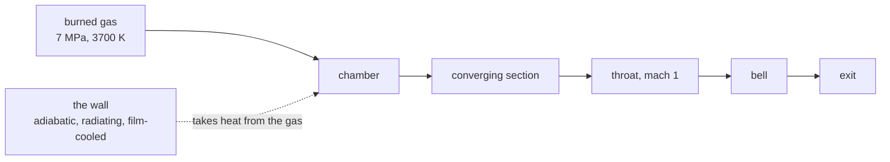

An engine burns gas at seven megapascal and drives it through a nozzle.
The wall it runs against is not a boundary condition anyone gets to choose:
it is metal, it takes heat, and how much it takes changes the thrust.
This page measures the bracket the engine report needs, the wall that
draws heat from the gas against the wall that does not, on the same
chamber geometry the throat case uses.



## The wall treatment

The axisymmetric combustion lane grew a viscous sibling for this. The
planar viscous lane treats a duct's rectangular boundary, but an engine's
contour is a body: the wall runs along a staircase of cells and needs a
one-sided flux pointing into the gas.

The wall treatment is one-sided and isothermal:

- no slip, so the tangential velocity vanishes at the wall
- Fourier conduction to the wall temperature, taken one-sided through the
  wall value and the two gas cells beside it
- black-body radiation from the wall to the gas, scaled by the wall's
  emissivity
- a film coefficient, standing for coolant crossing the boundary layer
- no composition gradient, so the wall neither creates nor absorbs species

Transport is Wilke's mixture rule for viscosity and conductivity, the same
ones the planar lane and the park lane use. The radial flux carries the
annular weight $(r_p f_n - r_m f_s) / (r_c \Delta r)$, matching the
reactive axisymmetric march.

A wall temperature of zero, or no wall temperature at all, means the wall
is adiabatic.

## Measuring the wall

The bracket needs measured numbers, so the run reports the conductive
power leaving the gas at every wall face, summed and bucketed along the
axis. A positive result means the wall is pulling heat out of the gas.

```
wall duty: 0.8985 MW leaving the gas into a 400 K wall
```

The run separates the duty by mechanism, so a disagreement between the
diagnostic and the flow can be attributed rather than merely noted:

```
wall duty: 0.8985 MW total leaving the gas into a 400 K wall
  conduction 0.1416 MW
  radiation  0.5765 MW
  film       0.4147 MW
```

These figures come from the march before the defect described below was
fixed, and they are kept here as the record of what the run reported, not
as the bracket's result. Radiation dominates at these temperatures, by about four times over
conduction, and the film term exceeds conduction. Bucketing by station
also matters, because the duty is not spread evenly: the contraction and
the bell dominate it, and the chamber's shoulder hardly contributes.

## The bracket

Three marches of the same geometry, differing only in the wall:

| leg | wall | what it establishes |
| --- | --- | --- |
| `wall-adiabatic` | adiabatic | the no-heat-sink reference |
| `wall-radiating` | 400 K, emissive | heat leaving by radiation and conduction |
| `wall-filmcooled` | 400 K, emissive, filmed | heat leaving by radiation, conduction and film |

`cases/engine-wall-bracket/gates.py` holds the bracket to these contracts:

- the adiabatic wall draws no heat
- the cooled walls draw heat from the gas
- the wall's duties increase monotonically across the three legs
- a cooler chamber carries more choked mass flow, and the gate says by
  how much the wall's duty implies it should

That last contract follows from the choked relations. Deriving them
gives

```
m_dot = A_star p0 sqrt(gamma) / (sqrt(R) sqrt(t0))
```

so at a fixed total pressure a cooler chamber passes more mass, and the
throat's static pressure scarcely moves at all. Watching throat pressure
therefore cannot witness the effect the bracket is looking for. Choked
mass flow is the observable, and it moves in proportion to
`1 / sqrt(t0)`.

The gate goes further than a direction. It takes the wall's measured duty,
the chamber's mass flow and the burnt gas's heat capacity, computes the
bulk temperature drop that duty implies, converts that to the mass flow
shift it predicts, and compares the prediction against the shift measured.
A contrast that disagrees with its own prediction by more than a factor
of three fails the gate.

## How the flow is measured

The march settles into a periodic orbit rather than converging; the
residual stagnates around 3.29 against a target of 1e-10. The field saved
at step 250 is byte-identical to the field saved at step 3750, so one
period spans 3500 steps, which is fourteen field intervals. Three things
follow, and they govern how every number in this section is taken:

- the march stops on time, not on convergence, so a residual target is
  never reached
- a window shorter than one period carries the wave's phase with it, and
  three fields depart from the cycle mean by up to 1.33 percent, which is
  ten times the wall effect being sought
- comparing two legs at matched step indices is meaningless, because the
  waves' phases drift apart

Whole periods are therefore averaged. The uncertainty comes from the
spread between periods where two periods are available, and from the
disagreement between the halves of a single period otherwise. The
adiabatic leg's own halves disagree by 0.153 percent. Contrasts are
reported in standard errors, and a contrast under about two is not
resolved however attractive the number looks.

An orbit that is periodic without having quite closed shows no repeated
checksum, so the period is then found from the observable's own
recurrence. The checker records which of the two criteria supplied it.

The recurrence criterion needs enough fields before it can speak. A lag
of fourteen fields can only be examined when the saved series extends
past sixteen fields, because a correlation at that lag consumes two
overlapping stretches of the series. Below that the series cannot show
the period however periodic it is, and the criterion reports no
recurrence rather than a wrong one. A series shortened in this way will
often show a tall correlation at a shorter lag, where the fundamental
lies beyond the saved window. That is an artifact of the window, not a
property of the flow.

The recurrence criterion is also the weaker of the two, and it is
restricted to lags that admit at least two whole recurrences inside the
saved data. A lag fitted by only one repetition cannot be distinguished
from a coincidence.

## A defect the bracket found

The first two-period pass measured a contradiction. The wall reported
removing 0.8985 MW from the gas, while the chamber's bulk temperature
registered about 4.6 kW of it, a shortfall of roughly two hundredfold.
Oblique projection of the wall normal explained only about twofold of
that, so the projection was not the whole story.

The cause was an indexing error in the viscous axisymmetric lane. The
radial face quantities are laid out with a column stride, one block of
radial faces per column, and the radial divergence was reading the
first column's block for every column. A wall's heat flux was therefore
spent on the gas above the inlet rather than the gas under that wall.
The reported duty stayed believable because the diagnostic integrates
the same wall faces the solver assembles. Only the gas disagreed.

The fix reaches into the block belonging to the column being updated.
A test carries a walled shelf in the middle of a mesh and asks whether
the gas above the shelf feels the shelf's temperature. Without the fix
that gas responds not at all, because the shelf's flux never reaches it.
The test fails against the old indexing and passes against the new one,
so it guards the behaviour rather than restating the code.

Every leg measured before the fix describes a defective solver and is
being remarched. The numbers in this page come from the remarch.

## How the wall's effect is seen

The wall's duty is what the solver claims to have removed. Whether the
gas agrees is a separate question, and it is answered on the gas
directly: the temperature in the cells that touch the wall, averaged
over a whole flow period, compared against the adiabatic leg's.

Comparing single fields between two marches is useless here. The
chamber's periodic motion swings the per-column difference by more than
a hundred kelvin in both directions between two arbitrary phases of
otherwise equivalent legs. Averaging over the flow period removes the
phase and leaves the leg's own difference.

## What this does not settle

The viscosity here is a constant. A real engine's liner has a boundary
layer that grows through the contraction and the bell, and the wall's
roughness and film cooling change the effective heat transfer by a lot
more than the wall's bulk temperature does. The bracket here bounds the
effect of the wall's temperature on the throat state, which is the first
question, not the last.
