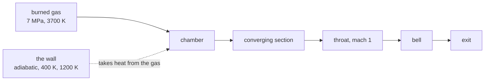

An engine burns gas at seven megapascal and drives it through a nozzle.
The wall it runs against is not a boundary condition anyone gets to choose:
it is metal, it takes heat, and how much it takes changes the thrust.
This page measures the bracket the engine report needs, the cold wall
against the cooled wall, on the same chamber geometry the throat case
uses.



## The wall treatment

The axisymmetric combustion lane grew a viscous sibling for this. The
planar viscous lane treats a duct's rectangular boundary, but an engine's
contour is a body: the wall runs along a staircase of cells and needs a
one-sided flux pointing into the gas.

The wall treatment is one-sided and isothermal:

- no slip, so the tangential velocity vanishes at the wall
- Fourier conduction to the wall temperature, taken one-sided through the
  wall value and the two gas cells beside it
- no composition gradient, so the wall neither creates nor absorbs species

Transport is Wilke's mixture rule for viscosity and conductivity, the same
ones the planar lane and the park lane use. The radial flux carries the
annular weight $(r_p f_n - r_m f_s) / (r_c \Delta r)$, matching the
reactive axisymmetric march.

A wall temperature of zero, or no wall temperature at all, means the wall
is adiabatic.

## Measuring the wall

The bracket needs measured numbers, so the run reports the conductive
power leaving the gas at every wall face, summed and bucketed along the
axis. A positive result means the wall is pulling heat out of the gas.

```
wall duty: 0.1502 MW leaving the gas into a 400 K wall
wall duty by station (MW):
  x  0.0000.. 0.0138    0.00486  perimeter 0.6205 m
  x  0.0138.. 0.0275    0.02735  perimeter 4.1469 m
```

Bucketing matters because the duty is not spread evenly: the contraction
and the bell dominate it, and the chamber's shoulder hardly contributes.

## The bracket

Three marches of the same geometry, differing only in the wall:

| leg | wall | what it establishes |
| --- | --- | --- |
| `wall-adiabatic` | adiabatic | the no-heat-sink reference |
| `wall-cold400` | 400 K | the cold end |
| `wall-warm1200` | 1200 K | a regeneratively cooled liner |

`cases/engine-wall-bracket/gates.py` holds the bracket to four contracts:

- the adiabatic wall draws no heat
- the 400 K wall draws heat from the gas
- the colder wall draws more heat than the warmer one
- the cooled wall's throat pressure sits below the adiabatic wall's

The fourth is the physical consequence of the first three: the coolant
takes energy out of the gas before it accelerates, so the throat reaches
a lower pressure.

## What this does not settle

The viscosity here is a constant. A real engine's liner has a boundary
layer that grows through the contraction and the bell, and the wall's
roughness and film cooling change the effective heat transfer by a lot
more than the wall's bulk temperature does. The bracket here bounds the
effect of the wall's temperature on the throat state, which is the first
question, not the last.
