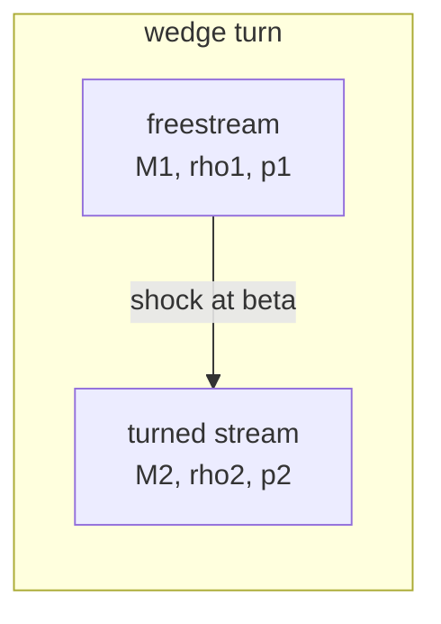

A supersonic stream turning through a wedge is a canonical 2D compressible
problem. The sharper the wedge, the stronger the oblique shock that detaches
from it, and the whole shock is described exactly by the two-dimensional
theta-beta-M relations - a closed-form reference the solver is checked
against.

## The theta-beta-M relations

For an incoming Mach number $M_1$ and a turn through the wedge angle
$\theta$, the shock lies at an angle $\beta$ from the incoming direction,
found on the weak branch from

$$\tan\theta = \frac{2}{\tan\beta}\,\frac{M_1^2\sin^2\beta - 1}{M_1^2(\gamma + \cos 2\beta) + 2}$$

and the downstream state is the normal-shock jump across the normal
component $M_1 \sin\beta$: density, pressure, and the downstream Mach all
follow from the one-dimensional Rankine-Hugoniot relations.

For the gate case ($M_1 = 2$, $\theta = 10$ deg): $\beta = 34.3$ deg,
$M_2 = 1.64$, $p_2/p_1 = 1.71$.

## Verification

`tests/oblique_shock.rs` takes M1 = 2 and a 10-degree turn, computes beta and
the post-shock state from the relations, initializes a 2D domain split by a
shock line at that angle (the turned stream below it, the free stream
above) and marches with the solver. Because an oblique shock is a
steady solution, the solver must keep it in place:

- the free stream stays at rho = 1 exactly,
- the turned region holds the analytic post-shock density to about a quarter
  of a percent,
- the shock line does not drift.

Try the same exercise for a stronger turn (larger theta) and the post-shock
state follows the relations until the shock detaches.

## See also

- [[numerics/2d/euler|2D Euler solver]]
- [[numerics/2d/shock-reflection|Shock reflection]]
- [[verification/index|Verification ladder]]
