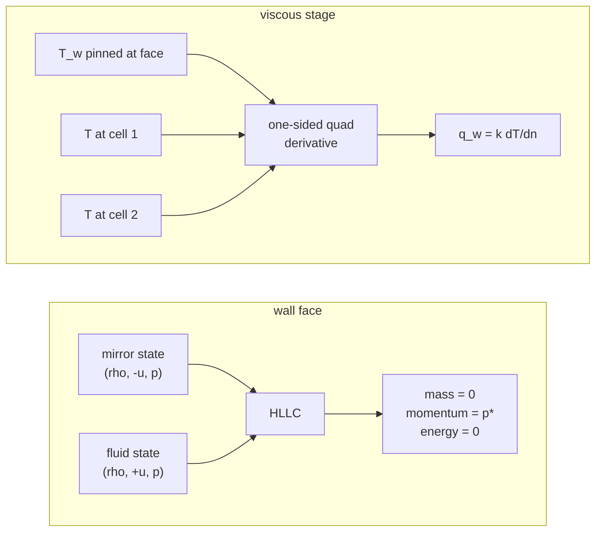

The Euler equations are the inviscid limit of the Navier-Stokes equations.
Adding viscosity and heat conduction turns the sharp, non-diffusive solver into
a full compressible Navier-Stokes one, at the cost of second-order spatial
derivatives and a more restrictive time step. The viscous terms are layered on
top of the existing 2D Euler update rather than mixed into it, so the inviscid
legacy stays intact and a single flag turns viscosity on.

## The viscous flux

The diffusive part of the conservation law:

$$\frac{\partial \rho}{\partial t} = 0, \qquad \frac{\partial \rho u_i}{\partial t} = \frac{\partial \tau_{ij}}{\partial x_j}, \qquad \frac{\partial \rho e}{\partial t} = \frac{\partial (u_j \tau_{ij})}{\partial x_i} - \frac{\partial q_i}{\partial x_i}$$

with the Newtonian stress and Fourier heat flux

$$\tau_{ij} = \mu \bigl( \partial_j u_i + \partial_i u_j - \tfrac{2}{3} \partial_k u_k \delta_{ij} \bigr), \qquad q_i = -k \partial_i T, \qquad k = \mu c_p / \mathrm{Pr}$$

The conductivity carries real units: $c_p = \gamma R/(\gamma-1)$ with the
case gas constant, so $k$ is W/m/K and the wall heat flux it produces is
W/m^2. Temperature comes from the closure (ideal-gas $T = p/\rho$ under
the perfect model, the CEA table under `eqair`).

## Numerical treatment

`viscous2d.rs` computes cell-centred velocity and temperature gradients by
central differencing (one ghost layer mirrored at the boundary), averages them
onto each cell face, and the flux divergence is added to the same conservative
update as the inviscid flux, but with the sign a diverging diffusive flux
requires. The domain-edge faces carry zero viscous flux, so the viscous terms
conserve mass and total energy exactly (no transport leaks through the sides).

On a non-uniform rectilinear grid the same machinery runs metric-aware: each
cell takes the exact three-point Lagrange derivative at its true center over
its neighbors (quadratic-exact on any spacing, the plain central difference
when the axis is uniform), face values interpolate to the true face
position, and the divergence divides by the cell's own width. The wall
treatment generalizes the same way: the one-sided quadratic through the wall
value and the first two cell centers is evaluated on the true positions, so
the stretched Poiseuille hold balances to machine precision. Uniform grids
keep the original scalar fast path bit for bit.

A profile inflow side feeds the layer through this machinery too: the ghost
velocities come from the profile at each row's true height (the Blasius
profile or a loaded table), so the centred wall-normal gradient at the
inflow column sees the shear the incoming layer actually carries. That is
what keeps the Blasius hold balanced from the first cell.

## Body walls

Every face that touches a solid cell is a wall. The advective half mirrors
the fluid state about the face and runs the same HLLC the interior faces
use; the reflected Riemann returns mass 0 with the stagnation pressure the
wall must hold. The viscous half is the no-slip isothermal conductor: the
face flux comes from one-sided quadratic derivatives through the wall value
and the first two fluid centers.

A wall-adjacent fluid cell keeps centered gradients only on components
whose stencil stays inside the fluid - any component that would read a
solid cell (velocity or temperature alike) becomes a one-sided interior
difference, so the wall slope never leaks into the fluid-fluid faces. The
solid classification is the cached mask both halves read, so the advective
and viscous treatments agree on exactly which faces are walls. Faces
between two solid cells carry nothing.

## Steady-state marching

On a clustered wall mesh the explicit diffusion bound at the first wall
cell is orders below the acoustic bound everywhere else, and a global
time step cannot cross the shock layer in reasonable wall clock. The
viscous lane honors `local_time_stepping = true` in the case numerics for
exactly this, in two halves: the inviscid stage advances every cell at its
own acoustic bound (one forward-Euler stage; Heun's neighbor-consistent
stages are unstable under per-cell increments) in the standard residual
form, while the viscous stage holds the whole field at the minimum fluid
increment. A diffusion update under per-cell increments manufactures
momentum and energy at cells whose neighbors step several decades away
(the wall layer vs the freestream), so the diffusive half of the operator
cannot ride the local increments; holding it at the field minimum costs
nothing in the converged state because the near-wall cells own that
minimum anyway. The intermediate states of a residual-form march are not
conservative - that is the price of the acceleration, and it bounds the
method to steady targets where only the converged field is read. Solid
cells behind the mask step at the minimum fluid increment, the wake keeps
a positivity floor, and on sharp-featured transients (an impulsive start
past a blunt body at Mach 20) even this split scheme can drive undisturbed
cells into the floor, so treat LTS on new case classes as experimental
until the run holds its freestream. The default global-dt march is always
the validated path.

## Stability

Explicit diffusion is unstable unless the time step respects the diffusive
bound, dt <= h^2 / (2 D), where the binding diffusivity D = mu*kappa/rho with
kappa = gamma/((gamma-1) Pr). Because heat conduction usually diffuses several
times faster than momentum (kappa ~ 4.9 for air), that conduction limit is the
one that binds. The viscous time stepper (`advance2d_visc_rk2`) clamps its
step to that limit with a safety factor, so turning on viscosity never silently
outruns the scheme's stability.

## Sutherland's law

Constant viscosity is the simple choice for a first viscous milestone, but a
temperature-dependent law is provided too:

    mu(T) = mu0 (T/T0)^1.5 (T0 + S) / (T + S)

with the air constants mu0 = 1.716e-5, T0 = 273.15 K, S = 110.4 K. It lowers the
computational cost of the channel-flow milestone's high-temperature cases.

## See also

- [[numerics/2d/channel-flow|Channel flow]]
- [[numerics/2d/2d-euler|2D Euler solver]]
- [[numerics/foundations/positivity|Positivity]]
