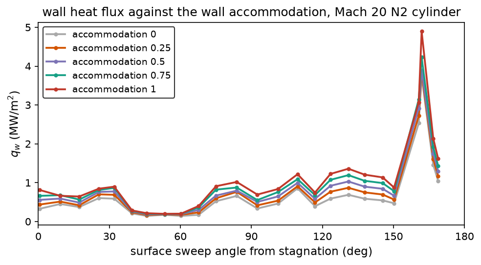
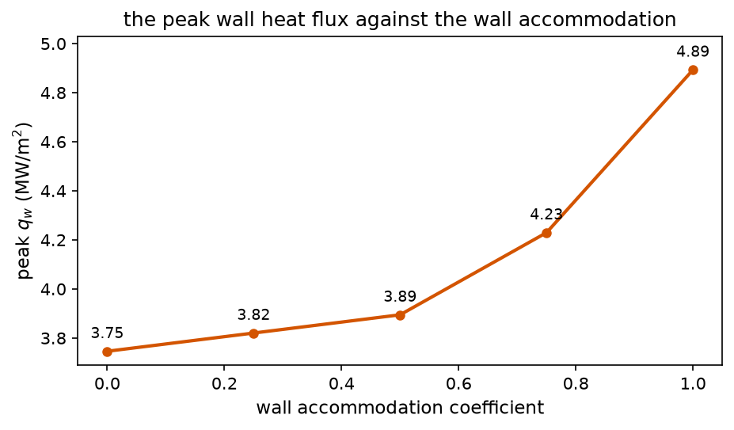

The five-species lane advects a dissociated shock layer over an
inviscid wall: the composition rides the flow but never touches the
surface. Real thermal protection systems are not inviscid and not
inert. Atoms that reach a surface recombine on it, and every
recombination drops the formation enthalpy into the wall as heat.
This page carries the other half of that problem: the diffusive
species transport through the viscous shock layer, and the wall
condition that decides what happens to the atoms at the surface.

## The transport

A viscous park5 case switches the march from the inviscid lane to
the species viscous lane: the same RK2 flow stepping, with a viscous
pass after each substep. The mixture transport comes from the
Wilke (1950) rules over RP-1232 curve fits per species: viscosity

$$
\mu_i = \exp(A_i z^2 + B_i z + C_i), \quad z = \ln T
$$

converted from the tabulated g/(cm s) form, mixed as

$$
\mu_{mix} = \sum_i \frac{Y_i / M_i}{\sum_j Y_j / M_j} \frac{\mu_i}{\phi_i}, \quad
\phi_i = \sum_j \frac{Y_j / M_j}{\sum_k Y_k / M_k}\left(1 + \sqrt{\mu_i / \mu_j}\right)^{1/2}
$$

with the same combination rule carrying the conductivity $k_i$
(quartic in $z$) to the mixture value. Below 1000 K the fits fall
back to Sutherland air, so the cold freestream never extrapolates a
high-temperature fit out of range.

The species diffusion is the effective-binary form: one $D_{eff}$
per cell from the pair fits, and the diffusion flux

$$
J_s = -\rho D_{eff} \nabla Y_s
$$

with the discrete fluxes constructed so $\sum_s J_s = 0$ exactly: the
divergence update conserves $\sum_s Y_s = 1$ to roundoff without a
renormalization crutch (a sweep still renormalizes to kill the
accumulated drift).

The march stays explicit, and the diffusion number bounds it. A
global minimum over the field would let the near-vacuum freestream
(huge $D/\rho$, uniform composition) crush the whole march to the
diffusive step; the pass pairs each face with the local stability
limit of its two cells instead, the same per-cell pairing the
momentum bound uses. The shock layer steps at its own diffusive
pace, the freestream at the acoustic one.

## The wall

The viscous wall is isothermal at `physics.wall_temperature`, with
no-slip momentum and one of three composition conditions:

- `catalytic_wall = "none"`: zero gradient, $\partial Y_s /
  \partial n = 0$ along the wall normal. Atoms bounce; nothing
  recombines; the wall heats by conduction alone.
- `catalytic_wall = "full"`: the wall composition is the equilibrium
  composition at the wall temperature. Every atom that reaches the
  surface recombines instantly; the wall drains atoms from the
  layer above it and collects their formation enthalpy.
- `catalytic_wall = "partial"`: a wall that accommodates a fraction
  of the atoms that arrive, with the fraction set by
  `physics.catalytic_efficiency`.

The fully-catalytic ghost composition is the same closed-form
equilibrium the chemistry substep relaxes toward, evaluated at
$T_{wall}$ and the near-wall density: the degree of dissociation
$\alpha$ solves

$$
\frac{\alpha^2}{1-\alpha} = \frac{K_c M_{X_2}}{4\rho}, \quad
\alpha = \frac{\sqrt{b^2+4b}-b}{2}, \quad b = \frac{K_c M_{X_2}}{4\rho}
$$

with the closure's own $K_c$ fits, no new constants.

The wall heating then carries three pieces: conduction
($-k\,\partial T/\partial n$), the catalytic formation-enthalpy flux,
and the enthalpy transport the species diffusion drags along.

## Accommodation

A binary wall condition brackets the answer but predicts nothing: a
metal oxide, a nitride and a ceramic sit at different points
between the two ends. The lane takes that point as an accommodation
coefficient $\eta$, the fraction of the arriving atoms the surface
takes and recombines. The wall composition is the blend

$$
Y^{wall}_s = (1-\eta)\,Y^{near}_s + \eta\,Y^{eq}_s(T_{wall}, \rho)
$$

so $\eta = 0$ is the zero-gradient wall, $\eta = 1$ the fully
catalytic one, and the fraction the surface does not accommodate stays
in the gas phase, so the wall takes the atom drain and the formation
enthalpy in proportion to $\eta$. Everything downstream follows from
that ghost: the atom drain slows with $\eta$, the formation enthalpy it
carries slows with it, and the gas itself cools a little less.

The coefficient is the model's one surface-kinetics input. It is not
fitted here and it is not tuned to a case: a measurement of a
material's recombination efficiency supplies it. Mixing $\eta$ into
the ghost rather than scaling the flux afterwards keeps the atom
mass balance and the energy flux consistent with each other at every
value, which a post-hoc factor on the heat flux would not.

## What the coefficient stands for

The measurements do not support one constant. The surface loss
probability for oxygen and nitrogen atoms spans roughly $10^{-5}$ to
$10^{-1}$ on realistic surfaces, and it moves by factors of three to
a hundred with the material and its state: fused silica sits near
$10^{-4}$ to $10^{-3}$, sintered alumina and silicon carbide nearer
$10^{-3}$ to $10^{-2}$, clean metals between $10^{-3}$ and $10^{-1}$,
and an oxide or adsorbate layer on a metal shifts the value by an
order of magnitude on its own (oxidised titanium falls below $10^{-3}$
while clean titanium exceeds $0.05$). Alumina carries an Arrhenius
branch change near 1400 K and the coated silicon-carbide systems
another near 1500 K, so a coefficient that does not move with
temperature is not what the data describe.

Most of those numbers come from coupons in low-pressure plasmas and
flow tubes, mostly between 300 and 1000 K, and an arcjet coupon
changes state while it flies. A coefficient transfers between the two
only when the surface state, the pressure and the temperature match,
which is why the lane takes it as an input rather than assuming one.

## References

- Borrego, C. et al., "A Review of Recombination Coefficients of Neutral
  Oxygen Atoms for Various Materials", *Materials* 16, 1774 (2023),
  https://doi.org/10.3390/ma16051774
- Balat-Pichelin, M., "Interaction of Reactive Gas Flows and Ceramics at High
  Temperature", NATO RTO-EN-AVT-142, paper 12 (2007)
- Oinuma, G. et al., "A comparative study of the surface recombination of
  nitrogen atoms on various materials at atmospheric pressure",
  *Journal of Physics D* 43, 255202 (2010),
  https://doi.org/10.1088/0022-3727/43/25/255202
- Paul, D. et al., "Recombination of oxygen atoms on the surface of oxidized
  polycrystalline nickel", *Plasma Sources Science and Technology* 32,
  075001 (2023), https://doi.org/10.1088/1361-6595/ace129
- Adams, S. F. and Miller, T. A., "A Study of the Effect of Surfaces on Oxygen
  Atom Recombination at Low Pressures", NASA TSR-4 (1969)

## The accommodation series

The same Mach 20 nitrogen cylinder over the isothermal 1000 K wall
(400x200 grid, marched to t = 3 ms), with the accommodation stepped
from the non-catalytic wall to the fully catalytic one:

| accommodation | peak wall heat flux | against the non-catalytic wall | peak face |
|---|---|---|---|
| 0, the non-catalytic wall | 3.746 MW/m2 | 1.000 | (0.963, 0.315) |
| 0.25 | 3.820 MW/m2 | 1.020 | (0.963, 0.315) |
| 0.5 | 3.895 MW/m2 | 1.040 | (0.963, 0.315) |
| 0.75 | 4.230 MW/m2 | 1.129 | (0.963, 0.315) |
| 1, the fully catalytic wall | 4.893 MW/m2 | 1.306 | (0.963, 0.315) |

The two ends reproduce the shipped wall-condition pair exactly, which
is what the gate checks: the same case, the same mesh, the same final
time, and the same numbers as the committed non-catalytic and fully
catalytic run logs. The series does what the model says it should:
the peak grows with the accommodation, and it grows fastest where the
atoms are coldest relative to the wall, because that is where the
reflected atoms are worth the most formation enthalpy.





The figures are a model study, not a bracket of the wall heat flux.
The obstacle is the continuum criterion, and it is not a modelling
choice: near the wall the gradient-length Knudsen number reaches
1089 on density and 9.3 on temperature across the series, and about
10 percent of the cells sit above the breakdown threshold. Wall heat
flux there is not a continuum quantity, whatever the conductivity is.
Sampling the first fluid row along rays from the body centre gives:

| ray | first row temperature | clearance from the wall |
|---|---|---|
| nose, 180 deg | 6678 K | 0.0095 m |
| shoulder, 60 deg | 8586 K | 0.0100 m |
| lee, 0 deg | 11233 K | 0.0135 m |
| the face carrying the peak, 18 deg | 18342 K | 0.0126 m |

Earlier drafts of this page blamed the peak on the boundary row, where the
mesh has no cut cells and a cell that straddles the wall is handed a whole
cell's volume. The field does not support that. The peak sits inside a
smooth region: the cell above it reads 16137 K, the cell beside it 13180 K
and the cell below 18791 K, and the row warms steadily from the nose to the
lee apart from that district. The attribution is withdrawn.

An earlier draft also blamed the spread between the walk-through
reported peak and the march's own peak on the conductance: it claimed
the march held the conductivity constant at $\gamma/(\gamma-1)$ times
Pr, 4.93 W/m.K, across the field. That was wrong. The species lane
conducts with the Wilke-mixed species conductivities from the RP-1232
fits, which vary with both temperature and composition
(`crates/nufor-core/src/species_props.rs`); the constant-conductivity
form belongs to the single-species closure lanes. The walk-through
number also predates the far-field repair, so it was flown on a
stream the case never declared: 50 K at Mach 42, with an air seed
carried into a nitrogen march. The two numbers were never a model
comparison, and the explanation that tied them to the conductance is
withdrawn with it.

What the series does establish is the shape of the surface-chemistry
sensitivity: the accommodation moves the peak by a factor of 1.31
across the ladder, from 3.75 to 4.89 MW/m2, and the movement is
smooth, so a measured $\eta$ converts straight into a quoted wall heat
flux. What it cannot establish is the absolute number, because the
flow at the wall is out of the range where a continuum solution means
anything.

The current state of these figures is tracked in
[[research/claim-register|the claim register]], and the marched
numbers sit on [[research/results|the results page]]. The gates that
hold the series: the ends of the ladder reproduce the shipped
wall-condition pair, the peak grows monotonically with the
accommodation, and every leg carries the continuum diagnostic.

## Using it

A park5 case with `physics.mu > 0` picks the lane automatically; no
other change. The wall block:

```toml
[physics]
eos = "park5"
gas = "n2"
mu = 1.716e-5
pr = 0.71
wall_temperature = 1000.0
catalytic_wall = "partial"     # "none", "partial" or "full"
catalytic_efficiency = 0.5      # the accommodation, in [0, 1]
```

The case pair ships as
`cases/cylinder-m20-park5-visc/case-none.toml` and
`case-full.toml`; `make_accommodation_cases.py` in that directory
writes the whole ladder from the same case.
`catalytic_wall` absent means `"none"`, and `"partial"` without a
`catalytic_efficiency` is an error rather than a default.

## Limits

The blend interpolates the two limiting wall conditions rather than
solving the surface reaction kinetics, so the coefficient stands in
for a Damköhler-type wall characterisation: a measurement supplies it,
and a surface-kinetic closure could replace it without disturbing the
rest of the lane.

The accommodation coefficient is a single number for the whole
surface, and the model takes it as given and constant: real materials
differ by species (nitrogen and oxygen recombine at different rates),
and the value moves with the surface temperature and its oxidation
state as the surface evolves. The section above is why that is a
simplification and not a claim.

The continuum criterion still decides whether any of these wall
numbers mean anything, and on this case they do not. A denser
stream, or a case resolved in the transition regime, is what turns
the series into a bracket.

The lane is laminar: the turbulence model does not see the species
fields yet.
