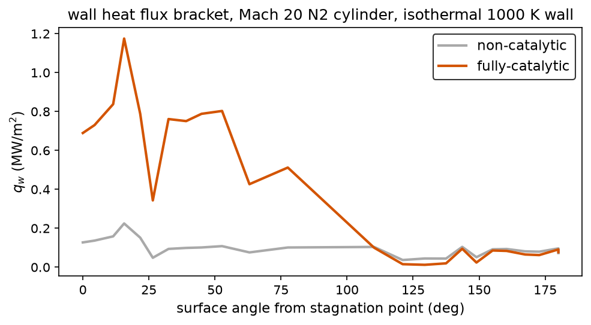
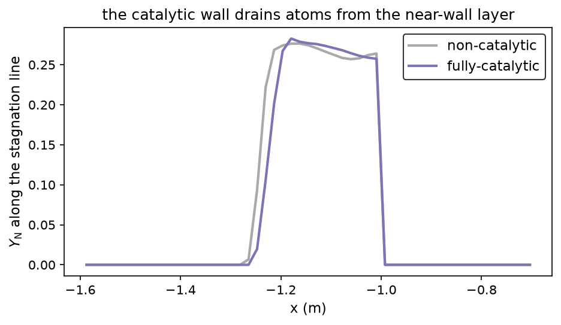

The five-species lane advects a dissociated shock layer over an
inviscid wall: the composition rides the flow but never touches the
surface. Real thermal protection systems are not inviscid and not
inert. Atoms that reach a surface recombine on it, and every
recombination drops the formation enthalpy into the wall as heat.
This page carries the other half of that problem: the diffusive
species transport through the viscous shock layer, and the wall
condition that decides what happens to the atoms at the surface.

## The transport

A viscous park5 case switches the march from the inviscid lane to
the species viscous lane: the same RK2 flow stepping, with a viscous
pass after each substep. The mixture transport comes from the
Wilke (1950) rules over RP-1232 curve fits per species: viscosity

$$
\mu_i = \exp(A_i z^2 + B_i z + C_i), \quad z = \ln T
$$

converted from the tabulated g/(cm s) form, mixed as

$$
\mu_{mix} = \sum_i \frac{Y_i / M_i}{\sum_j Y_j / M_j} \frac{\mu_i}{\phi_i}, \quad
\phi_i = \sum_j \frac{Y_j / M_j}{\sum_k Y_k / M_k}\left(1 + \sqrt{\mu_i / \mu_j}\right)^{1/2}
$$

with the same combination rule carrying the conductivity $k_i$
(quartic in $z$) to the mixture value. Below 1000 K the fits fall
back to Sutherland air, so the cold freestream never extrapolates a
high-temperature fit out of range.

The species diffusion is the effective-binary form: one $D_{eff}$
per cell from the pair fits, and the diffusion flux

$$
J_s = -\rho D_{eff} \nabla Y_s
$$

with the discrete fluxes constructed so $\sum_s J_s = 0$ exactly: the
divergence update conserves $\sum_s Y_s = 1$ to roundoff without a
renormalization crutch (a sweep still renormalizes to kill the
accumulated drift).

The march stays explicit, and the diffusion number bounds it. A
global minimum over the field would let the near-vacuum freestream
(huge $D/\rho$, uniform composition) crush the whole march to the
diffusive step; the pass pairs each face with the local stability
limit of its two cells instead, the same per-cell pairing the
momentum bound uses. The shock layer steps at its own diffusive
pace, the freestream at the acoustic one.

## The wall

The viscous wall is isothermal at `physics.wall_temperature`, with
no-slip momentum and one of two composition conditions:

- `catalytic_wall = "none"`: zero gradient, $\partial Y_s /
  \partial n = 0$ along the wall normal. Atoms bounce; nothing
  recombines; the wall heats by conduction alone.
- `catalytic_wall = "full"`: the wall composition is the equilibrium
  composition at the wall temperature. Every atom that reaches the
  surface recombines instantly; the wall drains atoms from the
  layer above it and collects their formation enthalpy.

The fully-catalytic ghost composition is the same closed-form
equilibrium the chemistry substep relaxes toward, evaluated at
$T_{wall}$ and the near-wall density: the degree of dissociation
$\alpha$ solves

$$
\frac{\alpha^2}{1-\alpha} = \frac{K_c M_{X_2}}{4\rho}, \quad
\alpha = \frac{\sqrt{b^2+4b}-b}{2}, \quad b = \frac{K_c M_{X_2}}{4\rho}
$$

with the closure's own $K_c$ fits, no new constants.

The wall heating then carries three pieces: conduction
($-k\,\partial T/\partial n$), the catalytic formation-enthalpy flux,
and the enthalpy transport the species diffusion drags along. At a
cold wall in a dissociated stream the catalytic term dominates.

## The bracket

Mach 20 nitrogen over the cylinder, isothermal wall at 1000 K, the
same case twice with the wall condition flipped (400x200 grid, 3237
and 3236 steps to t = 3 ms, both runs finishing clean). The pair brackets
the answer: a non-catalytic TPS (a clean ceramic) lives at the
lower bound, a fully-catalytic one (a metal or a contaminated
surface) at the upper.

| quantity | non-catalytic | fully-catalytic |
|---|---|---|
| peak wall heat flux | 0.240 MW/m2 | 1.216 MW/m2 |
| peak location | stagnation shoulder | stagnation shoulder |
| amplification | 1x | 5.1x |

$$
q_{cat} = \sum_s h^0_s \, J_{s,wall}
$$

is the added term; with $h^0_N$ = 33.6 MJ/kg the recombination heat
at a cold wall dwarfs the conduction. The composition fields show
the mechanism behind the number: the catalytic run's atomic
nitrogen collapses toward the wall (first fluid ring: $Y_N$ 0.09
non-catalytic vs 0.02 fully-catalytic) while the frozen-chemistry
region past the shoulder is untouched.





Gates held: the fully-catalytic peak sits strictly above the
non-catalytic one at the same surface point, the near-wall atom
content depletes under the catalytic condition, the uniform-field
identity moves nothing (a non-catalytic wall on uniform
composition is bit-stable), and sum-$Y_s$ stays 1 to 5e-8 across
both fields. Full numbers:
[[research/results|the results page]].

## Using it

A park5 case with `physics.mu > 0` picks the lane automatically; no
other change. The wall block:

```toml
[physics]
eos = "park5"
gas = "n2"
mu = 1.716e-5
pr = 0.71
wall_temperature = 1000.0
catalytic_wall = "full"    # or "none"
```

The case pair ships as
`cases/cylinder-m20-park5-visc/case-none.toml` and
`case-full.toml`. `catalytic_wall` absent means `"none"`.

## Limits

The wall condition is binary: none or full. Real TPS materials sit
between (a recombination efficiency $\gamma$ per species), and a
temperature-dependent efficiency is what makes the bracket a
prediction. The equilibrium-wall ghost is as hot as a wall can get;
a finite-rate surface model is the refinement. The lane is
laminar: the turbulence model does not see the species fields yet.
