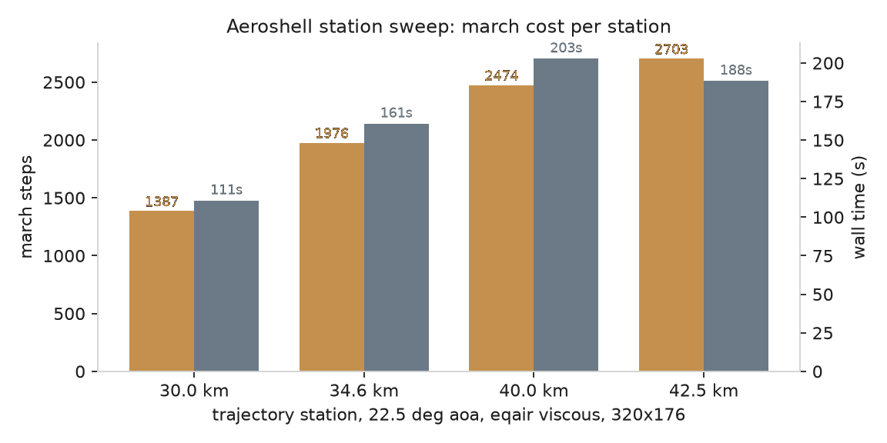

The equilibrium-air closure: what it models, where its numbers come
from, and how a case selects it.

## What it is

Above roughly 800 K, air stops behaving like a calorically perfect
gas: vibrational modes excite, then O2 dissociates (starting near
2500 K), then N2 (near 4500 K), then ionization. The energy that
would otherwise raise the temperature is spent breaking molecules
instead, which changes everything a solver feels: the post-shock
temperature, the density jump across a strong shock, the speed of
sound, and the effective gamma (which falls from 1.4 toward 1.1 in
the dissociated regime).

The `eqair` closure models all of that as thermodynamic equilibrium
air: a gas whose composition at each (density, internal energy) is
whatever minimizes its free energy, folded into two functions:

$$p = p(\rho, e), \qquad a = a(\rho, e)$$

pressure and speed of sound from the same pair of conserved-variable
inputs, with no species and no reaction rates.

No species, no reaction rates, no extra transport equations: the
composition is assumed to relax instantly to equilibrium. That is a
good model for the shock layer of a reentering capsule at the
altitudes where the flow time is slow compared to the chemistry.

## The curve fits

The functions come from the Srinivasan-Tannehill-Weilmuenster fits of
NASA RP-1181 (1987), in the TGAS1 form of the accompanying FORTRAN
listing (NASA CR-181245): 12 piecewise polynomial blocks over

$$Y = \log_{10}(\rho / 1.292), \qquad Z = \log_{10}(e / 78408.4)$$

with rho in kg/m^3 and e in m^2/s^2.

three density regions (Y <= -4.5, -4.5 < Y <= -0.5, Y > -0.5), each
cut in Z, with a Grabau-type sigmoid blending the high-temperature
transition in each block. The fits reproduce the underlying
equilibrium-air tables to a stated 7.6 percent worst-case in pressure
over 250 K to 15000 K; the report's own tables give the error
distribution.

The coefficients in `nufor-core/src/eqair.rs` were transcribed from
the CR-181245 FORTRAN listing and every block was audited against the
listing's own derivative identities (the listing prints both the fits
and their partials, so each coefficient cross-checks algebraically
against its neighbors). Two acceptance gates pin the implementation:

- cold air at sea level returns p within 0.31 percent of 101325 Pa
  (the gate measures 0.3008 percent) and a ~ 340 m/s
- a Mach 22 normal shock compresses 16.3x, past the perfect-gas
  ceiling of 6x, with a subsonic post-shock state

Both are enforced in `crates/nufor-core/tests/eqair.rs`.

## The CEA grid behind the 2D march

The planar and axisymmetric 2D marches close from a tabulated
equilibrium-air grid instead of the fits. The table in
`nufor-core/data/cea_eqair_table.tsv` was generated with NASA CEA
(release 2024, Gibbs free-energy minimization over N2/O2/NO/N/O) over
101 pressures from 0.01 Pa to 10.1 MPa and 30 temperatures from 200 K
to 30000 K, then inverted onto a uniform 40x60 grid in
(log10 rho, log10 e). The energy axis is sensible internal energy:
CEA's tabulated `u` shifted by its 298.15 K reference (+299.6 kJ/kg)
so the table reads the same conserved variable the march carries,
`e = p/((gamma-1) rho)`. The march bilinearly interpolates (rho, e)
to (p, T) per cell and per face state, with sound speed from finite
differences on the same grid. Parity gates in
`crates/nufor-core/tests/mpi_parity.rs` pin the Fortran and Rust
readers to identical numbers (sod and uniform cases exact, the
capsule-body case at 4e-15 relative).

## Selecting it in a case

```toml
[physics]
equations = "euler_axi"
eos = "eqair"
```

The default is `eos = "perfect"`, the constant-gamma closure every
earlier case used. Under `eqair` the case's initial and inflow
pressures are inverted to internal energies through the fits, the
march closes pressure and sound speed per cell (and per face state)
from (rho, e), and the HLLC wave speeds use the closure's own sound
speed. The `gamma` key stays in the file as the perfect-gas fallback
for degenerate cells; the fits themselves carry the real gamma.

The shipped example is `cases/capsule-reentry-eqair`: the
sphere-cone capsule at Mach 22 in air at 40 km density
(rho = 0.004 kg/m^3, p = 287 Pa), run axisymmetrically. Against the
perfect-gas capsule at the same Mach, the equilibrium-air run shows
the two real-gas signatures: the bow shock stands closer to the body
(the colder, denser shock layer is thinner), and the density jump
across the shock reaches 10.7x on the 320x160 grid, where the perfect
gas is capped at 6x. the jump is the ratio between the two cells that
straddle the shock, and the local gate in
`crates/nufor-cli/tests/capsule_eqair_artifact.rs` reads the snapshot
the case writes and holds it inside the measured band. the gate needs
that snapshot, so it runs on my desktop with the case's own output in
place.

## A way to run viscous

A planar 2D case with `physics.mu` set to a positive value runs the
laminar viscous march (`advance2d_model_visc_rk2`) instead of the
inviscid one. Each cell's molecular viscosity comes from the Sutherland
law against the cell temperature (air at 273.15 K, S = 110.4 K), and
the conductivity follows as $k = \mu c_p / \mathrm{Pr}$ with
$c_p = \gamma R / (\gamma-1)$ and the case gas constant - the state is
dimensional, so the conduction carries real units (W/m/K). Under
`eqair` the wall, the bow shock, and the shear layer all heat the gas
with the real-gas pressure relation.

```toml
[physics]
equations = "euler_2d"
eos = "eqair"
mu = 1.8e-5
wall_temperature = 1200.0
```

`wall_temperature` (K) picks the wall thermal condition: 0 (or
absent) is an adiabatic wall, and any positive value holds the wall
at that temperature, which is the cold wall the entry heating
correlations (Fay-Riddell) are posed at.

## Where the perfect gas remains

1D and 3D marches still run the perfect gas; the planar and
axisymmetric 2D paths (the hypersonic entry paths) are the
closure-aware ones. The nonequilibrium models are built on top of
this: two-temperature vibration ([[numerics/foundations/two-temperature|two-temperature vibration]])
and five-species chemistry ([[numerics/foundations/five-species|five-species chemistry]]) are
the next steps past equilibrium.


