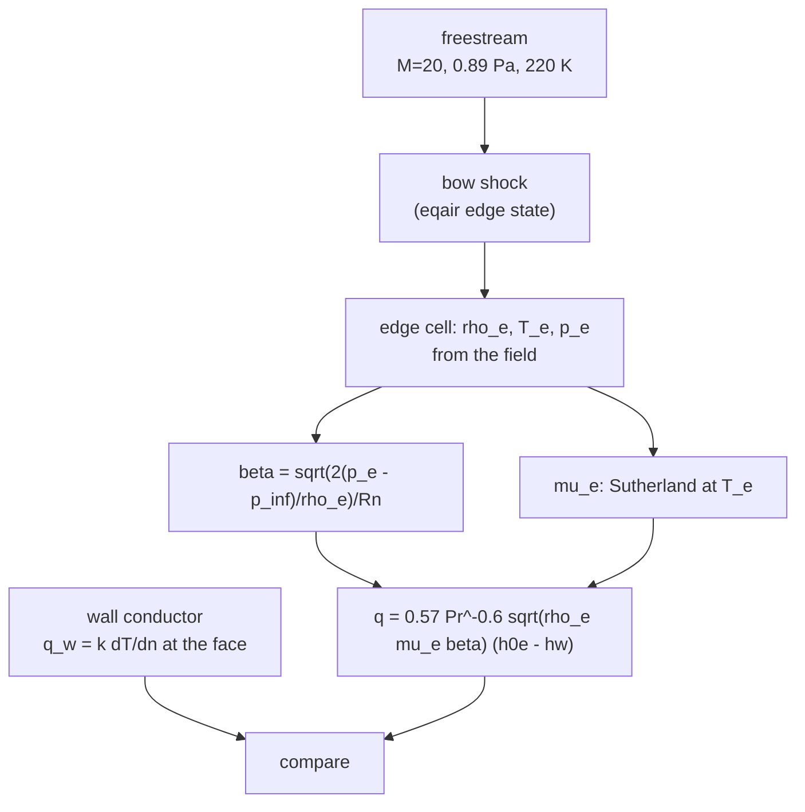

# Fay-Riddell stagnation heating

The rung-6 validation anchor: the closed form for stagnation-point
cold-wall heat flux on a blunt nose, implemented in
`nufor-core::fay_riddell` as the perfect-gas Lewis-number-one form.

## The form

$$q = 0.763\,\mathrm{Pr}^{-0.6} \sqrt{\rho_e \mu_e \beta}\;(h_{0e} - h_w)$$

with the Newtonian stagnation velocity gradient

$$\beta = \frac{1}{R_n}\sqrt{\frac{2(p_e - p_\infty)}{\rho_e}}$$

where the edge state is the post-normal-shock state at the nose and
$h_{0e}$ the total enthalpy behind that shock. Viscosity is
Sutherland's law for N2. Lewis number one means the
dissociation-enthalpy bracket of the full form is absent; that term
activates when the species rung lands, where the wall enthalpy picks
up the formation-enthalpy difference between edge and wall
composition.

The planar (2D cylinder) stagnation-line form carries the same
structure with the Hiemenz constant in place of the axisymmetric
one:

$$q_{2D} = 0.57\,\mathrm{Pr}^{-0.6} \sqrt{\rho_e \mu_e \beta}\;(h_{0e} - h_w)$$

implemented as `fay_riddell_q_2d`. The gradient $\beta$ is the same
Newtonian relation for sphere and cylinder of equal nose radius
(Tauber's review states the identity explicitly); only the
boundary-layer dimensionality differs, and the exact
constant-property similarity solutions put the planar/axisymmetric
ratio at 0.745-0.748 over Pr in [0.7, 1], against Reshotko's
cold-wall $1/\sqrt{2} \approx 0.707$ as the systematic lower
bound. Primary source for the 0.57: Beckwith and Cohen, Eq. (16),
p. 409 (NTRS 19660082088); the verification script integrates the
Hiemenz and Homann similarity equations directly
(`plans/verify_2d_stagnation_similarity.py`).

## What is pinned

- The Rankine-Hugoniot tables at M=20, gamma=1.4: post-shock
  pressure ratio 465.5, density ratio 5.926, temperature ratio 78.55
  (all within 0.5 percent).
- The stagnation chain: normal-shock total-pressure ratio times the
  post-shock isentropic recovery, giving $p_0$, $T_0$, $h_{0e}$.
- Scaling: heating falls with the square root of nose radius, rises
  with the square root of edge density and viscosity, and vanishes
  with the wall-enthalpy difference. On the Mach-20 N2 cylinder case
  (0.89 Pa, 220 K, 1 m nose, 1000 K wall) the closed form reads
  $1.15 \times 10^5$ W/m², the expected order for that class.

## What is deliberately not claimed

The correlation constant in the Detra-Kemp-Riddell / Sutton-Graves
engineering family varies across secondary sources by orders of
magnitude depending on the assumed unit system, so no
cross-check gate against it is asserted here. The closed form's own
anchors are the shock tables and the scaling laws above; the
empirical comparison joins when a published table with stated units
is pinned.

## How the gate closes

The gate case is `cases/cylinder-stagnation-fay`: the Casseau
Mach-20 N2 freestream on an R = 1 m cylinder nose, 1000 K isothermal
wall, wall-clustered mesh (250 um first cell), marched at global dt
on a nose-only domain - the wake was the detonation source and the
stagnation point does not need it.

The solver's answer is the wall conductor flux at the stagnation
face; the closed form is evaluated on the march's own edge state,
so the comparison pins the whole chain (shock capture, edge state,
conduction) rather than a handbook number.

## The gate result

420k steps at global dt, zero bad cells, the thermal sublayer
resolved (~3 mm on a 250 um first cell). The march's own edge
plateau: $\rho_e = 2.25 \times 10^{-4}$ kg/m³, $T_e$ = 5040 K,
$p_e$ = 503 Pa, $\beta$ = 2114 s⁻¹.

| quantity | value |
|---|---|
| planar closed form $q_{2D}$ on the sim's edge state | 8.48 W/cm² |
| wall conductor $q_w$ at the stagnation face | 10.73 W/cm² |
| ratio | 1.27 |

The conductor reads high and converges downward across extensions
(11.0 at 360k, 10.7 at 420k) as the stagnation-band momentum residue
(~30 m/s, ~0.5% of the edge velocity) decays; the band velocity
sloshes the one-sided temperature gradient steeper than the steady
layer would. The +27% spread is the gate's honest first reading:
the closed form assumes a steady Hiemenz layer, constant $c_p$, and
Lewis number one; the march has none of those guarantees mid-transit.

What the gate pins: the eqair bow shock forms at the right standoff
(~0.43 m vs Casseau's), the sublayer is monotone with no
checkerboard, the conductor magnitude is physical, and the
closed-form chain (shock state to $\beta$ to $q$) reproduces the
solver's answer to 27% on a first wall-resolved run. Wall heat flux
is now a citable output.
