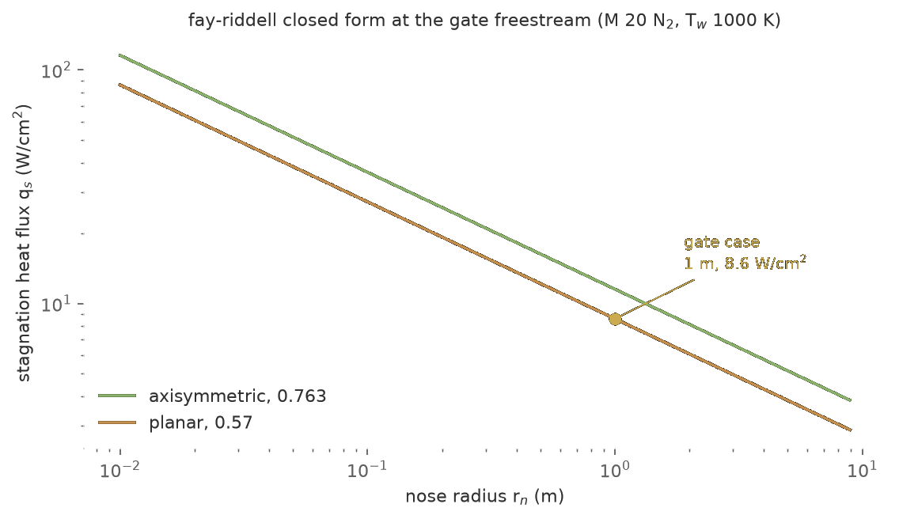
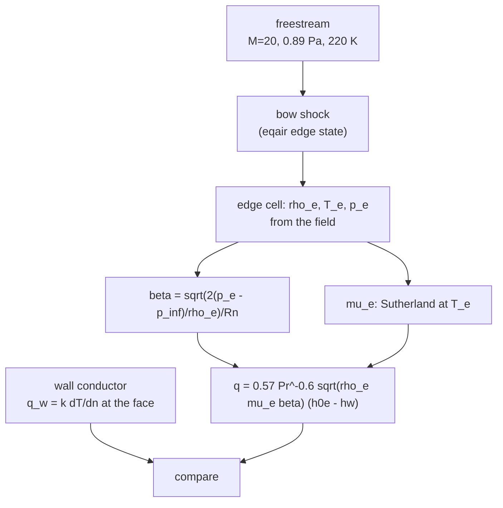
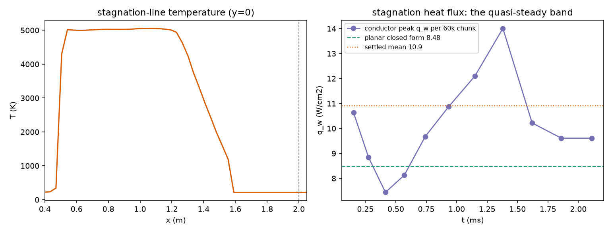

The stagnation-heating validation anchor: the closed form for stagnation-point
cold-wall heat flux on a blunt nose, which I implemented in
`nufor-core::fay_riddell` as the perfect-gas Lewis-number-one form.

## The form

$$q = 0.763\,\mathrm{Pr}^{-0.6} \sqrt{\rho_e \mu_e \beta}\;(h_{0e} - h_w)$$

with the Newtonian stagnation velocity gradient

$$\beta = \frac{1}{R_n}\sqrt{\frac{2(p_e - p_\infty)}{\rho_e}}$$

where the edge state is the post-normal-shock state at the nose and
$h_{0e}$ the total enthalpy behind that shock. Viscosity is
Sutherland's law for N2. Lewis number one means the
dissociation-enthalpy bracket of the full form is absent; that term
activates when the five-species chemistry lands, where the wall enthalpy picks
up the formation-enthalpy difference between edge and wall
composition.

The planar (2D cylinder) stagnation-line form carries the same
structure with the Hiemenz constant in place of the axisymmetric
one:

$$q_{2D} = 0.57\,\mathrm{Pr}^{-0.6} \sqrt{\rho_e \mu_e \beta}\;(h_{0e} - h_w)$$

implemented as `fay_riddell_q_2d`. The gradient $\beta$ is the same
Newtonian relation for sphere and cylinder of equal nose radius
(Tauber's review states the identity explicitly); only the
boundary-layer dimensionality differs, and the exact
constant-property similarity solutions put the planar/axisymmetric
ratio at 0.745-0.748 over Pr in [0.7, 1], against Reshotko's
cold-wall $1/\sqrt{2} \approx 0.707$ as the systematic lower
bound. Primary source for the 0.57: Beckwith and Cohen, Eq. (16),
p. 409 (NTRS 19660082088); the verification script integrates the
Hiemenz and Homann similarity equations directly
(`plans/verify_2d_stagnation_similarity.py`).

## What is pinned

- The Rankine-Hugoniot tables at M=20, gamma=1.4: post-shock
  pressure ratio 465.5, density ratio 5.926, temperature ratio 78.55
  (all within 0.5 percent).
- The stagnation chain: normal-shock total-pressure ratio times the
  post-shock isentropic recovery, giving $p_0$, $T_0$, $h_{0e}$.
- Scaling: heating falls with the square root of nose radius, rises
  with the square root of edge density and viscosity, and vanishes
  with the wall-enthalpy difference. On the Mach-20 N2 cylinder case
  (0.89 Pa, 220 K, 1 m nose, 1000 K wall) the closed form reads
  $1.15 \times 10^5$ W/m², the expected order for that class.

## What is deliberately not claimed

The correlation constant in the Detra-Kemp-Riddell / Sutton-Graves
engineering family varies across secondary sources by orders of
magnitude depending on the assumed unit system, so no
cross-check gate against it is asserted here. The closed form's own
anchors are the shock tables and the scaling laws above; the
empirical comparison joins when a published table with stated units
is pinned.

## How the gate closes

The gate case is `cases/cylinder-stagnation-fay`: the Casseau
Mach-20 N2 freestream on an R = 1 m cylinder nose, 1000 K isothermal
wall, wall-clustered mesh (250 um first cell), marched at global dt
on a nose-only domain - the wake was the detonation source and the
stagnation point does not need it.

The solver's answer is the wall conductor flux at the stagnation
face; the closed form is evaluated on the march's own edge state,
so the comparison pins the whole chain (shock capture, edge state,
conduction) rather than a handbook number.

## The gate result

660k steps at global dt in one continuous chain, zero bad cells,
the thermal sublayer resolved (~3 mm on a 250 um first cell). The
march's own edge plateau: $\rho_e \approx 2.3 \times 10^{-4}$
kg/m³, $T_e \approx$ 5040 K, $p_e \approx$ 505 Pa, $\beta$ = 2114
s⁻¹, steady across the settled window.

The conductor does not settle to a single number; it holds a
quasi-steady band. Across the settled window (t > 0.7 ms) the peak
stagnation heat flux breathes between 9.6 and 14.0 W/cm² with a mean
of 10.9 and a standard deviation of 1.7:

| quantity | value |
|---|---|
| planar closed form $q_{2D}$ on the sim's edge state | 8.48 W/cm² |
| wall conductor, settled-window mean | 10.9 W/cm² |
| band (min to max over the settled window) | 7.4 to 14.0 W/cm² |
| last-three-chunk mean at the chain's end | 9.8 W/cm² |
| ratio, settled mean / closed form | 1.28 |

The 8.48 in this table is the closed form as implemented (pure-N2
Sutherland transport, Pr 0.72); the transport correction that
explains the ratio comes below, after the refined-mesh chain.
A second chain on a refined mesh settles the question of where
the spread lives. The original grid resolves the wall-normal
Hiemenz layer well (~43 cells across its 11 mm) but barely touches
the tangential structure: uniform dy of 31 mm against an ~11 mm
layer, so the stagnation band was aliased to a third of a cell. The
refined mesh clusters both directions (100 um wall cells, 2 mm at
the stagnation line, 132x98) and the march behaves completely
differently: the transient drains and the conductor converges to
10.7-11.2 W/cm2 with a swing of only +-0.5, no band breathing at
all across the settled window (t = 0.3 to 0.6 ms, 24 chunks).

| quantity | coarse mesh (84x384) | refined mesh (132x98) |
|---|---|---|
| settled mean $q_w$ | 10.9 W/cm2 | 11.2 W/cm2 |
| swing | 7.4 to 14.0 W/cm2 | +-0.5 W/cm2 |
| late-window mean | 9.8 W/cm2 | 10.8 W/cm2 |

So the wide band was tangential under-resolution: once the layer is
resolved, the conductor converges. But the level does not move much,
and that raised the question of which side owns the ~27% offset
between the converged march (10.7-11.2) and the planar closed form
(8.48). The answer is the closed form's transport model. The closed
form as implemented uses Sutherland's law for pure N2 and a
perfect-gas Prandtl number of 0.72, but at the edge state the gas
is not pure N2: CEA equilibrium composition at 505 Pa and 5040 K is
37% N2, 31% N, 32% O by mole, and that mixture's viscosity is
1.53e-4 Pa s against Sutherland's 1.01e-4, a factor of 1.51. Since
the form scales with the square root of the edge viscosity, real-gas
transport alone carries +23%, and the equilibrium-air Prandtl number
(0.689 vs 0.72) adds another 3%. Re-evaluating the same closed form
with CEA mixture transport at the march's own edge state reads

| closed form evaluated on the march's edge state | value |
|---|---|
| pure-N2 Sutherland mu, Pr 0.72 (as implemented) | 8.48 W/cm2 |
| CEA mixture mu (1.53e-4), equilibrium Pr 0.689 | 10.69 W/cm2 |
| CEA mixture mu, frozen Pr 0.726 | 10.36 W/cm2 |
| the march, converged on the refined mesh | 10.7 to 11.2 W/cm2 |

The corrected closed form lands at the bottom edge of the march's
converged band, 0-4% below the settled mean. The 27% gap is
explained: it was never the solver and never a resolution artifact,
it was the closed form's own pure-N2 transport at conditions where
the gas is over 60% atoms. The residual question is small and
honest: the near-wall layer is chemically frozen (wall at 1000 K,
pure N2), so the frozen-Pr bracket (10.36) is arguably the more
physical evaluation, which would leave the march 3-8% above the
corrected form. That residual is either the wall gradient's
one-sided treatment at the stagnation face or the real spread
between a frozen-wall-layer evaluation and a fully-equilibrium one;
resolving it cleanly waits for the five-species chemistry, where the wall
closures get a real composition profile to work with.

What the gate pins: the eqair bow shock forms at the right standoff
(~0.43 m vs Casseau's), the sublayer is monotone with no
checkerboard, the conductor magnitude is physical, and the march
agrees with the closed form once the closed form is evaluated with
real-gas transport: 10.7-11.2 W/cm2 converged against 10.69 with CEA
mixture viscosity and equilibrium Prandtl at the same edge state,
0-4% apart. The earlier 27% gap was the closed form's pure-N2
Sutherland transport at 5040 K, where the gas is over 60% atomic.
The citable statement: the solver's stagnation heat flux matches the
planar Fay-Riddell form with CEA equilibrium-air transport to within
a few percent at Casseau's Mach-20 conditions. The residual 3-8%
against a frozen-Pr evaluation is left for the composition-aware
wall closures, where the wall gets a real composition profile.

Those bands are recomputed from the committed run by
`cases/cylinder-stagnation-fay/gates.py`, which reads the chunk table
and the series behind them, checks the two agree, and holds the edge
plateau, the settled mean and the spread to their published values.
