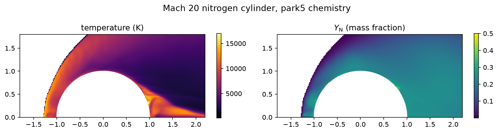
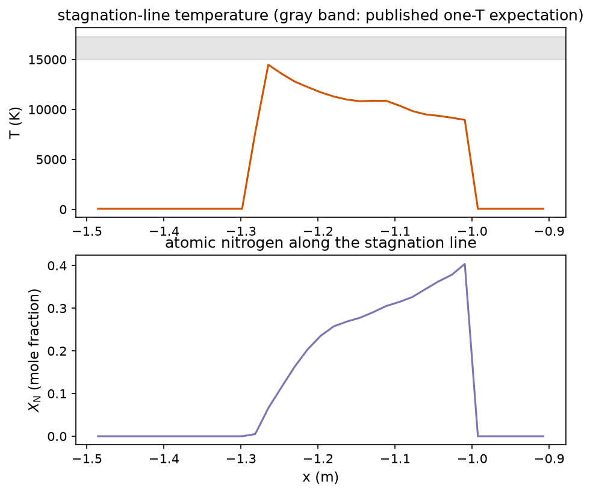

The equilibrium closure assumes the composition relaxes instantly;
the two-temperature model carries the vibrational lag but keeps the
gas chemically frozen. The chemistry itself is what this page adds:
five species, five reactions, finite rates, and a composition field
that the flow advects and the reactions rewrite.

## The model

Species mass fractions $Y_s$ for N2, O2, NO, N, O, one field per
species per cell, advected with the HLLC face mass fluxes

$$\frac{\partial \rho Y_s}{\partial t} + \nabla \cdot (\rho Y_s \mathbf{u}) = \dot{\omega}_s$$

with upwind $Y_s$ at each face (the contact-preserving choice: the
mass flux already knows which side of a contact the face sits on, so
the composition rides it exactly and a uniform field stays uniform to
roundoff).

The reaction set is the Park (1990) five-reaction air model:

| reaction | forward $A$, $\eta$, $T_d$ | collider |
|---|---|---|
| N2 + M -> 2N + M | 7.0e15, -1.6, 113200 K | M = N2, O2, NO |
| N2 + M -> 2N + M | 3.0e16, -1.6, 113200 K | M = N, O |
| O2 + M -> 2O + M | 2.0e15, -1.5, 59400 K | all |
| NO + M -> N + O + M | 5.0e9, -1.0, 75500 K | all |
| N2 + O -> NO + N | 6.4e11, -1.0, 38370 K | Zeldovich |
| NO + O -> O2 + N | 8.4e6, 0, 19450 K | Zeldovich |

The rate constants are SI ($k_f$ in $m^3/mol/s$ shape). Several
published tables print them in CGS with an SI column header; I take
the values from Park's book conventions and cross-check the
equilibrium constants against the dissociation energies, which
catches any unit slip.

Backward rates come from the equilibrium constants,

$$k_b = \frac{k_f(T)}{K_c(T)}$$

with $K_c$ from Park's 1985 five-coefficient curve fits (the
companion fits for these forward rates):

$$\ln K_c = B_1 + B_2 \ln Z + B_3 Z + B_4 Z^2 + B_5 Z^3, \qquad Z = \frac{10000}{T}$$

$K_c$ carries $mol/cm^3$ units for the dissociation reactions
(mole-count change +1) and is dimensionless for the exchange
reactions; the fit values convert to SI once at load. The N2
dissociation reaction splits by collider, and each branch carries its
own backward rate through the same $K_c$, which keeps detailed
balance exact per branch.

## Thermodynamics

Each species is calorically perfect on the frozen-vibration
convention the rest of the solver uses: $c_{v,s} = 5R_s/2$ for the
molecules (translation + rotation), $3R_s/2$ for the atoms. The
second bookkeeping term is one formation enthalpy per
species on the 0 K atom-positive convention of the standard
five-species tables: the atoms carry the dissociation energy (N:
33.6 MJ/kg, O: 15.4), NO carries the Hess-cycle residual, and the
ground-state molecules are zero. The internal energy per mass is

$$e = \sum_s Y_s \left( c_{v,s} T + h^0_s \right)$$

so dissociation draws from the thermal pool (the products carry more
formation energy) and recombination returns it. Total energy is
conserved by construction: the conserved state never changes during
the chemistry substep, only $Y$ does, and the temperature re-solves
from the same $e$ at the new composition.

The mixture closure: $R_{mix} = (\sum Y_s/M_s)^{-1}$, $c_{v,mix} = \sum Y_s c_{v,s}$,
$p = \rho R_{mix} T$, $a = \sqrt{\gamma_{mix} p / \rho}$ with
$\gamma_{mix} = 1 + R_{mix}/c_{v,mix}$. All the closure quantities are
per-cell: the flux functions see the composition through face-pair
closure states, so a contact in composition bends the wave speeds
honestly.

## March structure

One RK2 step per flow update, then the chemistry substep
(operator-split after the corrector). The substep sub-iterates an
explicit local ODE per cell: the chemical timescale sets the
sub-step (a fifth of the fastest species' rate scale, capped at 64
sub-steps), the temperature re-solves from the conserved energy
after each sub-step, and the composition renormalizes to sum one.
Dissociation cooling then feeds back into the next flow step's
sound speed: a hot cell that dissociates slows its own waves.

## Validation

Unit level: the equilibrium constants reproduce the verified
TP-2867 table values, the exchange-reaction cycle
$K(N_2+O) = K(N_2)/K(NO)$ closes to 2% across 4-15 kK, the
closed-form equilibrium composition nulls the source term, and the
Hess cycle on the dissociation energies pins the formation
enthalpies.

The external gate is the Casseau Mach-20 nitrogen cylinder, run
inviscid at 400x200 cells: the reacting run peaks 2.8 kK below the
frozen ceiling (dissociation cooling), the atomic fraction rises
monotonically through the shock layer, and the stagnation-line
temperature and composition land in or above the published bands for
the right physical reason (one-temperature rates dissociate faster
than the published two-temperature runs). Full numbers:
[[research/results|the results page]].





The standoff sits at the non-reacting value rather than the
published reacting one: the published reduction is a shock-layer
thinning the cool recombining wall drives, and an inviscid slip wall
does not carry that. The peak temperature and composition are the
scalars that transfer cleanly at this resolution.

## Using it

Set `physics.eos = "park5"` on an `euler_2d` case, with `gas`
picking the freestream composition:

```toml
[physics]
equations = "euler_2d"
gamma = 1.4
gas_constant = 296.8
eos = "park5"
gas = "n2"
```

`gas = "air"` seeds standard air (0.767 N2 / 0.233 O2 by mass);
`gas = "n2"` seeds pure nitrogen for the dissociation gates. The
snapshot writer adds the five mass-fraction fields (`y_N2` through
`y_O`) and computes pressure, temperature, and mach through the
species closure.

The lane is inviscid cartesian: the viscous,
curvilinear, cut-cell, and unstructured marches reject `park5`
loudly (an invalid-arguments error at startup) rather than
silently running frozen. Wiring the species fields through those
lanes is future work.
