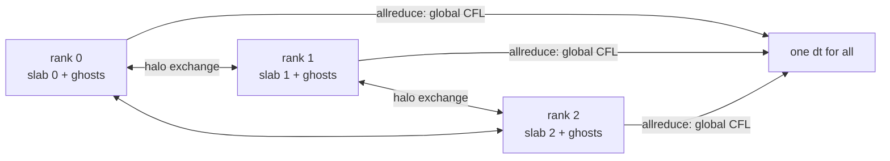
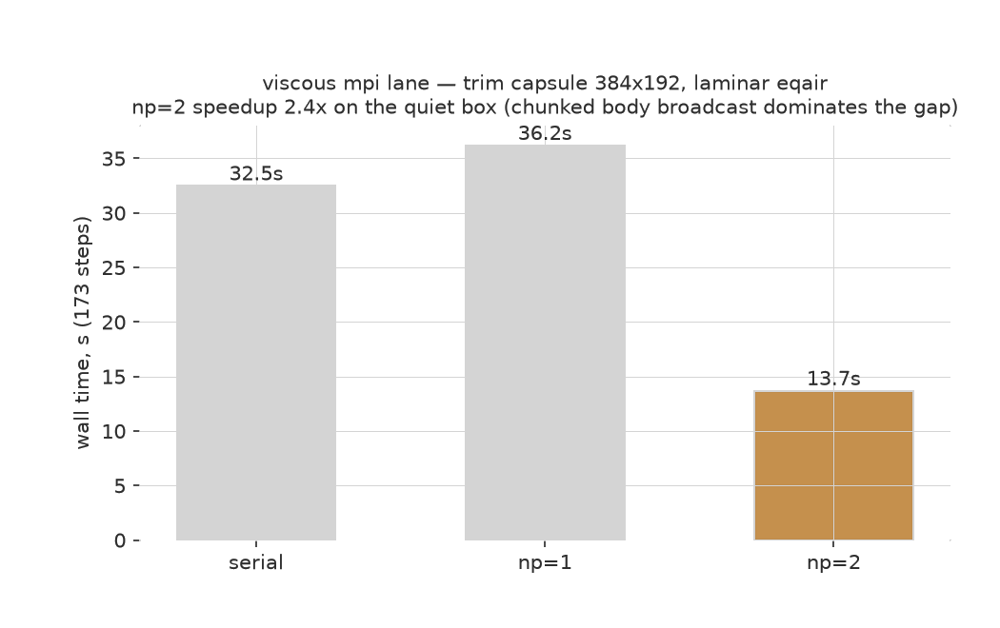

The 2D equilibrium-air march runs MPI-parallel: `mpirun -np N nufor run
case.toml` splits the grid into column slabs, one per rank, and the Fortran
core owns the decomposition, the halo exchange, and the march. I keep the
parallelism entirely in Fortran on purpose: Rust stays the
front door, every rank runs the same `nufor` binary, and none of them call
MPI from Rust. Rank 0 loads the case, drives the run, and writes the output; all
ranks call the Fortran kernels.

## How the parallel step works



The grid is carved into column slabs along x, two ghost columns each side.
Each rank runs the full RK2 step on its slab: MUSCL strip reconstruction,
HLLC face fluxes, the equilibrium-air closure, the boundary conditions at the
domain edges. Rank boundaries become halo faces instead, fed by non-blocking
send/receive of the two ghost columns. The time step is a global CFL reduce,
so every rank advances the same dt.

Bodies ride along in single-step chunks: the march runs one step, rank 0
gathers the full state, applies the solid-cell projection, and broadcasts the
state back out so every rank re-carves identical slabs. Wall-face fluxes are
zeroed inside the Fortran step, with the same cells the serial closure kills.

## The viscous lane

Laminar equilibrium-air cases (`physics.mu` set, no turbulence model) route
through a Fortran twin of the serial viscous march: `nfor_mpi_step_visc` runs
the full two-stage Heun step inside one call - Euler advance, halo refresh,
viscous divergence add, second stage, Heun average. Sutherland viscosity and
conductivity come from the CEA closure temperature on the slab, so the
transport physics is identical to the serial path. The viscous stencil needs
one cell, well inside the two-cell halos; a second halo refresh after each
viscous add keeps the next stage's neighbors current at slab seams.



On the body-free class the Euler and viscous lanes both sit at roundoff
against the serial Rust marches at np=1 and np=2 (the gates below): the two
Euler gates are exact-zero, and the viscous gate's worst relative difference
is 4.1e-15. Each bridge runs the full two-stage Heun in one call. Masked body cases keep a single-stage
Euler pack: a naive second stage diverges at wall-band cells because the
stage-2 reconstruction next to reference-state solid cells amplifies through
the y sweep, and porting the staging needs its own body-case gate before it
lands. The capsule gate pins the single-stage kernel exactly in the
meantime.

## The RANS lane

Spalart-Allmaras cases (`physics.mu` plus a `[physics.turbulence]` block)
route through `nfor_mpi_step_sa`. Each call runs one full two-stage Heun
step: Euler, eddy viscosity from the current nu_tilde and the post-stage
density, viscous add with the total (molecular + eddy) viscosity, SA
transport on the post-viscous state, then the second stage and the Heun
average. The laminar viscosity takes the CEA closure temperature through
the pressure-route bisection, the same path the serial driver uses. The
nu_tilde halo exchanges two layers after each transport call, and the
domain-edge ghost columns reseed from the edge cell on passive boundaries
(transmissive and outflow) so the viscous and transport stencils see the
evolved edge rather than a stale entry copy. Wall-cell gradient overrides
apply across the full slab width including the ghost columns, because at
np>1 the seam face has to average two overridden wall-cell gradients just
like the serial lane does.

Three defects mattered here and all three were parity bugs, not physics
choices: the laminar lane was folding the molecular viscosity in twice
(once as the cell viscosity and once as the eddy array), the stage-2 eddy
viscosity read the pre-stage density, and the ghost columns went stale
after each Euler stage because the serial lane re-derives its pads from
the current state on every kernel call while the Fortran slab ghosts
carried the scatter-time values. After fixing those, all five fields
(density, both momenta, energy, nu_tilde) sit at roundoff against
the serial driver at np=1, 2, and 3: the worst relative difference is
8.2e-14, on the transverse momentum of a cell whose value is near zero.

## The parity gates

Five tests in `crates/nufor-core/tests/mpi_parity.rs` lock the Fortran march
to the serial Rust march:

- sod 2D shock tube, exact-zero parity
- a uniform equilibrium-air field, exact-zero parity
- a laminar viscous uniform field (Sutherland transport, CEA closure
  temperature), worst relative difference 4.1e-15 at np=1, 2, and 3
- an SA capsule-regime field with a wall-adjacent perturbation (shear,
  vorticity, and transport all live), the five fields agree to roundoff
  at np=1, 2, and 3: the worst relative difference is 8.2e-14 on the
  transverse momentum of a cell whose value is near zero, and the worst
  absolute difference is 7.3e-11 on the energy
- a capsule body at 22.5 degrees angle of attack, worst relative difference
  3.8e-15 (roundoff; the wall faces churn every step)

Each runs at np=1 and np=2 in CI. np=1 is the anchor: it runs the same MPI
code path with a single rank and must reproduce the serial result exactly, so
any divergence between the two implementations surfaces before multi-rank
effects can muddy the cause. Setting `NF_GATE_NOPERT=1` on the SA gate runs
it against the unperturbed uniform seed, which is the degenerate regime the
CLI e2e comparison rides on.

The body gate earned its place the hard way. The first gates were body-free,
and the march corrupted on any real body case at 2+ ranks: the y sweep built
face states one cell off from the update indexing, the y boundary fill
clobbered the first and last interior cell of every column, and the shipped
tgas1 table evaluated with row-major coefficients read into a column-major
array. A capsule field with full 2D momenta catches all three.

## Measured scaling

On my 8-core desktop (release build), the 34.6 km station case at 320x176,
30 steps:


| ranks | wall | speedup |
|------:|------|--------:|
| serial | 1.5 s | 1.00 |
| np=1 | 1.5 s | 1.00 |
| np=2 | 0.8 s | 1.88 |
| np=4 | 0.8 s | 1.88 |

np=4 does not beat np=2 here. The grid is 320 columns; at four ranks each
slab is 80 columns wide, and the halo exchange plus the gather-per-step body
broadcast eat the gains at that width. The message is that this march wants
wider slabs or a bigger grid before more ranks pay off, which matches the
memory-bandwidth-bound picture from [[numerics/parallel/threading|shared-memory threading]].

np=1 matches serial wall time bit-for-bit in output, so choosing the MPI path
costs nothing when the march might later scale.

## Using it

```bash
mpirun -np 4 nufor run case.toml
```

The solver routes equilibrium-air 2D Euler (body-free and masked-body both),
laminar viscous, and SA RANS marches (body-free) through the MPI core when
launched under `mpirun` (or with `NFOR_MPI=1` set); np=1 runs the same path.
Masked-body Euler cases march in single-step chunks so rank 0 can re-project
the wall band between steps (the body gate above); viscous masked-body cases
stay on the serial Rust march because the Fortran viscous kernel wall-treats
domain faces only, so a body under mpirun would silently skip the no-slip
band. Restart support for the scattered state is the next step.
