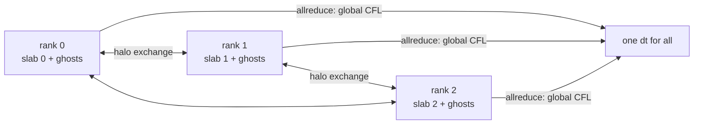
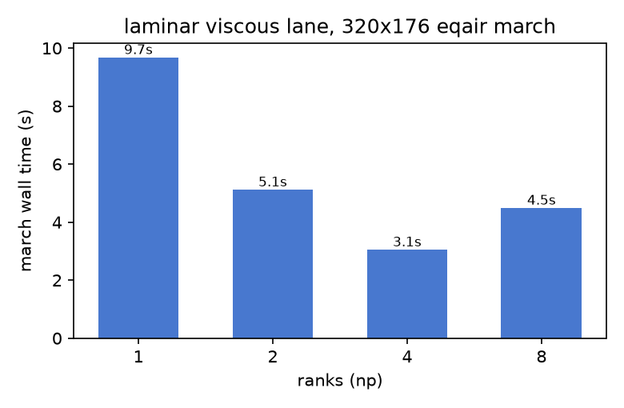
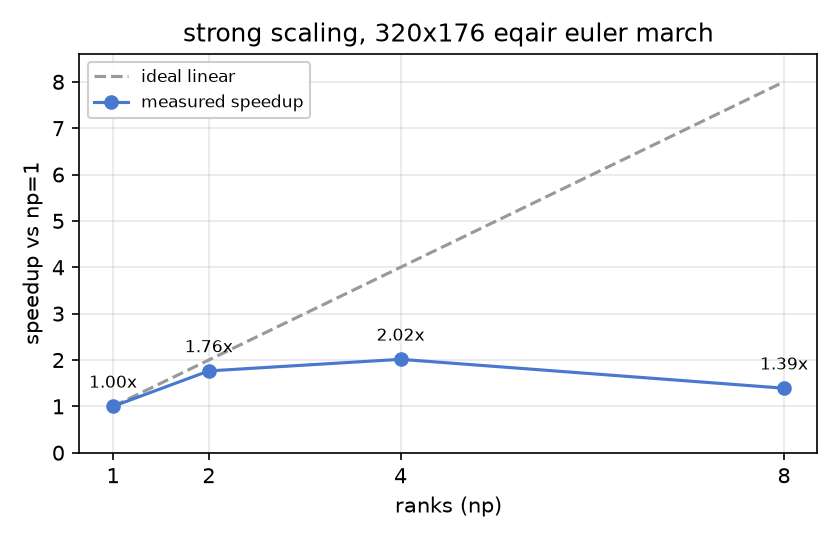

The 2D equilibrium-air march runs MPI-parallel: `mpirun -np N nufor run
case.toml` splits the grid into column slabs, one per rank, and the Fortran
core owns the decomposition, the halo exchange, and the march. I keep the
parallelism entirely in Fortran on purpose: Rust stays the
front door, every rank runs the same `nufor` binary, and none of them call
MPI from Rust. Rank 0 loads the case, drives the run, and writes the output; all
ranks call the Fortran kernels.

## How the parallel step works



The grid is carved into column slabs along x, two ghost columns each side.
Each rank runs the full RK2 step on its slab: MUSCL strip reconstruction,
HLLC face fluxes, the equilibrium-air closure, the boundary conditions at the
domain edges. Rank boundaries become halo faces instead, fed by non-blocking
send/receive of the two ghost columns. The time step is a global CFL reduce,
so every rank advances the same dt.

Bodies ride along in single-step chunks: the march runs one step, rank 0
gathers the full state, applies the solid-cell projection, and broadcasts the
state back out so every rank re-carves identical slabs. Wall-face fluxes are
zeroed inside the Fortran step, with the same cells the serial closure kills.

## The viscous lane

Laminar equilibrium-air cases (`physics.mu` set, no turbulence model) route
through a Fortran twin of the serial viscous march: `nfor_mpi_step_visc` runs
the full two-stage Heun step inside one call - Euler advance, halo refresh,
viscous divergence add, second stage, Heun average. Sutherland viscosity and
conductivity come from the CEA closure temperature on the slab, so the
transport physics is identical to the serial path. The viscous stencil needs
one cell, well inside the two-cell halos; a second halo refresh after each
viscous add keeps the next stage's neighbors current at slab seams.



The viscous lane scales better than the inviscid one because the two-stage
Heun step doubles the arithmetic per cell. On the same machine and the same
station-shaped case at 320x176, 119 steps at every rank count:

| ranks | march wall | speedup |
|------:|-----------:|--------:|
| np=1 | 9.7 s | 1.00 |
| np=2 | 5.1 s | 1.89 |
| np=4 | 3.1 s | 3.17 |
| np=8 | 4.5 s | 2.15 |

Four ranks reach 3.17x on four physical cores, and the eighth rank lands
back on hyperthread siblings that share the same cores. Both tables come
from `tools/bench_mpi.py`, the viscous one with `--viscous`.

On the body-free class the Euler and viscous lanes both sit at roundoff
against the serial Rust marches at np=1 and np=2 (the gates below): the two
Euler gates are exact-zero, and the viscous gate's worst relative difference
is 5.2e-15. Each bridge runs the full two-stage Heun in one call. Masked body cases keep a single-stage
Euler pack: a naive second stage diverges at wall-band cells because the
stage-2 reconstruction next to reference-state solid cells amplifies through
the y sweep, and porting the staging needs its own body-case gate before it
lands. The capsule gate pins the single-stage kernel exactly in the
meantime.

## The RANS lane

Spalart-Allmaras cases (`physics.mu` plus a `[physics.turbulence]` block)
route through `nfor_mpi_step_sa`. Each call runs one full two-stage Heun
step: Euler, eddy viscosity from the current nu_tilde and the post-stage
density, viscous add with the total (molecular + eddy) viscosity, SA
transport on the post-viscous state, then the second stage and the Heun
average. The laminar viscosity takes the CEA closure temperature through
the pressure-route bisection, the same path the serial driver uses. The
nu_tilde halo exchanges two layers after each transport call, and the
domain-edge ghost columns reseed from the edge cell on passive boundaries
(transmissive and outflow) so the viscous and transport stencils see the
evolved edge rather than a stale entry copy. Wall-cell gradient overrides
apply across the full slab width including the ghost columns, because at
np>1 the seam face has to average two overridden wall-cell gradients just
like the serial lane does.

Three defects mattered here and all three were parity bugs, not physics
choices: the laminar lane was folding the molecular viscosity in twice
(once as the cell viscosity and once as the eddy array), the stage-2 eddy
viscosity read the pre-stage density, and the ghost columns went stale
after each Euler stage because the serial lane re-derives its pads from
the current state on every kernel call while the Fortran slab ghosts
carried the scatter-time values. After fixing those, all five fields
(density, both momenta, energy, nu_tilde) sit at roundoff against
the serial driver at np=1, 2, and 3: the worst relative difference is
8.5e-14, on the transverse momentum of a cell whose value is near zero.

## The parity gates

Five tests in `crates/nufor-core/tests/mpi_parity.rs` lock the Fortran march
to the serial Rust march:

- sod 2D shock tube, exact-zero parity
- a uniform equilibrium-air field, exact-zero parity
- a laminar viscous uniform field (Sutherland transport, CEA closure
  temperature), worst relative difference 5.2e-15 at np=1, 2, and 3
- an SA capsule-regime field with a wall-adjacent perturbation (shear,
  vorticity, and transport all live), the five fields agree to roundoff
  at np=1, 2, and 3: the worst relative difference is 8.5e-14 on the
  transverse momentum of a cell whose value is near zero
- a capsule body at 22.5 degrees angle of attack, worst relative difference
  2.5e-15 (roundoff; the wall faces churn every step)
- a two-temperature field, exact-zero parity

The two-temperature lane is the strictest of the set. It marches the
equilibrium-air field through the Fortran core, then evolves the
vibrational-energy plane `e_v` with its own substep, and compares that
plane against the serial Rust substep bit for bit. Bitwise equality is the
bar because both sides run the same scalar expressions on the same values;
anything less than bitwise would hide a rearrangement in the donor
stencil. The seed carries five gaussian bumps positioned so that they
straddle every rank seam in the np=1 through np=5 decompositions, so the
halo exchange has to be right for the comparison to hold. The march itself
has to leave the four conserved planes untouched, which the lane asserts
separately, and the plane has to actually move during the substep, which
rules out a parity check passing on an inert field.

Getting to bitwise parity took two fixes worth recording. The Fortran
kernel and the Rust twin disagreed in the last bits on 78 of 4096 cells
because the Fortran build fused multiply-add contractions the Rust build
did not, so `-ffp-contract=off` is pinned in both the debug and the release
flags. That cut the mismatches to 21 cells, and the rest came from the
seed sitting in a regime where the equilibrium-air closure fit is sensitive
enough for the two implementations to round apart; a calmer seed makes the
closure agree exactly while leaving the plane transport fully exercised.

The parity matrix runs at np=1 through np=5, five counts, and the fifth
is chosen because at that count the outermost rank owns no body cell. The
collected gate artefact lives in `cases/mpi-parity/gates.json`, and
`cases/mpi-parity/verify_committed_gate.py` re-judges it without spending
nine minutes of MPI time; pass `--rerun` to regenerate it from the built
binaries and compare every number.

Each lane runs at np=1 and np=2 in CI, with the two-temperature lane and
the body lane entered twice, because the launcher can lose the race
between the MPI teardown and the test harness exit while the test itself
still passed. np=1 is the anchor: it runs the same MPI
code path with a single rank and must reproduce the serial result exactly, so
any divergence between the two implementations surfaces before multi-rank
effects can muddy the cause. Setting `NF_GATE_NOPERT=1` on the SA gate runs
it against the unperturbed uniform seed, which is the degenerate regime the
CLI e2e comparison rides on.

The body gate earned its place the hard way. The first gates were body-free,
and the march corrupted on any real body case at 2+ ranks: the y sweep built
face states one cell off from the update indexing, the y boundary fill
clobbered the first and last interior cell of every column, and the shipped
tgas1 table evaluated with row-major coefficients read into a column-major
array. A capsule field with full 2D momenta catches all three.

## Measured scaling

The numbers below are measured on the development machine, an eight-thread
Intel i7-7700T (four physical cores), on the station-shaped eqair case at
320x176. `tools/bench_mpi.py` runs the sweep and writes the json this
section and the chart are built from, so neither can drift away from a
measurement:

```bash
python3 tools/bench_mpi.py --repeats 3 --ranks 1 2 4 8 --json mpi-scale.json
/usr/bin/python3 tools/plot_mpi_scaling.py mpi-scale.json --out docs/numerics/parallel
```

Every rank count marches the same 473 steps, including np=1, which runs
under `mpirun` so all rows take the same Fortran path rather than mixing
the serial Rust march into the baseline. The timing is the march's own
reported wall time, so the live viewer booting and the vtk and html
reports writing do not dilute it.

| ranks | march wall | speedup |
|------:|-----------:|--------:|
| np=1 | 27.6 s | 1.00 |
| np=2 | 15.6 s | 1.76 |
| np=4 | 13.7 s | 2.02 |
| np=8 | 19.8 s | 1.39 |



Four ranks buy half of the ideal speedup and eight lose ground again.
The grid is 320 columns, so at eight ranks each slab is forty columns
wide and the halo exchange costs more than the marching it accelerates.
The same memory bandwidth bound shows up in the
[[numerics/parallel/threading|shared-memory threading]] measurements, and
the cure is the same there: wider slabs or a bigger grid before more
ranks pay off.

The serial Rust march on the same case took 30.7 s for the same 473
steps, so taking the MPI path at np=1 costs nothing and leaves the door
open for ranks later.

## Using it

```bash
mpirun -np 4 nufor run case.toml
```

The solver routes equilibrium-air 2D Euler (body-free and masked-body both),
laminar viscous, and SA RANS marches (body-free) through the MPI core when
launched under `mpirun` (or with `NFOR_MPI=1` set); np=1 runs the same path.
Masked-body Euler cases march in single-step chunks so rank 0 can re-project
the wall band between steps (the body gate above); viscous masked-body cases
stay on the serial Rust march because the Fortran viscous kernel wall-treats
domain faces only, so a body under mpirun would silently skip the no-slip
band.

## Distributed restart

An MPI run can stop at a chunk boundary, write a restart file, and resume from
it under the same rank count. The saved file holds the conserved planes and,
for SA RANS, the turbulence plane, so the resumed march picks up the same eddy
field the interrupted one was carrying instead of re-seeding it.

Both halves of the state have to reach every rank. The conserved planes are
broadcast after each chunk, and the turbulence plane is broadcast with them:
without that, the non-root ranks march on a stale field seeded from its
initial value, the state can still come out looking plausible, and the field
recorded at the rank seam describes a march that never ran.

The distributed restart gate runs the march in chunks, interrupts it at the
split point, resumes from the file, and compares against the uninterrupted
run. It holds every plane to exact equality at np=1, np=2, and np=3.

The two-temperature plane rides the same machinery. The restart writer
already knew how to carry an extra plane alongside the conserved state, so
`e_v` travels as that plane and comes back identical: the resumed run
reproduces the uninterrupted one on all four conserved planes and on the
vibrational plane, bit for bit, at np=1 through np=4. The generic nature
of the extra-plane path is why this costs no format change; a future
species-transport plane would travel the same way.
