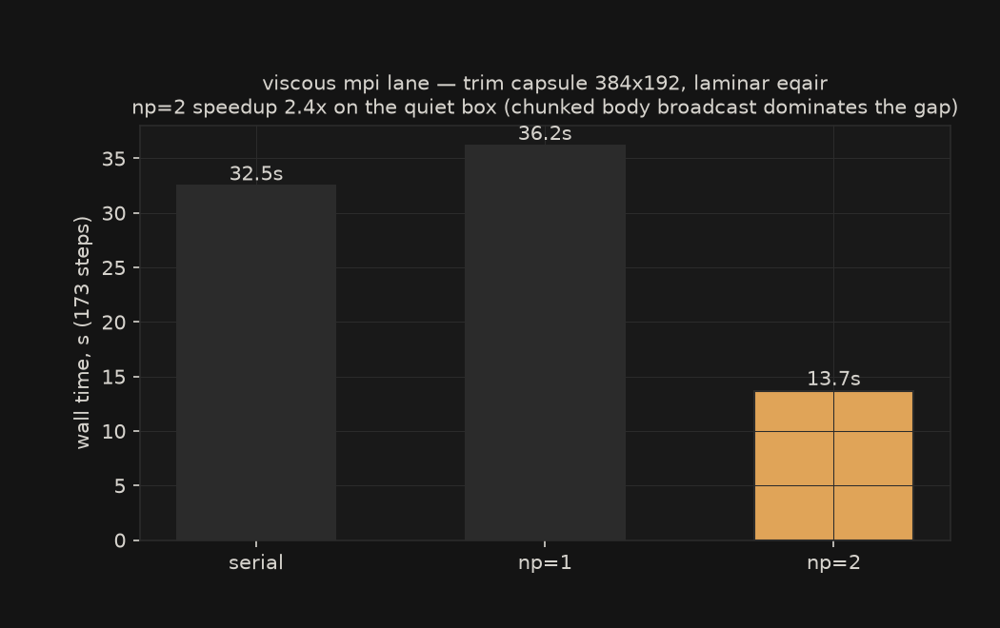

The 2D equilibrium-air march runs MPI-parallel: `mpirun -np N nufor run
case.toml` splits the grid into column slabs, one per rank, and the Fortran
core owns the decomposition, the halo exchange, and the march. Rust stays the
front door: every rank runs the same `nufor` binary and none of them call MPI
from Rust. Rank 0 loads the case, drives the run, and writes the output; all
ranks call the Fortran kernels.

## How the parallel step works

The grid is carved into column slabs along x, two ghost columns each side.
Each rank runs the full RK2 step on its slab: MUSCL strip reconstruction,
HLLC face fluxes, the equilibrium-air closure, the boundary conditions at the
domain edges. Rank boundaries become halo faces instead, fed by non-blocking
send/receive of the two ghost columns. The time step is a global CFL reduce,
so every rank advances the same dt.

Bodies ride along in single-step chunks: the march runs one step, rank 0
gathers the full state, applies the solid-cell projection, and broadcasts the
state back out so every rank re-carves identical slabs. Wall-face fluxes are
zeroed inside the Fortran step, with the same cells the serial closure kills.

## The viscous lane

Laminar equilibrium-air cases (`physics.mu` set, no turbulence model) route
through a Fortran twin of the serial viscous march: `nfor_mpi_step_visc` runs
the full two-stage Heun step inside one call — Euler advance, halo refresh,
viscous divergence add, second stage, Heun average. Sutherland viscosity and
conductivity come from the CEA closure temperature on the slab, so the
transport physics is identical to the serial path. The viscous stencil needs
one cell, well inside the two-cell halos; a second halo refresh after each
viscous add keeps the next stage's neighbors current at slab seams.



On the body-free class the viscous lane is bit-exact against the serial Rust
march at np=1 and np=2 (the gate below). On strong-shock body cases a separate
mechanism dominates: the serial lane integrates with Heun (two stages plus an
average) while the MPI Euler lane takes one forward-Euler step per call. The
one-step gap between the two integrators is first-order in dt and reads about
19 percent on the trim capsule shock layer, independent of rank count. The
gates compare against the single-step twin deliberately, so they pin the shared
flux kernel exactly (sod, uniform, capsule all machine-exact); the integrator
gap is a known limitation of the MPI Euler lane, not a kernel bug. Closing it
needs a second Euler stage inside the bridge call, and a naive second stage
diverges at wall-band cells because the stage-2 reconstruction next to
reference-state solid cells amplifies through the y sweep; that port needs
its own body-case gate before it lands. The viscous lane does not share the
problem: its bridge runs the full two-stage Heun in one call and tracks the
serial twin to machine zero on the body-free class.

## The parity gates

Four tests in `crates/nufor-core/tests/mpi_parity.rs` lock the Fortran march
to the serial Rust march:

- sod 2D shock tube, exact-zero parity
- a uniform equilibrium-air field, exact-zero parity
- a laminar viscous uniform field (Sutherland transport, CEA closure
  temperature), exact-zero parity at np=1 and np=2
- a capsule body at 22.5 degrees angle of attack, worst relative difference
  4e-15 (machine roundoff; the wall faces churn every step)

Each runs at np=1 and np=2 in CI. np=1 is the anchor: it runs the same MPI
code path with a single rank and must reproduce the serial result exactly, so
any divergence between the two implementations surfaces before multi-rank
effects can muddy the cause.

The body gate earned its place the hard way. The first gates were body-free,
and the march corrupted on any real body case at 2+ ranks: the y sweep built
face states one cell off from the update indexing, the y boundary fill
clobbered the first and last interior cell of every column, and the shipped
tgas1 table evaluated with row-major coefficients read into a column-major
array. A capsule field with full 2D momenta catches all three.

## Measured scaling

On the development box (8 cores, pinned at a 35 W package limit, release
build), the 34.6 km station case at 320x176, 30 steps:

    ranks      wall      speedup
    serial     1.5 s     1.00
    np=1       1.5 s     1.00
    np=2       0.8 s     1.88
    np=4       0.8 s     1.88

np=4 does not beat np=2 here. The grid is 320 columns; at four ranks each
slab is 80 columns wide, and the halo exchange plus the gather-per-step body
broadcast eat the gains at that width. The message is that this march wants
wider slabs or a bigger grid before more ranks pay off, which matches the
memory-bandwidth-bound picture from [shared-memory threading](threading.md).

np=1 matches serial wall time bit-for-bit in output, so choosing the MPI path
costs nothing when the march might later scale.

## Using it

```bash
mpirun -np 4 nufor run case.toml
```

The solver routes equilibrium-air inviscid 2D Euler marches through the MPI
core when launched under `mpirun` (or with `NFOR_MPI=1` set); np=1 runs the
same path. All other case types still run the serial march. Restart support
for the scattered state and the viscous/SA kernels are the next rungs.
