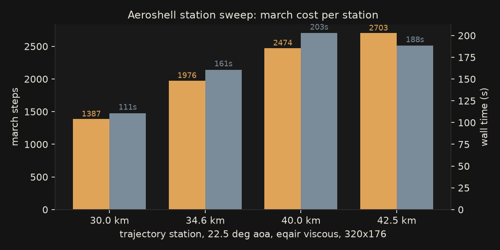
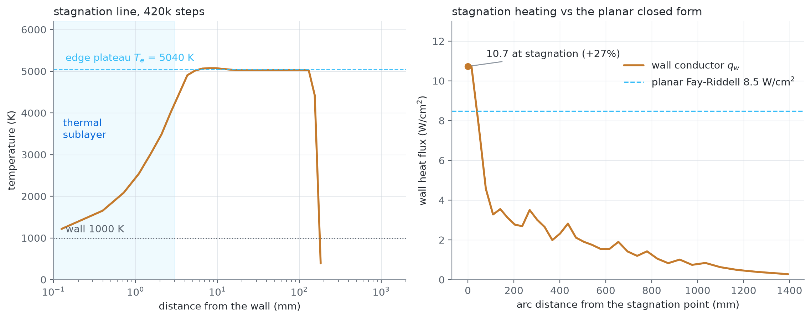
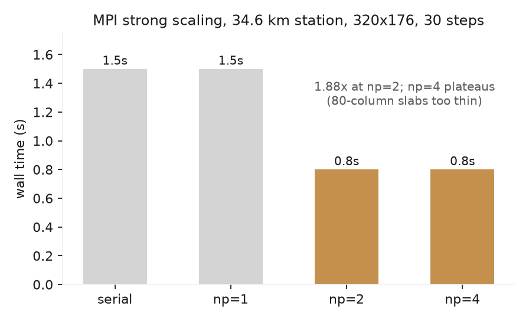

The numbers behind the solver features, measured on the cases I ship. Every
figure here regenerates from the case run logs in the repo, so the numbers age
with the code instead of drifting from it.

## Aeroshell station sweep

Four trajectory stations at 22.5 degrees angle of attack, equilibrium air,
viscous with a 300 K wall, 320x176 grid, marched to t = 15 ms. This is the
sweep that anchors the hypersonic 2D path; the 34.6 km station is the peak-q
point of my re-entry trajectory.

| station | steps | wall (s) | max density ratio | peak p (Pa) | max T (K) |
|---------|-------|----------|-------------------|-------------|-----------|
| 30.0 km | 1387  | 110.8    | 27.5              | 6.54e5      | 5149      |
| 34.6 km | 1976  | 160.7    | 35.7              | 9.63e5      | 7776      |
| 40.0 km | 2474  | 202.8    | 54.1              | 9.89e5      | 10271     |
| 42.5 km | 2632  | 219.4    | 67.0              | 1.09e6      | 14031     |

The march length now tracks the shock layer rather than a table ceiling.
Under the old table the two highest stations clamped at its 1 MPa top;
with the rebuilt grid (101 pressures to 10.1 MPa, 30 temperatures to
30000 K, sensible internal energy) the same stations read peak pressures
up to 1.09 MPa and the shock-layer temperatures rise accordingly. The
42.5 km station pays the most: its thin, hot shock layer needs the
smallest time steps, and its density ratio of 67 is the sternest test of
the march's positivity.

Lift-to-drag across the sweep runs 0.55, 0.61, 0.65, 0.72 from sea level
to 42.5 km: the cleaner freestream at altitude rewards the same 22.5
degree shell with a better ratio.

## Stagnation heating gate (rung 6)

The Fay-Riddell case (`cases/cylinder-stagnation-fay`): the Casseau
Mach-20 nitrogen freestream on a 1 m cylinder nose, 1000 K isothermal
wall, nose-only domain at global dt, 420k steps.

| quantity | value |
|---|---|
| edge plateau $\rho_e$, $T_e$, $p_e$ | 2.25e-4 kg/m3, 5040 K, 503 Pa |
| planar closed form on the sim's edge state | 8.48 W/cm2 |
| wall conductor at the stagnation face | 10.73 W/cm2 |
| ratio, conductor / closed form | 1.27 |

Details and the honest caveats: [[numerics/foundations/fay-riddell|Fay-Riddell stagnation heating]].

## The trim anchor

The finest shipped case is the trimmed capsule: 384x192, viscous, a 1600 K
radiation-equilibrium wall, 1772 steps to t = 2 ms in 239.1 s. Peak surface
pressure 2.07 MPa at (x=1.622, y=1.219), maximum field temperature 29379 K,
peak wall heat flux 12.2 MW/m2, C_D 0.501 with L/D 0.335. The peak pressure
sits far above the old table's ceiling, which used to clamp it at 1 MPa.
This is the case the wake visualizations come from, including the header
render on the repository front page.

## MPI scaling

The multi-rank Fortran march measured on the 34.6 km station case, 320x176,
30 steps, on the 8-core development box at its 35 W package limit:

| ranks  | wall (s) | speedup |
|--------|----------|---------|
| serial | 1.5      | 1.00    |
| np=1   | 1.5      | 1.00    |
| np=2   | 0.8      | 1.88    |
| np=4   | 0.8      | 1.88    |

np=4 does not beat np=2 on this grid. At four ranks each column slab is 80
cells wide and the halo exchange plus the per-step body gather/broadcast cost
more than the thinner slabs save. The scaling page discusses the mechanism;
the honest summary is that the march scales to two ranks on entry-capsule
grids and needs wider slabs (a bigger grid, or a 3D decomposition) before
more ranks pay.

The parity discipline behind these numbers: every rank-count configuration is
gated against the serial Rust march, exact zero for the body-free cases and
4e-15 worst relative difference for the capsule body case.

## Shared-memory threading (prior result)

The thread-sharded 2D step, measured in the 1.5.0 era on a 384x384 mesh,
40 steps: 1.86x at four physical cores, 2.04x at six threads, backsliding to
1.75x at eight (hyperthread oversubscription). The step is memory-bound, so
the plateau tracks memory bandwidth rather than core count. Full table on the
[threading page](numerics/parallel/threading.md).
