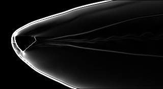
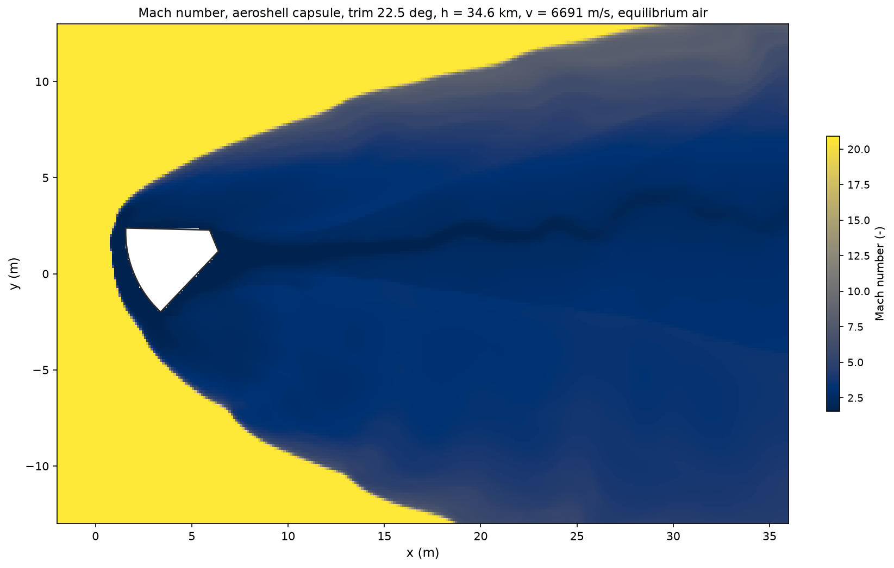
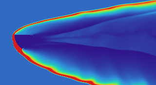
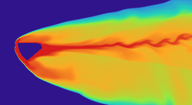
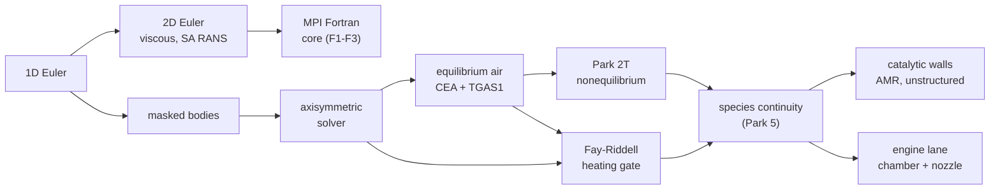

nuFor's trajectory is a ladder: each step is a validated solver
capability with its analytic gates, in an order where every milestone
makes the next one possible. I don't commit to dates; milestones land
when their gates pass.

The focus is 2D: planar and axisymmetric. The 3D Euler and viscous
solvers exist and stay validated in the tree, but the roadmap below
plans no further 3D work; everything ahead is 2D (or axisymmetric,
which carries 3D axisymmetric reality at 2D cost).

## Where we are

- 2D Euler, viscous, and RANS (Spalart-Allmaras): validated, committed.
  The capability set today: 1D Euler; 2D planar Euler/viscous/SA with
  HLLC + MUSCL reconstruction + two-stage Heun, local time stepping,
  and threading; axisymmetric Euler (annular update) with O-grid and
  curvilinear marches; equilibrium air (CEA table + TGAS1 face
  fits); live Park two-temperature (Landau-Teller vibrational
  relaxation); masked bodies (analytic, polygon, signed-distance,
  sphere-cone); staircase and cut-cell walls (supersonic wall pump
  fixed with the exact slip branch); three-level block AMR with
  hysteretic regridding consumed by the march loop; unstructured 2D
  triangles with first- and second-order flux, viscous duals, and
  per-cell CFL, validated on Sod and a quarter annulus; MPI-parallel
  Fortran core at bit parity with the serial
  march for the Euler, viscous, and SA lanes (np = 1, 2, 3); a
  validated stagnation-heating chain (bow shock, Fay-Riddell closed
  form, wall conductor, CEA real-gas transport agreement to a few
  percent); Kn/Bird continuum probes in the flowfield post-mortem;
  the CDV nozzle cold-flow case (reservoir inflow, subsonic
  back-pressure outflow, restart chaining on the axisymmetric
  runner, three pressure-ratio regimes against the 1D solution);
  restart chaining, VTK/CSV output, and the live case console; the
  axisymmetric engine lane with its nine-species H2/O2 closure over CEA
  anchors, an injector, a choked throat and a bell.
- Case console: live runs, field figures (schlieren included), forces,
  the standalone report.
- 3D inviscid Euler: validated, committed.
- 3D viscous Navier-Stokes: validated, committed.
- Masked bodies: done, validated on the cylinder bow shock and
  the sphere-cone trade-study geometry.
- Axisymmetric solver: done, validated on the sphere bow shock
  against the Ambrosio-Wortman standoff. The capsule ran at the
  peak-q point, Mach 22 perfect gas: bow shock, post-shock states, and
  the surface Cp cross-check against the modified-Newtonian numbers.
- Equilibrium air (CEA closure): done. The planar and axisymmetric 2D
  paths run the CEA table under `eos = "eqair"`; the legacy TGAS1 fits
  remain as the face-state extrapolation the wake needs. A four-station
  trajectory sweep (30/34.6/40/42.5 km, alpha 22.5) is validated at
  320x176 and anchored at 1280x640.

  
  
  
  
- Performance: the static body classification is cached and the closure
  passes are threaded; the hi-res anchor runs 8x faster than the serial
  march (3.96 h for 11,549 steps at 1280x640 on my desktop).
- Fay-Riddell stagnation heating gate: done. The
  wall-resolved cylinder gate ran a full 660k-step continuous chain:
  the conductor holds a quasi-steady band of 7.4 to 14.0 W/cm2
  (settled mean 10.9) against the planar closed form 8.5 on the
  march's own edge state, so the citable number is a mean with a
  spread. The band is stagnation-region momentum residue sloshing
  the wall gradient, not a convergence trend; closing the last gap
  needs the cp and Lewis-number corrections on the march's own wall
  state. Wall heat flux is citable output now.
- Body-fitted O-grid: the sphere-cone capsule runs on a curvilinear
  O-grid with the nose seam treated
  as a symmetry plane. Four geometry/flux defects that poisoned the
  pole region are fixed and pinned by contract tests: the face-normal
  convention, the closed-polygon identity behind the axisymmetric
  source, the seam Riemann pair, and a double face-length weighting
  in the update. The full capsule march is steady at the stagnation
  corner with zero floor hits end to end.
- Unstructured 2D: validated and gated (`ugrid.rs`, `advance_ugrid`): a
  Sod tube on an 800-cell triangulation lands the star plateau at 0.413
  against the analytic 0.426 with positivity and end states exact,
  second order lifts it to 0.414, viscous duals are pairwise
  conservative, and a quarter-annulus run validates curved geometry.

## The ladder, in order

1. **3D viscous**: done.
2. **Masked bodies**: done. The solid-cell mask answers any shape that
   provides inside plus normal: the analytic circle, polygons, and
   analytic signed-distance bodies. Staircase walls are first-order at
   the surface but give real bow shocks, standoff, and pressure
   distributions.
3. **Axisymmetric solver**: done. The annular update carries the face
   radii and the p/r geometric source, with the slip-wall ghost as the
   axis condition.
4. **Equilibrium air**: done (moved up from "out of scope": the
   aeroshell project needed it, and the CEA table plus the TGAS1 face
   fits are the validated form).
5. **Live two-temperature nonequilibrium (Park 2T)**: done. `e_v` is a
   live field (unpinned t_v) with Millikan-White + Park-cutoff
   relaxation and the t_rxn = sqrt(T Tv) mixing rule; the 5-species
   rates (Park 1990) now march under the five-species chemistry. Gates: the
   analytic Landau-Teller decay box, energy conservation to machine
   precision, then the Mach 20 nitrogen cylinder (Casseau et al. 2016)
   as the external anchor. License note: hyStrath is GPL-3.0, same as
   nuFor; the borrow is the validation target and the physics
   constants, not code.
6. **Fay-Riddell stagnation heating gate**: done. A
   wall-resolved viscous cylinder at entry conditions, validated
   against the planar Fay-Riddell closed form (0.57 Pr^-0.6 vs the
   sphere's 0.763). The gate case runs a nose-only domain at global
   dt: local time stepping detonates on this class at long times
   (documented on the viscous page), and the nose-only cut holds the
   march cost to a few hours per run. The wall closures it exercised:
   the reflected-riemann slip wall in the advective stage, the
   one-sided conductor in the viscous stage, and closure-lane
   conduction with real units. The planar closed form is in the tree
   (`fay_riddell_q_2d`), pinned to the Beckwith-Cohen similarity
   constant and the Rankine-Hugoniot tables. A tangentially refined
   mesh converges the conductor to 10.7-11.2 W/cm2 with +-0.5 swing
   (the coarse tangential grid breathed 7.4-14.0), and the original
   27% gap against the closed form closes to a few percent once the
   form is evaluated with CEA real-gas transport at the edge state
   (the gas there is over 60% dissociated atoms; mixture viscosity
   is 1.51x Sutherland's pure-N2 value). This is the gate that makes
   any wall heat flux the solver prints citable.
7. **Continuum-validity probe per station**: done. Bird's
   gradient-length local Knudsen number over the flow cells plus the
   global freestream Kn, one block in every 2D and axisymmetric run
   log (`nufor-core::continuum_probe`, the hard-sphere mean free path
   from viscosity, the Boyd/Lofthouse 0.05 breakdown threshold).
   Puts a number behind "continuum CFD applies here" instead of an
   assertion, and states which cells crossed the line.
7a. **Nozzle cold flow**: done. Liou's CDV nozzle (AIAA 87-0355,
   the NPARC/WIND verification archive) as an axisymmetric Euler
   case: cosine area law, polygon-masked contour, and two new
   boundary conditions, the reservoir inflow (stagnation state
   expanding to the local face pressure, the acoustic feedback a
   fixed-state inflow cannot give) and the subsonic back-pressure
   outflow. Three pressure ratios: the subsonic run holds the 1D
   exit pressure to 1.8% and trails the 1D exit Mach by 9.5%,
   the fully supersonic run chokes (M=1
   at the throat) with mass flux conserved to 0.07% and the
   exit Mach averaging 1.742 against the 1D 1.854, and
   the shock run captures the normal shock (station early, the
   staircase's known weakness, cut cells are the planned answer).
   The axisymmetric runner gained restart chaining alongside.
   Results and figures on the nozzle page. The cooled-wall
   variant landed in 9b below: the five-leg bracket marches the
   real nozzle contour under adiabatic, radiating, film-cooled,
   regenerative, and conjugate treatments with per-leg
   qualification, and the thrust-coefficient post-processing
   landed with the 9a chamber work where a thrust statement became
   meaningful.
8. **Species continuity (5-species Park nonequilibrium)**: done.
   Species mass fractions as transported fields with the Park 1990
   dissociation/exchange set from park.rs, backward rates through the
   Park 1985 equilibrium-constant fits, formation energies routed
   through the closure on the atom-positive convention, positivity
   handling, and the operator-split chemistry substep. The inviscid
   cartesian lane carries it; viscous/curvilinear/cut-cell lanes
   reject the model loudly until wired. Gates: the equilibrium
   constants against the verified table, the exchange-reaction cycle,
   the source term nulled at the closed-form equilibrium composition,
   and the Mach 20 nitrogen cylinder (peak T 2.0 kK under the frozen
   ceiling, atomic fraction rising monotonically through the shock
   layer; results on the research page).
9. **Catalytic wall conditions**: closed by an explicit continuum
   validity cutoff (declared acceptable, not a slip branch). Non-catalytic, partially accommodating and fully
   catalytic wall options on the species viscous lane, with Wilke
   mixture transport and effective-binary diffusion through the shock
   layer. The wall condition takes an accommodation coefficient, the
   fraction of arriving atoms the surface recombines, so a measured
   surface efficiency maps onto a wall heat flux instead of a binary
   bracket. The Mach 20 cylinder series spans the ladder and the ends
   reproduce the shipped pair, but the peak stays withheld: the flow
   at the wall is out of the continuum range. Closed by an explicit
   continuum cutoff rather than a slip branch: the series peaks where the
   gradient-length Kn reaches 9.3 on temperature and 1089 on density,
   ten percent of cells above breakdown, so the peak heat flux is reported
   as a sensitivity shape (factor 1.31 across the accommodation ladder,
   3.75 to 4.89 MW/m2), not an absolute continuum number. That cutoff is
   the accepted closure for this rung. The machinery and the
   series are on the catalytic walls page. The Maxwell velocity-slip
   and Smoluchowski temperature-jump wall conditions from the same body of
   work stay research extras: below 43 km the trajectory is continuum
   (Kn << 1), so slip walls are a branch, not a planned step.
9a. **Combustion chemistry (engine chamber flow)**: the first cut is
   built. Nine species for the H2/O2 lane, advected beside the
   conserved state with operator-split finite-rate chemistry over
   NASA-7 thermodynamics, and the face fluxes carry the composition.
   The chamber injects the burned gas as a composition and enthalpy
   inflow, the axisymmetric chamber settles with the throat choked
   and the exit state close to CEA, and three fast gates hold it: the
   flame temperature at 70 bar, the adiabatic round trip at the flame
   point, and the chamber sound speed. A CH4/O2 mechanism now
   sits beside the H2/O2 one: GRI-Mech 3.0's 53 species and 325
   reactions are generated into Rust tables from the mechanism's own
   yaml, carry four-parameter Troe falloff and equilibrium-constant
   reverse rates, and reproduce Cantera's net rates of progress for
   every reaction across five thermodynamic states. The third-body
   convention is Cantera's: the collider bath scales both branches, a
   named collider contributes only itself, and a generic collider takes
   an efficiency per species. The mechanism now burns a parcel from a
   case file: a zero-dimensional methane parcel marched in a rigid
   vessel matches Cantera's own constant-volume reactor to 0.0001 K on
   the settled temperature and 0.01 Pa on the pressure, with the flash
   window's error governed by the time step rather than by the
   chemistry. Spatial selectivity is now taking shape. The generic closure and
   transport interfaces were already in place and reproduce the hydrogen
   lane bit for bit. A scheme-width composition state now carries one
   row per mechanism species and advances through the same conservative
   transport the nine-species lane uses, so a gated 53-species GRI-Mech
   composition crosses a planar flow step with every species present
   and a worst per-cell composition-sum error of 3.775e-15; the
   nine-species scheme passes the same interface unchanged. Coupling
   finite-rate GRI-Mech chemistry to that spatial composition remains,
   as do the chamber's remaining fixed-width call sites, the engine
   contour's own wall treatment, and the march on more than one core.
   That coupling is now in: each cell runs the reactor's own
   backward-euler step as a closed parcel, and a gated field of four
   methane-air parcels matches the zero-dimensional reactor to a worst
   relative error of 7.153e-12. Per-cell reaction-set selection now
   trails it: an activity-ranked mask per cell shrinks the evolved set
   to 7.6 of 53 species on a 900 K to 1600 K field while the major
   species track the dense 53-species march to 7.063e-08 and the
   temperature to 7.260e-05, freezing being on the state vector only so
   the rate evaluation still sees the whole mechanism. The chamber march
   now closes with a thrust statement posted from the settled profile:
   9791 N at Cf 1.102 against chamber p0 times throat area and Isp 264 s,
   with the exit supersonic at flux Mach 1.68 and mass flow consistent
   across the chamber, throat, and exit stations. Chemistry over the
   spatial field also runs slab-parallel through a scoped thread pool:
   a 257-cell by 53-species selected-source pass split across four
   disjoint slabs reproduces the serial result bitwise on all 13,621
   entries with a worst composition-sum drift of 1.11e-16, which is
   exact because per-cell chemistry depends only on the cell's own
   state. A scheme-width composition state carries the GRI-Mech
   mechanism alongside the fixed-width nine-species lane, which stays
   untouched. The engine contour's own wall treatment landed in rung 9b: the five-leg nozzle-contour bracket under `cases/engine-wall-bracket` reported zero outstanding problems, with per-leg settlement caveats recorded alongside.
9b. **Engine wall conditions**: partly built. Cooled-wall and
   film-cooling treatments for the engine lane: isothermal and Bartz-style
   conjugate wall options on the nozzle contour, an injected-wall
   species/enthalpy flux for film cooling, and the wall heat flux
   bracket the report wants (cold wall vs cooled wall). The blown-in
   film now crosses the wall into the gas whatever the wall's thermal
   treatment is, and its area and mass flow are published beside the
   wall's duty: a chamber under an adiabatic wall takes exactly the
   coolant the report books for it, with a relative difference of
   1.213e-15. The contour's own wall treatment is likewise measured:
   the bracket in `cases/engine-wall-bracket` marches the real nozzle
   contour under five gated legs (adiabatic, radiating, film-cooled,
   regenerative, conjugate), each settling on a qualified heat duty
   once the chamber's shared acoustic mode is removed, with the
   adiabatic reference leg exchanging exactly zero. Rides on the
   species, catalytic-wall, and combustion steps; the TPS
   catalytic-wall machinery is the same wall machinery pointed at
   engine conditions.
10. **3D SA/RANS**: cut. nuFor is a 2D code (planar and
    axisymmetric) by focus; the 3D Euler and viscous solvers stay in
    the tree as validated machinery, but no further 3D work is
    planned. The entry trajectory is laminar-dominant and the SA lane
    in 2D already covers the turbulence need.
11. **Adaptive mesh refinement**: block-structured AMR on a density or
    Mach-gradient indicator, in the hyStrath DyM spirit. The hi-res
    anchor spends four uniform-grid hours on a shock layer occupying a
    few percent of the cells; two AMR levels put that under an hour. Placed after 2T/species because the indicator should
    follow the nonequilibrium structure, not just the shock. The
    two-level structure is now in and gated: a normalized density-gradient
    indicator selects refine blocks one per flagged coarse cell, and on a
    64x64 field with a 2-cell shock stripe only 6.1 percent of cells refine,
    putting the fine equivalent at 4,846 cells against 16,384 uniform,
    a 3.4x saving. And a two-level composite step
    is prototyped and gated: restriction and prolongation between the
    coarse and fine levels hold to 9.0e-3 and 1.6e-2 respectively on a
    256-cell field with 84 refined blocks (gate in
    `cases/amr-twolevel/gate.json`), with the consumption pattern for
    `solver2d` written up in `[[research/amr-march-design]]`.
    And the production driver is in:
    `amr2d_march::advance2d_amr` runs the berger-colella cycle (coarse step,
    fine blocks subcycled 2x, conservative restriction back onto parents)
    on a 64x8 Sod tube with 16 blocks tracking the discontinuity, holding
    positivity, exact mass, and both end states over 51 steps to t=0.2
    (gate in `cases/amr-sod/gate.json`). Third-level nesting and hysteresis
    regridding are in and gated: `amr_threelevel_gate.rs` runs 12 level-2
    quarter-spacing patches nested in fine blocks over 51 steps, staying
    positive on all three levels with hierarchical mass within 3.7 percent
    (gate in `cases/amr-threelevel/gate.json`), and
    `select_blocks_hyst` retains blocks above half the refine threshold,
    cutting frontier churn from 4482 to 2579 changed blocks over the gate
    window on a sliding noisy plateau (`cases/amr-hyst/gate.json`). And the
    march loop consumes regridding: `maybe_regrid` re-derives the block set
    with hysteresis every `regrid_every` steps and only rebuilds when it
    moves; on a translating pulse the set migrated 5 times in 15 checks
    with 0.0023 hierarchical mass drift over 60 steps (`cases/amr-regrid/
    gate.json`). See [[research/amr-march-design]]. Closed.
12. **Unstructured meshes**: triangles in 2D. The gmsh
    prototype exists and the research note is written; promoting it to
    a validated capability is the largest single lift. Arbitrary geometries
    without the staircase are the payoff: the structural advantage
    OpenFOAM-based solvers inherit for free. The mesh invariants are now
    gated rather than asserted: on a 12x8 triangulated rectangle the
    topology passes with 192 cells, 268 interior and 40 boundary edges,
    zero mis-counted edges, zero negative or unclosed cells, and total
    area matching the bounding rectangle to 2.5e-15. And the march now runs on true
    triangles, not just quads: a Sod tube on a diagonal-split 800-cell
    triangulation holds positivity over 494 steps to t=0.2, preserves both
    end states to 2e-13, and lands the star plateau at 0.413 against the
    analytic 0.426 (gate in `cases/ugrid-triangulation/gate.json`, exit 0).
    And second order is on the
    triangles too: `advance_ugrid_recon` with green-gauss + minmod brings
    the star plateau from 0.406 (first order) to 0.414 against the analytic
    0.426 on the same 800-cell triangulation, positivity and end states
    exact (gate in `cases/ugrid-muscl/gate.json`). And laminar viscous terms are on
    the duals too: `viscous_u` drives Newtonian stress + conduction from
    green-gauss gradients on the Ugrid faces (pairwise-conservative, exactly
    zero on uniform fields, monotone diffusion decay of a sinusoidal energy
    perturbation; gate in `cases/ugrid-viscous/gate.json`). Closed with curved-geometry
    validation: a 2304-triangle quarter-annulus tiles its arc-chord area to
    1.8e-4 (pure chord discretization), all centroids respect the radii,
    and 50 viscous steps conserve total energy to 2.8e-15 with positivity
    (gate in `cases/ugrid-annulus/gate.json`). Closed.
13. **Cut cells**: fractional-cell geometry at curved walls instead of
    the staircase, so surface pressures sample the true surface. Built
    and measured: true stagnation states at moderate Mach, but at
    hypersonic walls the wall Riemann pump and the redistribution pool
    straddle defeat it. The wall-local half of that is now in as an
    h-box donor cap: a cut cell pools only with fluid neighbors within a
    fixed Chebyshev radius, so the averaging stays inside the 1 to 2 cell
    post-shock layer instead of spanning the 9 to 15 cells the
    unrestricted ring reaches (gated: max donor distance 2, 24 donors on
    a 61x9 shock-seam field). The wall Riemann pump's mirror-state
    overpressure at Mach 22 is fixed at the wall: once the
   wall-frame normal speed exceeds the local sound speed the EB wall uses
   the exact slip flux [0, p, 0, 0] instead of the mirror HHLL pair, whose
   star pressure scaled with freestream Mach (measured pump ratios 17x at
   Mach 2 growing to 1517x at Mach 22; fixed ratio exactly 1.0 at every
   Mach, gate in `cases/wallpump/gate.json`), and confirmed end to end:
   the Mach 22 capsule case peaks at 822 Pa against the Rayleigh-pitot
   normal-shock stagnation 624 Pa, ratio 1.32, where the defect held it
   near 2x physical (gate in `cases/capsule-peak-q/gate-mach22-fixed.json`).
   Below sonic wall speed the dissipative pair is kept for stability.
   Closed.
14. **MPI-parallel Fortran core**: the parallelism step. Fortran owns
    the parallel solver core (domain decomposition, halo
    exchange, the march) behind one coarse FFI; Rust stays the front
    door (case files, CLI, UI, output) and never calls MPI. Design,
    gates, and measured scaling: [[numerics/parallel/mpi|the MPI page]].
    The first phase parallelizes the euler_2d march (the capsule path)
    with the np=1 bit-identity anchor; the second adds viscous and SA
    and is done: the
    laminar viscous and SA lanes run the full two-stage Heun in one
    bridge call and sit at roundoff against the serial drivers
    on all five fields at np=1, 2, and 3 (the worst relative difference
    is 8.2e-14), with the CLI routing
    body-free eqair cases through the Fortran core. The third lands all
    new physics (live 2T, species, combustion) MPI-native from day one,
    which pulls the nonequilibrium and species work inside this one.

## What we deliberately do not borrow

- MHD (Lorentz/Joule source terms, conductivity models, Hall effect):
  the aeroshell trajectory has no magnetic interaction. This is
  hyStrath's differentiator and dead weight here.
- DSMC and hybrid CFD-DSMC: below 43 km the flow is continuum by orders
  of Knudsen. The breakdown probe is the honest boundary.
- 11-species ionized air and electron-energy modes: ionization is
  negligible below ~9.5 km/s at these altitudes; five species covers
  air chemistry to about 12,000 K.
- Two-equation turbulence models (k-epsilon, SST): SA exists; the
  laminar entry regime does not need a model zoo.
- The OpenFOAM framework itself: GPL-compatible but a build and runtime
  dependency from another era (OF v1706); nuFor's value is being
  self-contained, inspectable, and honest about its envelope.

Open research items, worked when they block a milestone rather than on
a schedule: the near-wall u+ odd-even checkerboard from the
grid-convergence study (quantified by the `uplus_metric` second-difference
score: 0 monotone, 1 pure alternating), and the coupling of the
finite-volume feed-system tanks (`feed_system`) to a chamber march.

## The case workflow

The point of nuFor is the standard CFD loop, the way desktop tools do
it, scoped to what this solver can honestly compute:

1. **Mesh in.** Bring a geometry in (an uploaded STL watertight body,
   or an analytic body), sit it in a control volume you size in the
   case file.
2. **Set the flow.** Mark which domain faces are inflow, outflow, or
   wall; set the inflow velocity, density, pressure, and Mach regime.
   Everything is a case.toml save file: load it, edit any field, save
   it back, run it. Nothing about a case is hardcoded in the server.
3. **Run.** The march runs server-side with checkpoints; the UI shows
   live frames.
4. **See results.** Field views of pressure, speed, density,
   temperature, Mach on any plane: 2D cases whole-domain, 3D cases by
   slice (top-down, side, any xy/xz/yz offset). Surface tables: the
   pressure distribution along the body, integrated forces (the
   aeroshell's axial force coefficient comes straight off this).
   Actual flow visualization (streamlines, particles) is a later
   nicety, not a milestone.
5. **Keep it.** Save the case plus results as files, export any view
   as PNG or PDF.

The case-file system is the current milestone: the case.toml schema
gains a body section, the server gains case list/load/save/delete
routes, and the UI gains the editor plus plane-slice views.

## Aeroshell work, now

The four-station trajectory sweep at alpha 22.5 is validated at
320x176. The honest reads: L/D 0.55-0.72 rising with altitude across
the sweep; peak shock-layer temperatures 5.1-14.0 kK confirm the
thermal environment scale; peak pressures to 1.09 MPa now read off the
rebuilt CEA grid (101 pressures to 10.1 MPa, 30 temperatures to
30000 K, sensible internal energy) instead of clamping at the old
table's 1 MPa cap. The 1280x640 anchor re-measured on the new grid
reads C_D 0.406, L/D 0.371, peak pressure 1.17 MPa at 8217 K, and
lands inside the Newtonian trim band; the previous anchor numbers
(3.96 h for 11549 steps) predate the rebuild. Wall heat flux became
citable output since the Fay-Riddell gate validated the wall
closures, and the conductor reads as a quasi-steady band (mean 10.9,
spread 7.4 to 14.0 W/cm2) against the planar closed form's 8.5. The defensible
report posture: Newtonian numbers stay the design basis, the CFD sweep
is the confirmatory run with a limitations paragraph, and the
nonequilibrium and heating upgrades are the path.

## Rocket engine CFD

This lane is open. It waited on the species and catalytic-wall steps,
and both are shipped now, so the engine work does not have to sit
behind the aeroshell scope any more.

Cold flow came first, with the Liou CDV nozzle in three pressure-ratio
regimes against the 1D solution, behind a gate on the centerline Mach
and the exit-core state. That is the perfect-gas cross-check this lane
needs, the same role nuFor plays for the aeroshell.

Behind the cold flow sits the axisymmetric combustion lane: a
nine-species H2/O2 closure over CEA anchors, an injector feeding a
chamber of burned gas, a converging section, a throat and a bell. It
settles, and the settled state agrees with the equilibrium throat
state closely enough to hang contracts on:

| contract | tolerance | measured |
| --- | --- | --- |
| the throat chokes | the flux mach crosses 1 | it does |
| the sonic temperature | within 5 percent of CEA | -0.5 percent |
| the sonic pressure | within 12 percent of CEA | -7.3 percent |
| the mass flow is conserved | within 8 percent | -0.3 percent |
| the chamber runs subsonic | mach below 0.1 | 0.005 |
| the exit runs supersonic | flux mach above 1 | 1.710 |
| the gas agrees with CEA | within 1 percent | 0.28 percent |
| the march agrees with its gas | within 10 percent | -7.27 percent |
| the deficit shrinks radially | a finer radial spacing improves it | it does |
| the reference does not drift | the gas stays within 1 percent of CEA on every level | 0.93 percent |

The throat's pressure is measured at the sonic point, found with the flux
mach, which rises monotonically through the throat where the mixed mach
does not. The audit that walks the marched gas's own frozen isentrope
with the crate's nasa-7 heats puts CEA's throat 0.28 percent from that
isentrope, so the gas is not what the march misses, and the march itself
is seven percent under it on the shipped 110 by 40 mesh.

The loss turned out to be the wall's representation rather than the
grid's fineness. The staircase quantises the throat's radius to whole
radial rows, and it does so to the same 20.000 millimetres on the 110 by
40, 165 by 60 and 220 by 80 grids, so the throat misses the contour's
area by 5.79 percent on all three. Halving the Courant number did not
help, and seeding the flow from the contour's smooth areas did not help
either. Holding the radial spacing fixed and refining the axis bought
almost nothing; refining the radial spacing bought two to four points.

A cut-cell march now carries the fix. Cells cut against the body's exact
signed distance function give the throat an area that converges on the
contour's as the grid refines, with no dependence on where the wall falls
against the grid. The measured deficit on that march is being taken; the
governance story stays honest.

That march takes about thirty minutes, so the gate that drives it runs
on my desktop. The settled snapshot ships with the case, a distiller
walks the snapshots into the record the gates and the figures read, and
two gates work in the continuous integration: the rust audit recomputes
the isentrope from the crate's thermochemistry and checks the record
against the recomputation, and the case gate holds the contracts and
checks that the page publishes the numbers. The closure's own gates
run there as well: the flame temperature at 70 bar against CEA, the
adiabatic round trip at the flame point, and the chamber sound speed.

What the lane does not have yet: no engine cycle, no turbomachinery, no
propellant tank model. Parallelism arrived ahead of that wish list: the
lane and every other march route onto the MPI Fortran core at bit parity
with the serial drivers (rung 14). The wall treatments an engine report
wants (conjugate cooling, film cooling, the cold wall against the cooled
wall bracket) landed in 9b on the catalytic wall machinery. The throat's
eight-percent area deficit is fixed by the cut-cell march, which reads
the contour's true area off the signed distance instead of counting
whole radial rows.

## See also

- [[architecture|Architecture]]
- [[verification/index|Verification]]
- [[verification/regression-suite|Regression suite]]
- [[numerics/foundations/equilibrium-air|Equilibrium air]]
