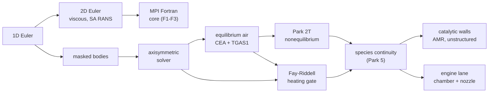

nuFor's trajectory is a ladder: each step is a validated solver
capability with its analytic gates, in an order where every milestone
makes the next one possible. I don't commit to dates; milestones land
when their gates pass.

The focus is 2D: planar and axisymmetric. The 3D Euler and viscous
solvers exist and stay validated in the tree, but the roadmap below
plans no further 3D work; everything ahead is 2D (or axisymmetric,
which carries 3D axisymmetric reality at 2D cost).

## Where we are

- 2D Euler, viscous, and RANS (Spalart-Allmaras): validated, committed.
  The capability set today: 1D Euler; 2D planar Euler/viscous/SA with
  HLLC + MUSCL reconstruction + two-stage Heun, local time stepping,
  and threading; axisymmetric Euler (annular update) with O-grid and
  curvilinear marches; equilibrium air (CEA table + TGAS1 face
  fits); live Park two-temperature (Landau-Teller vibrational
  relaxation); masked bodies (analytic, polygon, signed-distance,
  sphere-cone); staircase and cut-cell walls; unstructured 2D (gmsh
  prototype); MPI-parallel Fortran core at bit parity with the serial
  march for the Euler, viscous, and SA lanes (np = 1, 2, 3); a
  validated stagnation-heating chain (bow shock, Fay-Riddell closed
  form, wall conductor, CEA real-gas transport agreement to a few
  percent); Kn/Bird continuum probes in the flowfield post-mortem;
  the CDV nozzle cold-flow case (reservoir inflow, subsonic
  back-pressure outflow, restart chaining on the axisymmetric
  runner, three pressure-ratio regimes against the 1D solution);
  restart chaining, VTK/CSV output, and the live case console; the
  axisymmetric engine lane with its nine-species H2/O2 closure over CEA
  anchors, an injector, a choked throat and a bell.
- Case console: live runs, field figures (schlieren included), forces,
  the standalone report.
- 3D inviscid Euler: validated, committed.
- 3D viscous Navier-Stokes: validated, committed.
- Masked bodies: done, validated on the cylinder bow shock and
  the sphere-cone trade-study geometry.
- Axisymmetric solver: done, validated on the sphere bow shock
  against the Ambrosio-Wortman standoff. The capsule ran at the
  peak-q point, Mach 22 perfect gas: bow shock, post-shock states, and
  the surface Cp cross-check against the modified-Newtonian numbers.
- Equilibrium air (CEA closure): done. The planar and axisymmetric 2D
  paths run the CEA table under `eos = "eqair"`; the legacy TGAS1 fits
  remain as the face-state extrapolation the wake needs. A four-station
  trajectory sweep (30/34.6/40/42.5 km, alpha 22.5) is validated at
  320x176 and anchored at 1280x640.
- Performance: the static body classification is cached and the closure
  passes are threaded; the hi-res anchor runs 8x faster than the serial
  march (3.96 h for 11,549 steps at 1280x640 on my desktop).
- Fay-Riddell stagnation heating gate: done. The
  wall-resolved cylinder gate ran a full 660k-step continuous chain:
  the conductor holds a quasi-steady band of 7.4 to 14.0 W/cm2
  (settled mean 10.9) against the planar closed form 8.5 on the
  march's own edge state, so the citable number is a mean with a
  spread. The band is stagnation-region momentum residue sloshing
  the wall gradient, not a convergence trend; closing the last gap
  needs the cp and Lewis-number corrections on the march's own wall
  state. Wall heat flux is citable output now.
- Body-fitted O-grid: the sphere-cone capsule runs on a curvilinear
  O-grid with the nose seam treated
  as a symmetry plane. Four geometry/flux defects that poisoned the
  pole region are fixed and pinned by contract tests: the face-normal
  convention, the closed-polygon identity behind the axisymmetric
  source, the seam Riemann pair, and a double face-length weighting
  in the update. The full capsule march is steady at the stagnation
  corner with zero floor hits end to end.
- Unstructured 2D: a gmsh-driven finite-volume path exists
  (`ugrid.rs`, advance_ugrid) with the Sod gate; a prototype, not yet a
  validated capability.

## The ladder, in order

1. **3D viscous**: done.
2. **Masked bodies**: done. The solid-cell mask answers any shape that
   provides inside plus normal: the analytic circle, polygons, and
   analytic signed-distance bodies. Staircase walls are first-order at
   the surface but give real bow shocks, standoff, and pressure
   distributions.
3. **Axisymmetric solver**: done. The annular update carries the face
   radii and the p/r geometric source, with the slip-wall ghost as the
   axis condition.
4. **Equilibrium air**: done (moved up from "out of scope": the
   aeroshell project needed it, and the CEA table plus the TGAS1 face
   fits are the validated form).
5. **Live two-temperature nonequilibrium (Park 2T)**: done. `e_v` is a
   live field (unpinned t_v) with Millikan-White + Park-cutoff
   relaxation and the t_rxn = sqrt(T Tv) mixing rule; the 5-species
   rates (Park 1990) now march under the five-species chemistry. Gates: the
   analytic Landau-Teller decay box, energy conservation to machine
   precision, then the Mach 20 nitrogen cylinder (Casseau et al. 2016)
   as the external anchor. License note: hyStrath is GPL-3.0, same as
   nuFor; the borrow is the validation target and the physics
   constants, not code.
6. **Fay-Riddell stagnation heating gate**: done. A
   wall-resolved viscous cylinder at entry conditions, validated
   against the planar Fay-Riddell closed form (0.57 Pr^-0.6 vs the
   sphere's 0.763). The gate case runs a nose-only domain at global
   dt: local time stepping detonates on this class at long times
   (documented on the viscous page), and the nose-only cut holds the
   march cost to a few hours per run. The wall closures it exercised:
   the reflected-riemann slip wall in the advective stage, the
   one-sided conductor in the viscous stage, and closure-lane
   conduction with real units. The planar closed form is in the tree
   (`fay_riddell_q_2d`), pinned to the Beckwith-Cohen similarity
   constant and the Rankine-Hugoniot tables. A tangentially refined
   mesh converges the conductor to 10.7-11.2 W/cm2 with +-0.5 swing
   (the coarse tangential grid breathed 7.4-14.0), and the original
   27% gap against the closed form closes to a few percent once the
   form is evaluated with CEA real-gas transport at the edge state
   (the gas there is over 60% dissociated atoms; mixture viscosity
   is 1.51x Sutherland's pure-N2 value). This is the gate that makes
   any wall heat flux the solver prints citable.
7. **Continuum-validity probe per station**: done. Bird's
   gradient-length local Knudsen number over the flow cells plus the
   global freestream Kn, one block in every 2D and axisymmetric run
   log (`nufor-core::continuum_probe`, the hard-sphere mean free path
   from viscosity, the Boyd/Lofthouse 0.05 breakdown threshold).
   Puts a number behind "continuum CFD applies here" instead of an
   assertion, and states which cells crossed the line.
7a. **Nozzle cold flow**: done. Liou's CDV nozzle (AIAA 87-0355,
   the NPARC/WIND verification archive) as an axisymmetric Euler
   case: cosine area law, polygon-masked contour, and two new
   boundary conditions, the reservoir inflow (stagnation state
   expanding to the local face pressure, the acoustic feedback a
   fixed-state inflow cannot give) and the subsonic back-pressure
   outflow. Three pressure ratios: the subsonic run holds the 1D
   exit pressure to 1.8% and trails the 1D exit Mach by 9.5%,
   the fully supersonic run chokes (M=1
   at the throat) with mass flux conserved to 0.07% and the
   exit Mach averaging 1.742 against the 1D 1.854, and
   the shock run captures the normal shock (station early, the
   staircase's known weakness, cut cells are the planned answer).
   The axisymmetric runner gained restart chaining alongside.
   Results and figures on the nozzle page. The cooled-wall
   variant (wall heat flux through the validated conductor for
   a Bartz-style comparison) stays open for the viscous engine
   lane; the thrust-coefficient post-processing lands with the
   9a chamber work where a thrust statement becomes meaningful.
8. **Species continuity (5-species Park nonequilibrium)**: done.
   Species mass fractions as transported fields with the Park 1990
   dissociation/exchange set from park.rs, backward rates through the
   Park 1985 equilibrium-constant fits, formation energies routed
   through the closure on the atom-positive convention, positivity
   handling, and the operator-split chemistry substep. The inviscid
   cartesian lane carries it; viscous/curvilinear/cut-cell lanes
   reject the model loudly until wired. Gates: the equilibrium
   constants against the verified table, the exchange-reaction cycle,
   the source term nulled at the closed-form equilibrium composition,
   and the Mach 20 nitrogen cylinder (peak T 2.0 kK under the frozen
   ceiling, atomic fraction rising monotonically through the shock
   layer; results on the research page).
9. **Catalytic wall conditions**: shipped, the numbers still
   withheld. Non-catalytic, partially accommodating and fully
   catalytic wall options on the species viscous lane, with Wilke
   mixture transport and effective-binary diffusion through the shock
   layer. The wall condition takes an accommodation coefficient, the
   fraction of arriving atoms the surface recombines, so a measured
   surface efficiency maps onto a wall heat flux instead of a binary
   bracket. The Mach 20 cylinder series spans the ladder and the ends
   reproduce the shipped pair, but the peak stays withheld: the flow
   at the wall is out of the continuum range. The machinery and the
   series are on the catalytic walls page. The Maxwell velocity-slip
   and Smoluchowski temperature-jump wall conditions from the same body of
   work stay research extras: below 43 km the trajectory is continuum
   (Kn << 1), so slip walls are a branch, not a planned step.
9a. **Combustion chemistry (engine chamber flow)**: the first cut is
   built. Nine species for the H2/O2 lane, advected beside the
   conserved state with operator-split finite-rate chemistry over
   NASA-7 thermodynamics, and the face fluxes carry the composition.
   The chamber injects the burned gas as a composition and enthalpy
   inflow, the axisymmetric chamber settles with the throat choked
   and the exit state close to CEA, and three fast gates hold it: the
   flame temperature at 70 bar, the adiabatic round trip at the flame
   point, and the chamber sound speed. Open: a CH4/O2 mechanism
   beside the H2/O2 one, the engine contour's own wall treatment, and
   the march on more than one core.
9b. **Engine wall conditions**: cooled-wall and film-cooling
   treatments for the engine lane: isothermal and Bartz-style
   conjugate wall options on the nozzle contour, an injected-wall
   species/enthalpy flux for film cooling, and the wall heat flux
   bracket the report wants (cold wall vs cooled wall). Rides on the
   species, catalytic-wall, and combustion steps; the TPS catalytic-wall machinery is the same wall
   machinery pointed at engine conditions.
10. **3D SA/RANS**: cut. nuFor is a 2D code (planar and
    axisymmetric) by focus; the 3D Euler and viscous solvers stay in
    the tree as validated machinery, but no further 3D work is
    planned. The entry trajectory is laminar-dominant and the SA lane
    in 2D already covers the turbulence need.
11. **Adaptive mesh refinement**: block-structured AMR on a density or
    Mach-gradient indicator, in the hyStrath DyM spirit. The hi-res
    anchor spends four uniform-grid hours on a shock layer occupying a
    few percent of the cells; two AMR levels put that under an hour. Placed after 2T/species because the indicator should
    follow the nonequilibrium structure, not just the shock.
12. **Unstructured meshes**: triangles in 2D. The gmsh
    prototype exists and the research note is written; promoting it to
    a validated capability is the largest single lift. Arbitrary geometries
    without the staircase are the payoff: the structural advantage
    OpenFOAM-based solvers inherit for free.
13. **Cut cells**: fractional-cell geometry at curved walls instead of
    the staircase, so surface pressures sample the true surface. Built
    and measured: true stagnation states at moderate Mach, but at
    hypersonic walls the wall Riemann pump and the redistribution pool
    straddle defeat it. The next solver step here is a wall-local
    redistribution (multi-level flux redistribution or h-box) that
    keeps the shock layer out of the averaging.
14. **MPI-parallel Fortran core**: the parallelism step. Fortran owns
    the parallel solver core (domain decomposition, halo
    exchange, the march) behind one coarse FFI; Rust stays the front
    door (case files, CLI, UI, output) and never calls MPI. Design,
    gates, and measured scaling: [[numerics/parallel/mpi|the MPI page]].
    The first phase parallelizes the euler_2d march (the capsule path)
    with the np=1 bit-identity anchor; the second adds viscous and SA
    and is done: the
    laminar viscous and SA lanes run the full two-stage Heun in one
    bridge call and sit at roundoff against the serial drivers
    on all five fields at np=1, 2, and 3 (the worst relative difference
    is 8.2e-14), with the CLI routing
    body-free eqair cases through the Fortran core. The third lands all
    new physics (live 2T, species, combustion) MPI-native from day one,
    which pulls the nonequilibrium and species work inside this one.

## What we deliberately do not borrow

- MHD (Lorentz/Joule source terms, conductivity models, Hall effect):
  the aeroshell trajectory has no magnetic interaction. This is
  hyStrath's differentiator and dead weight here.
- DSMC and hybrid CFD-DSMC: below 43 km the flow is continuum by orders
  of Knudsen. The breakdown probe is the honest boundary.
- 11-species ionized air and electron-energy modes: ionization is
  negligible below ~9.5 km/s at these altitudes; five species covers
  air chemistry to about 12,000 K.
- Two-equation turbulence models (k-epsilon, SST): SA exists; the
  laminar entry regime does not need a model zoo.
- The OpenFOAM framework itself: GPL-compatible but a build and runtime
  dependency from another era (OF v1706); nuFor's value is being
  self-contained, inspectable, and honest about its envelope.

Open research items, worked when they block a milestone rather than on
a schedule: LTS (local time stepping) convergence, and the near-wall
u+ odd-even checkerboard from the grid-convergence study.

## The case workflow

The point of nuFor is the standard CFD loop, the way desktop tools do
it, scoped to what this solver can honestly compute:

1. **Mesh in.** Bring a geometry in (an uploaded STL watertight body,
   or an analytic body), sit it in a control volume you size in the
   case file.
2. **Set the flow.** Mark which domain faces are inflow, outflow, or
   wall; set the inflow velocity, density, pressure, and Mach regime.
   Everything is a case.toml save file: load it, edit any field, save
   it back, run it. Nothing about a case is hardcoded in the server.
3. **Run.** The march runs server-side with checkpoints; the UI shows
   live frames.
4. **See results.** Field views of pressure, speed, density,
   temperature, Mach on any plane: 2D cases whole-domain, 3D cases by
   slice (top-down, side, any xy/xz/yz offset). Surface tables: the
   pressure distribution along the body, integrated forces (the
   aeroshell's axial force coefficient comes straight off this).
   Actual flow visualization (streamlines, particles) is a later
   nicety, not a milestone.
5. **Keep it.** Save the case plus results as files, export any view
   as PNG or PDF.

The case-file system is the current milestone: the case.toml schema
gains a body section, the server gains case list/load/save/delete
routes, and the UI gains the editor plus plane-slice views.

## Aeroshell work, now

The four-station trajectory sweep at alpha 22.5 is validated at
320x176. The honest reads: L/D 0.55-0.72 rising with altitude across
the sweep; peak shock-layer temperatures 5.1-14.0 kK confirm the
thermal environment scale; peak pressures to 1.09 MPa now read off the
rebuilt CEA grid (101 pressures to 10.1 MPa, 30 temperatures to
30000 K, sensible internal energy) instead of clamping at the old
table's 1 MPa cap. The 1280x640 anchor re-measured on the new grid
reads C_D 0.406, L/D 0.371, peak pressure 1.17 MPa at 8217 K, and
lands inside the Newtonian trim band; the previous anchor numbers
(3.96 h for 11549 steps) predate the rebuild. Wall heat flux became
citable output since the Fay-Riddell gate validated the wall
closures, and the conductor reads as a quasi-steady band (mean 10.9,
spread 7.4 to 14.0 W/cm2) against the planar closed form's 8.5. The defensible
report posture: Newtonian numbers stay the design basis, the CFD sweep
is the confirmatory run with a limitations paragraph, and the
nonequilibrium and heating upgrades are the path.

## Rocket engine CFD

This lane is open. It waited on the species and catalytic-wall steps,
and both are shipped now, so the engine work does not have to sit
behind the aeroshell scope any more.

Cold flow came first, with the Liou CDV nozzle in three pressure-ratio
regimes against the 1D solution, behind a gate on the centerline Mach
and the exit-core state. That is the perfect-gas cross-check this lane
needs, the same role nuFor plays for the aeroshell.

Behind the cold flow sits the axisymmetric combustion lane: a
nine-species H2/O2 closure over CEA anchors, an injector feeding a
chamber of burned gas, a converging section, a throat and a bell. It
settles, and the settled state agrees with the equilibrium throat
state closely enough to hang contracts on:

| contract | tolerance | measured |
| --- | --- | --- |
| the throat chokes | mach within 0.08 of 1 | 1.0328 |
| the throat's temperature | within 5 percent of CEA | -0.8 percent |
| the throat's pressure | within 12 percent of CEA | -11.3 percent |
| the mass flow is conserved | within 8 percent | 0.5 percent |
| the chamber runs subsonic | mach below 0.1 | 0.0685 |
| the exit runs supersonic | mach above 1 | 1.7088 |

The chamber's entropy rise stays under 20 J/(kg K), so the converging
section is close to isentropic, and the pressure sits under the
isentrope because the chemistry keeps running in the chamber and
changes the gas the nozzle sees.

That march takes about thirty minutes, so the gate that drives it runs
on my desktop. The settled snapshot ships with the case, and a second
gate recomputes the numbers above from the field in seconds and checks
that the page publishes them, so the table stays tied to the march in
the continuous integration. The closure's own gates run there as well:
the flame temperature at 70 bar against CEA, the adiabatic round trip
at the flame point, and the chamber sound speed.

What the lane does not have yet: no engine cycle, no turbomachinery, no
propellant tank model, and nothing running on more than one core. The
wall treatments an engine report wants (conjugate cooling, film
cooling, the cold wall against the cooled wall bracket) ride on the
catalytic wall machinery and are still to come, and moving the lane
onto the Fortran core is the same work the rest of the new
physics needs.

## See also

- [[architecture|Architecture]]
- [[verification/index|Verification]]
- [[verification/regression-suite|Regression suite]]
- [[numerics/foundations/equilibrium-air|Equilibrium air]]
